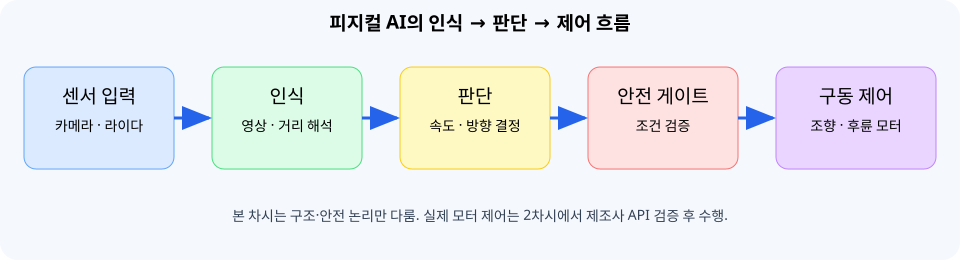

# 📘 01차시 · 자율주행 자동차 로봇 구조와 개발환경

> 훈련 교·강사 보수교육 / 자율주행 자동차 로봇을 활용한 피지컬 AI / 1일차 10:00~11:00 / **원본 과정 안내서 기준**

**교육 장비:** 알티노 AI(실물 사양 및 제조사 SDK는 별도 확인) · **실습 언어:** Python 3 · **실습 원칙:** 읽기 전용 진단과 모의 안전 판정, 실제 모터 구동 금지.

## 목차

- [1. 차시 개요와 60분 운영](#1-차시-개요와-60분-운영)
- [2. 피지컬 AI와 일반 AI의 차이](#2-피지컬-ai와-일반-ai의-차이)
- [3. 로봇을 다섯 계층으로 나누어 보기](#3-로봇을-다섯-계층으로-나누어-보기)
- [4. 데이터 흐름과 인터페이스 경계](#4-데이터-흐름과-인터페이스-경계)
- [5. 운영체제·드라이버·라이브러리의 역할](#5-운영체제드라이버라이브러리의-역할)
- [6. Jetson과 실제 알티노 AI 구성의 구분](#6-jetson과-실제-알티노-ai-구성의-구분)
- [7. Ubuntu 환경 확인: 읽기 전용 명령](#7-ubuntu-환경-확인-읽기-전용-명령)
- [8. 가상환경: 시스템 환경과 실습 환경 분리](#8-가상환경-시스템-환경과-실습-환경-분리)
- [9. 실습 A: 개인정보를 제외한 환경 진단](#9-실습-a-개인정보를-제외한-환경-진단)
- [10. 실습 B: 안전 게이트의 논리적 의미](#10-실습-b-안전-게이트의-논리적-의미)
- [11. 자동 테스트: 입력과 예상 결과 비교](#11-자동-테스트-입력과-예상-결과-비교)
- [12. 시스템 장애 분석: 계층별 원인 추적](#12-시스템-장애-분석-계층별-원인-추적)
- [13. 종합 실습: 시스템 준비 상태 판정표](#13-종합-실습-시스템-준비-상태-판정표)
- [14. 정리·형성 평가·2차시 연결](#14-정리형성-평가2차시-연결)

## 1. 차시 개요와 60분 운영

**과정:** 자율주행 자동차 로봇을 활용한 피지컬 AI / **01차시:** 로봇 구조와 개발환경 / **방법:** 이론 중심 + 안전한 환경 확인 실습 / **시간:** 60분.

이번 차시의 산출물은 로봇을 움직이는 코드가 아니다. 로봇의 센서·연산·판단·구동 경계를 설명하고, 사용 가능한 개발환경을 증거 기반으로 기록하는 것이다. 제어 함수를 확인하지 않은 상태에서 모터를 구동하면 오동작·충돌 위험이 있으므로 첫 시간에는 **읽기 전용 환경 진단**과 **구동 허용 조건 판정**까지만 수행한다.

| 시간 | 학습 활동 | 완료 증거 |
|---|---|---|
| 0~10분 | 로봇의 물리 구성, 센서와 액추에이터 구별 | 구성요소 5종 분류 |
| 10~20분 | 인식→판단→제어의 데이터 흐름 | 블록도 설명 |
| 20~35분 | OS, Python, 패키지 환경 확인 | 명령 실행 결과 |
| 35~45분 | 안전 점검과 읽기 전용 진단 코드 | JSON 출력 |
| 45~55분 | 안전 게이트 코드 실행·테스트 | 4개 테스트 통과 |
| 55~60분 | 점검표 작성 및 2차시 준비 | 환경 확인표 |

**필수 실습:** 환경 점검, 안전 게이트, 테스트. **선택 심화:** 실제 알티노 AI의 센서·제어 SDK 문서와 장비 설정을 대조하여 장치 인터페이스 목록 작성. 제조사 SDK가 없으면 심화를 수행하지 않아도 차시의 기본 목표는 달성된다.

## 2. 피지컬 AI와 일반 AI의 차이

**AI(Artificial Intelligence, 인공지능)**는 입력 데이터로부터 분류·예측·판단을 수행하는 기술을 넓게 가리킨다. **Physical AI(피지컬 에이아이, 물리 세계와 상호작용하는 인공지능)**는 인식 결과가 실제 장치의 움직임이나 상태 변화로 연결된다는 점이 중요하다. 영상에서 신호등을 찾아 화면에 상자를 그리는 기능은 인식에 해당하고, 신호등 상태에 따라 로봇의 속도를 결정하는 기능은 판단에 해당하며, 실제 모터 명령이 실행되는 것은 제어에 해당한다.

| 단계 | 입력 | 출력 | 예시 | 오류의 영향 |
|---|---|---|---|---|
| 감지 | 카메라·거리 센서 신호 | 픽셀·거리 측정 | 전방 영상 프레임 | 센서 잡음·가림 |
| 인식 | 센서 데이터 | 객체·차선 후보 | 정지 표지 검출 | 오검출·미검출 |
| 판단 | 인식 결과와 안전 규칙 | 목표 속도·방향 | 정지 여부 결정 | 잘못된 의사결정 |
| 제어 | 목표 속도·방향 | 구동 명령 | 조향·후륜 구동 | 충돌·과열 가능 |
| 피드백 | 실제 위치·속도·거리 | 오차·상태 | 차선 중심 편차 | 누적 오차 |

**핵심:** 카메라가 객체를 찾았다는 사실만으로 안전한 자율주행이 완성되지 않는다. 객체 검출 신뢰도, 센서 갱신 주기, 판단 지연, 제동 거리, 통신 단절 시 안전 정지 등이 함께 설계되어야 한다.

**실제 상황 예시:** 카메라가 1초에 20장의 영상을 생성하고 인식 프로그램이 1장당 100ms를 사용하면, 단일 처리 경로에서 모든 프레임을 실시간으로 처리할 수 없다. 처리 지연을 줄이거나 일부 프레임을 건너뛰는 정책이 필요하다. 단, 이 숫자는 계산을 위한 가상 예시이며 알티노 AI의 측정 성능이 아니다.

## 3. 로봇을 다섯 계층으로 나누어 보기

로봇을 외관으로만 이해하면 카메라·컴퓨터·모터가 하나의 장치처럼 보인다. 실제 설계에서는 역할을 나누어야 문제 원인을 찾을 수 있다.

1. **전원 계층:** 배터리 또는 어댑터, 전압 변환, 전원 스위치, 보호회로. 전압이 맞지 않으면 다른 계층이 정상이어도 동작하지 않는다.
2. **감지 계층:** 카메라, 라이다, 기타 거리·상태 센서. 물리량을 디지털 데이터로 변환한다.
3. **연산 계층:** CPU, GPU, 메모리, 저장장치. Python 프로그램과 AI 모델을 실행한다.
4. **제어 계층:** 제어 보드, 모터 드라이버, 조향 구동부. 명령을 실제 전기적 구동으로 변환한다.
5. **운영 계층:** 운영체제, 라이브러리, 응용 프로그램, 로그 및 사용자 인터페이스.

| 구성요소 | 무엇을 확인하는가 | 확인하지 않은 상태에서 단정하면 안 되는 내용 |
|---|---|---|
| 카메라 | 연결 포트·영상 형식·해상도 | 모든 장비가 `/dev/video0`을 사용한다는 가정 |
| 라이다 | 모델명·통신 방식·드라이버 | 모든 라이다가 USB 또는 ROS를 쓴다는 가정 |
| 연산 보드 | 실제 모델명·메모리·OS | Jetson 제품군 전체를 동일 사양으로 취급 |
| 모터 | 전압·구동 방향·정지 동작 | 특정 Python 함수가 곧바로 구동된다는 가정 |
| 통신 | USB·UART·네트워크 등 실제 연결 | 장비가 항상 고정 IP를 사용한다는 가정 |

**활동:** 로봇을 전원 OFF 상태로 관찰한다. 외부에 보이는 카메라·거리 센서·바퀴·전원 입력을 표시하고, 확인할 수 없는 내부 부품은 '미확인'이라고 적는다. 장비를 분해하거나 임의로 배선을 변경하지 않는다.

## 4. 데이터 흐름과 인터페이스 경계

센서 신호가 곧바로 모터에 들어가는 것은 아니다. 물리 세계의 데이터는 디지털 입력으로 바뀌고, 연산 프로그램은 결과를 해석하여 목표 동작을 계산한다. 실제 구동을 위해서는 제조사가 정의한 명령 형식과 제어 장치의 수신 방식이 필요하다.



**데이터와 제어의 방향 구분:** 카메라와 라이다는 주로 로봇에서 프로그램으로 데이터를 보낸다. 모터 구동 명령은 프로그램에서 제어기로 향한다. 피드백 센서가 존재하면 실제 동작 상태가 다시 프로그램으로 전달된다. 데이터 경로와 제어 경로를 같은 화살표로 표현하면 문제를 추적하기 어렵다.

**인터페이스(interface, 인터페이스, 장치 사이의 접점)**는 단순한 케이블이 아니다. 전기적 연결, 데이터 형식, 호출 규약, 갱신 주기, 오류 처리까지 포함한다. 예를 들어 USB 케이블이 연결되어도 어떤 드라이버가 장치를 인식하는지, 프로그램이 어느 파일 또는 API를 통해 데이터를 읽는지 확인해야 한다.

**2차시와의 연결:** 조향과 후륜 모터 제어를 구현하기 전에 제어 인터페이스, 안전 정지 명령, 구동 한계, 방향 부호와 초기값을 문서에서 확인한다. 1차시에는 실제 모터 명령을 보내지 않는다.

## 5. 운영체제·드라이버·라이브러리의 역할

**OS(Operating System, 운영체제)**는 프로세스, 메모리, 파일, 장치 접근을 관리한다. **드라이버(driver, 드라이버, 장치 제어 소프트웨어)**는 운영체제와 하드웨어 사이에서 장치를 다룬다. **라이브러리(library, 라이브러리, 재사용 함수 모음)**는 Python 코드가 영상처리나 수치 계산을 쉽게 수행하도록 돕는다. **SDK(Software Development Kit, 소프트웨어 개발 도구 모음)**는 제조사가 제공하는 API·예제·문서 등을 포함할 수 있다.

| 층 | 대표 사례 | 하는 일 | 잘못 이해하기 쉬운 점 |
|---|---|---|---|
| 응용 | Python 주행 판단 프로그램 | 인식 결과와 정책 결합 | Python 설치만으로 로봇 제어가 가능하다고 생각 |
| 라이브러리 | NumPy, OpenCV, PyTorch | 배열·영상·신경망 연산 | 카메라 드라이버와 동일시 |
| 제조사 SDK | 장비별 제공 API | 제어 명령을 올바른 형식으로 전송 | 문서 없이 임의 함수명 사용 |
| OS·드라이버 | Linux 장치 인터페이스 | 하드웨어 접근 관리 | 모든 장치가 같은 경로에 있다고 가정 |
| 하드웨어 | 카메라·라이다·제어기 | 물리 입력·출력 | 제어기 존재를 CPU와 혼동 |

**예시:** OpenCV의 `VideoCapture`는 여러 영상 입력 경로를 열 수 있지만, 어떤 카메라가 어떤 인덱스로 노출되는지는 장비·OS·드라이버에 따라 다르다. 따라서 3차시의 카메라 코드는 실제 장비 연결 정보가 확인된 뒤 작성해야 한다.

**관찰 문제:** '모터가 움직이지 않는다'는 현상만으로 Python 코드 오류라고 단정할 수 없다. 전원 → 장치 인식 → 제조사 SDK → 제어 명령 → 안전 게이트 → 구동부 순서로 원인을 분리한다.

## 6. Jetson과 실제 알티노 AI 구성의 구분

원본 과정 안내서에는 **NVIDIA Jetson Orin Nano 기반 YOLO 비전 AI 자율주행 시스템**이 기대효과로 제시되어 있다. 그러나 이는 현재 실습실의 개별 알티노 AI 장비에 설치된 Jetson 모듈, 운영체제, JetPack 버전, 카메라·라이다 모델을 실물 확인했다는 뜻은 아니다. **장비 실물 사양은 별도 확인 대상**이다.

**Jetson(젯슨, NVIDIA의 임베디드 AI 연산 플랫폼)**은 CPU와 GPU를 활용하는 연산 보드 계열이다. **JetPack(젯팩, Jetson 소프트웨어 개발 패키지)**은 Jetson Linux 및 개발 구성요소를 제공하는 배포 환경이다. **CUDA(쿠다, NVIDIA GPU 병렬 연산 플랫폼)**와 **TensorRT(텐서알티, 신경망 추론 최적화 도구)** 같은 구성요소는 실제 설치 환경과 버전에 따라 사용 가능성이 달라진다.

공식 Jetson Orin Nano 개발자 키트 문서에는 설치 경로가 JetPack 세대에 따라 달라진다고 설명되어 있다. 따라서 **제조사 제공 이미지로 동작하는 교육용 로봇에 일반 개발자 키트 설치 절차를 그대로 적용하지 않는다.** 특히 저장장치를 초기화하거나 펌웨어를 갱신하는 작업은 본 차시에서 금지한다.

| 확인 항목 | 안전한 확인 방법 | 결과 기록 방식 |
|---|---|---|
| 연산 보드 | 제조사 장비 명세·실물 라벨 | 모델명 또는 미확인 |
| OS | 제공된 터미널에서 읽기 전용 명령 | OS 계열·버전 |
| Python | `python3 --version` | 주·부·패치 버전 |
| JetPack | 제조사 설치 문서와 시스템 패키지 대조 | 설치 여부·버전·미확인 |
| GPU 사용 | 제조사 권장 진단 절차 | 지원 여부·미확인 |
| 카메라·라이다 | 제조사 장치 목록·실물 확인 | 모델·연결·미확인 |

**안전한 원칙:** 기존 장비의 정상 작동을 해칠 수 있는 재설치, 펌웨어 갱신, 패키지 일괄 업그레이드, 모터 구동 테스트는 1차시 기본 실습에서 제외한다.

## 7. Ubuntu 환경 확인: 읽기 전용 명령

Ubuntu(우분투, 리눅스 운영체제 배포판) 터미널에서 다음 명령을 한 줄씩 실행한다. 장비에서 터미널 사용 권한이 없다면 교육용 PC에서 수행하고, 결과를 'PC 확인'으로 표시한다.

```bash
# 현재 Python 3 버전을 확인한다. 설치나 설정을 변경하지 않는다.
python3 --version

# 운영체제 배포 정보 파일을 읽는다.
cat /etc/os-release

# CPU 아키텍처를 확인한다. 예: x86_64, aarch64
uname -m

# Python 패키지 관리 도구가 존재하는지 확인한다.
python3 -m pip --version

# 현재 위치에서 파일을 읽고 쓸 수 있는지 판단하기 전에 경로만 확인한다.
pwd
```

**명령 해석:** `python3 --version`은 인터프리터의 버전을 보여준다. `cat /etc/os-release`는 OS의 이름·버전 등 배포 정보를 출력한다. `uname -m`은 커널이 보고하는 하드웨어 아키텍처를 나타낸다. `python3 -m pip --version`은 해당 Python에 연결된 패키지 관리자 정보를 보여주며, 설치가 안 되어 있으면 오류가 나올 수 있다. `pwd`는 현재 작업 디렉터리를 출력하므로 **공개 보고서에 실제 개인 경로를 복사하지 않는다.**

**예상 결과(예시, 실측 아님):** Python 버전은 `Python 3.x.y` 형태로 표시될 수 있고, 아키텍처는 `x86_64` 또는 `aarch64` 등으로 나타날 수 있다. 특정 문자열을 정답으로 강제하지 않는다.

**점검 질문:** `python3`는 실행되는데 `pip`가 없다고 표시된다면 무엇이 확인된 것인가? 답: Python 실행기는 존재하지만 해당 환경의 pip 사용 가능성은 별도로 확인해야 한다.

## 8. 가상환경: 시스템 환경과 실습 환경 분리

**venv(브이엔브이, Python 가상환경 도구)**는 프로젝트별 패키지 설치 범위를 분리한다. 시스템 Python에 임의로 패키지를 설치하면 제조사 애플리케이션과 버전 충돌이 발생할 수 있으므로, 실습 PC에서는 가상환경을 권장한다. 다만 **알티노 AI 제조사가 특정 시스템 Python 또는 가상환경을 지정한 경우에는 제조사 절차를 우선한다.**

```bash
# Python의 내장 venv 기능으로 실습 전용 가상환경을 생성한다.
python3 -m venv .venv

# 현재 셸에서 가상환경을 활성화한다.
source .venv/bin/activate

# 활성화된 Python 인터프리터의 버전을 확인한다.
python --version

# 가상환경에서 설치된 패키지 목록을 확인한다.
python -m pip list

# 실습을 마치면 가상환경 활성화를 해제한다.
deactivate
```

**작동 원리:** `.venv`는 실습 폴더 안에 생성되는 격리된 실행 환경이다. `source` 명령은 현재 셸에 활성화 스크립트를 적용한다. `python -m pip list`는 현재 활성 Python 환경에서 확인되는 패키지를 나열한다. `deactivate`는 셸을 원래 환경으로 돌린다. **가상환경은 하드웨어 드라이버나 시스템 전체 라이브러리를 완전히 격리하는 가상머신이 아니다.**

**오류 대처:** `ensurepip is not available` 또는 `venv` 모듈 관련 오류가 나타나면 설치 권한·패키지 상태를 확인하고 담당자에게 요청한다. 제조사 로봇에서 `sudo apt install ...`을 임의 실행하지 않는다. PC에서 관리 권한이 있고 승인된 경우에만 OS에 맞는 `python3-venv` 패키지 설치를 검토한다.

**결과 확인:** 가상환경 활성화 전후에 Python의 설치 위치나 `sys.prefix` 값이 달라질 수 있다. 다음 실습의 진단 코드에서 `virtual_environment` 항목으로 확인한다.

## 9. 실습 A: 개인정보를 제외한 환경 진단

다음은 **장비를 제어하지 않는 완전한 Python 예제**다. 네트워크 주소, 사용자 이름, 호스트명, 장치 고유번호를 수집하지 않도록 설계하였다. 파일명은 `codes/ch01/system_probe.py`이다.

```python
"""1차시: 로봇과 PC 공통으로 실행 가능한 읽기 전용 환경 점검."""
import json
import os
import platform
import sys
from pathlib import Path


def collect_environment():
    """계정명·호스트명·IP·일련번호를 수집하지 않는다."""
    return {
        "python": platform.python_version(),
        "implementation": platform.python_implementation(),
        "os_family": platform.system(),
        "architecture": platform.machine(),
        "virtual_environment": sys.prefix != sys.base_prefix,
        "working_directory_accessible": Path.cwd().is_dir(),
        "display_configured": bool(os.environ.get("DISPLAY") or os.environ.get("WAYLAND_DISPLAY")),
    }


def main():
    print(json.dumps(collect_environment(), ensure_ascii=False, indent=2))


if __name__ == "__main__":
    main()
```

**실행 방법**

```bash
# 프로젝트 루트에서 실행한다. 외부 패키지 설치는 필요하지 않다.
python3 codes/ch01/system_probe.py
```

**예상 출력 예시(실측 아님)**

```json
{
  "python": "3.x.y",
  "implementation": "CPython",
  "os_family": "Linux",
  "architecture": "aarch64",
  "virtual_environment": false,
  "working_directory_accessible": true,
  "display_configured": false
}
```

**코드 풀이 — 이 코드가 무엇을 하는가:** `platform.python_version()`은 Python 버전 문자열을 반환한다. `platform.machine()`은 현재 실행 시스템의 아키텍처 정보를 보여준다. `sys.prefix != sys.base_prefix`는 일반적인 venv 활성화 여부를 판단하는 간단한 방법이다. `Path.cwd().is_dir()`은 현재 디렉터리의 존재 여부만 검사하며 파일 쓰기 권한을 보장하지 않는다. `DISPLAY`와 `WAYLAND_DISPLAY` 환경변수는 그래픽 세션의 구성 여부에 관한 힌트일 뿐, 실제 모니터·카메라가 정상 작동한다는 증거는 아니다.

**실습 확인:** 출력에 `username`, `hostname`, `ip_address` 항목이 없어야 한다. OS가 Windows라면 `os_family`에 `Windows`가 표시될 수 있으며, 이것은 코드 오류가 아니다.

## 10. 실습 B: 안전 게이트의 논리적 의미

실제 로봇을 구동하기 전에는 **안전 조건이 모두 충족되었는지** 판단해야 한다. 이 실습은 순수한 논리 판정이며 **실제 비상정지 회로를 대신하지 않는다.** 파일명은 `codes/ch01/safety_gate.py`이다.

```python
"""1차시: 물리 구동 없이 안전 조건을 판단하는 순수 Python 예제."""
from dataclasses import dataclass


@dataclass(frozen=True)
class SafetyInputs:
    emergency_stop_released: bool
    wheels_clear: bool
    operator_present: bool
    power_ok: bool
    software_ready: bool


def may_enable_motion(state: SafetyInputs) -> bool:
    """모든 안전 조건이 충족될 때만 True를 반환한다."""
    return all((state.emergency_stop_released, state.wheels_clear,
                state.operator_present, state.power_ok, state.software_ready))


def main():
    safe = SafetyInputs(True, True, True, True, True)
    blocked = SafetyInputs(True, False, True, True, True)
    print("모든 조건 충족:", may_enable_motion(safe))
    print("차륜 안전 미확인:", may_enable_motion(blocked))


if __name__ == "__main__":
    main()
```

**실행 방법**

```bash
# 어떤 모터에도 명령을 보내지 않는다.
python3 codes/ch01/safety_gate.py
```

**예상 출력**

```text
모든 조건 충족: True
차륜 안전 미확인: False
```

**코드 풀이 — 이 코드가 무엇을 하는가:** `@dataclass(frozen=True)`는 안전 상태를 변경 불가능한 데이터 묶음으로 표현한다. `all(...)`은 다섯 조건이 전부 참일 때만 참을 반환한다. 하나라도 거짓이면 구동 허용 조건이 충족되지 않은 것으로 판단한다. 이것은 **fail-safe(페일 세이프, 이상 시 안전 상태로 전환하는 설계)** 개념을 이해하기 위한 단순 모델이다.

**중요한 한계:** 실제 주행에서는 통신 끊김, 센서 갱신 지연, 하드웨어 비상정지, 명령 타임아웃, 모터 드라이버 오류 등을 별도 처리해야 한다. 단순한 Boolean 함수만으로 실제 로봇 안전을 보장할 수 없다.

**응용 문제:** `operator_present`만 거짓으로 바꿔 실행해 본다. 출력이 `False`로 바뀌는 이유를 다섯 조건의 논리곱 관점에서 설명한다.

## 11. 자동 테스트: 입력과 예상 결과 비교

실습 코드가 정상적으로 동작하는지 눈으로만 확인하면 놓치는 경우가 생긴다. **단위 테스트(unit test, 작은 기능을 개별 검증하는 시험)**를 사용하면 입력 조건에 따른 결과를 반복해서 확인할 수 있다. 파일명은 `codes/ch01/test_ch01.py`이다.

```python
"""장비 없는 환경에서 수행하는 자동 회귀 테스트."""
import unittest
from safety_gate import SafetyInputs, may_enable_motion
from system_probe import collect_environment


class Chapter01Tests(unittest.TestCase):
    def test_environment_keys(self):
        self.assertIn("python", collect_environment())
        self.assertNotIn("hostname", collect_environment())

    def test_all_safe(self):
        self.assertTrue(may_enable_motion(SafetyInputs(True, True, True, True, True)))

    def test_each_blocker(self):
        for idx in range(5):
            flags = [True] * 5
            flags[idx] = False
            with self.subTest(blocker=idx):
                self.assertFalse(may_enable_motion(SafetyInputs(*flags)))

    def test_no_hardware_side_effect(self):
        self.assertEqual(may_enable_motion(SafetyInputs(False, False, False, False, False)), False)


if __name__ == "__main__":
    unittest.main()
```

**실행 방법**

```bash
# 모든 테스트를 자동 발견하여 실행한다.
python3 -m unittest discover -s codes/ch01 -p 'test_*.py' -v
```

**예상 결과:** `test_environment_keys`, `test_all_safe`, `test_each_blocker`, `test_no_hardware_side_effect` 네 테스트가 모두 `ok`로 표시된다. `test_each_blocker` 내부에서는 다섯 가지 조건을 하나씩 거짓으로 바꾸어 각각 차단되는지 확인한다.

**코드 풀이:** `self.assertTrue`는 참이어야 하는 결과를 검증하고 `self.assertFalse`는 거짓이어야 하는 결과를 검증한다. `subTest`는 반복 검사의 어느 입력에서 실패했는지 찾기 쉽게 해준다. 테스트가 통과했다는 것은 **해당 Python 논리의 검증**이지, 실제 로봇의 제동·조향 안전성이 검증되었다는 뜻이 아니다.

**실습 기록:** 실행 날짜, Python 버전, 테스트 수, 성공·실패 여부를 기록한다. 실제 사용자 이름·개인 경로·IP는 기록하지 않는다.

## 12. 시스템 장애 분석: 계층별 원인 추적

실습에서는 문제가 발생하면 가장 눈에 띄는 Python 코드부터 수정하기 쉽다. 그러나 실제 장비에서는 전원, 센서, 드라이버, 패키지, 통신, 안전 조건 등 여러 계층이 원인이 될 수 있다. **재현 가능한 증상 → 관찰 증거 → 원인 후보 → 읽기 전용 확인 → 안전한 조치** 순서로 접근한다.

| 증상 | 우선 확인할 계층 | 안전한 확인 | 금지할 성급한 조치 |
|---|---|---|---|
| Python 실행 불가 | OS·개발환경 | `python3 --version` | OS 재설치 |
| `ModuleNotFoundError` | 가상환경·패키지 | 현재 Python·pip 목록 | 전역 패키지 일괄 업데이트 |
| 카메라 영상 없음 | 전원·드라이버·접근권한 | 제조사 상태 확인 | 장치 인덱스 임의 고정 |
| 라이다 데이터 없음 | 센서·통신·전원 | 연결 상태·제조사 진단 | 전원 사양 무시한 재배선 |
| 모터 구동 안 됨 | 안전 게이트·제어기 | 승인된 상태 표시 | 임의 PWM 인가 |
| 인식 결과 부정확 | 입력·모델·조명 | 입력 영상과 모델 버전 기록 | 안전 검증 없이 주행 속도 증가 |

**상황형 문제 A:** 카메라를 연결했지만 영상이 검은 화면으로 표시된다. 조명 문제, 장치 접근 권한, 카메라 포맷, 케이블 문제 등 서로 다른 원인을 제시하고 각 원인을 어떤 증거로 구별할지 작성한다.

**상황형 문제 B:** Python 버전은 맞지만 NumPy가 import되지 않는다. 가상환경 활성화 여부와 패키지 설치 위치를 먼저 확인한다. 장비에서 운영 중인 제조사 프로그램의 패키지를 무조건 업데이트하지 않는다.

**상황형 문제 C:** 제어 프로그램은 정상 종료되었지만 바퀴가 움직이지 않았다. 이는 실패일 수도 있고 안전 게이트가 정상적으로 구동을 차단한 결과일 수도 있다. 실행 로그만으로 원인을 단정하지 말고 승인된 진단 정보를 대조한다.

## 13. 종합 실습: 시스템 준비 상태 판정표

이제 개별 명령을 하나의 점검 절차로 묶는다. 실습자는 로봇의 실제 사양을 알고 있다고 가정하지 않고, **확인한 사실과 미확인 항목을 구분**한다.

| 번호 | 확인 항목 | 확인 방법 | 기록 예시 |
|---|---|---|---|
| 1 | 장비명·제조사 | 장비 라벨·공식 문서 | 알티노 AI / 모델 세부형 미확인 |
| 2 | 전원과 안전장치 | 담당자 안내·외관 관찰 | 구동 금지 상태 확인 |
| 3 | CPU·OS | 읽기 전용 진단 | Linux / 세부 버전 기록 |
| 4 | Python | 버전 명령 | 3.x.y |
| 5 | 가상환경 | 진단 코드 | 활성·비활성 |
| 6 | 카메라·라이다 | 장비 명세와 대조 | 모델·인터페이스 미확인 가능 |
| 7 | 제어 SDK | 제조사 제공 문서 | 미제공이면 미확인 |
| 8 | 테스트 | unittest 결과 | 4개 통과 또는 실패 원인 |

**제출 산출물:** (1) 계층별 구조도 1개, (2) 개인정보를 제거한 환경 진단 JSON 1개, (3) 테스트 결과 1개, (4) 장비 미확인 목록 1개. 실제 제어 명령을 실행하거나 저장장치를 변경하지 않는다.

**완료 판정:** 운영체제·Python·가상환경의 관계를 설명할 수 있고, 센서와 액추에이터의 방향을 구분하며, 안전 게이트가 단순 논리 검증임을 이해하면 필수 실습 완료로 판정한다. 제조사 SDK를 받지 못한 경우도 실습 자체의 실패가 아니다.

**선택 심화:** 장비 제조사의 공식 자료에서 제어 인터페이스 이름·정지 명령·통신 단절 시 동작을 조사하고, 문서명·버전·확인일을 기록한다. 확인되지 않은 항목은 빈칸 대신 '미확인'으로 남긴다.

## 14. 정리·형성 평가·2차시 연결

**핵심 정리:** 로봇은 전원·센서·연산·제어·운영 계층으로 구성되며, 인식→판단→제어는 서로 다른 단계다. Python과 라이브러리를 설치했다고 해서 모터 구동 API가 자동으로 생기는 것은 아니다. 실제 제어 인터페이스는 제조사 SDK와 장비 구성에 따라 결정된다. 첫 차시의 가장 중요한 습관은 **확인한 사실만 기록하고, 모르는 것은 미확인으로 남기는 것**이다.

**형성 평가(정답 포함)**

1. 카메라가 사람을 검출한 단계는 인식·판단·제어 중 무엇인가? → **인식**.
2. 조향 모터를 회전시키는 명령을 실제 전기적 출력으로 바꾸는 것은 어떤 계층인가? → **제어 계층**.
3. OpenCV를 설치하면 알티노 AI의 모터가 자동 제어되는가? → **아니오. 제조사 인터페이스 확인이 필요하다.**
4. `python3 --version`은 패키지 설치를 변경하는가? → **아니오. 버전만 읽는다.**
5. `virtual_environment`가 `False`이면 Python이 설치되지 않은 것인가? → **아니오. 일반 실행환경일 수 있다.**
6. 안전 게이트의 다섯 조건 중 하나라도 거짓이면 출력은? → **False**.
7. 단위 테스트 통과로 실제 주행 안전이 입증되는가? → **아니오. 논리 함수 범위만 검증한다.**
8. 알티노 AI의 카메라가 항상 `/dev/video0`에 연결된다고 가정해도 되는가? → **아니오. 장치별 확인이 필요하다.**

**2차시 준비:** 조향 제어와 후륜 모터 제어를 진행하기 전에 실제 장비의 제어 SDK·명령 규격·구동 한계·안전 정지 방법을 확보한다. SDK가 없는 경우 2차시에서는 구동 정책의 시뮬레이션과 모의 인터페이스를 먼저 검증하고 실제 구동을 미검증으로 남긴다.

**공식 참고자료(2026-11-04 확인)**

- 과정 안내서(1).pdf, 1~2쪽: 차시별 시간표 및 기대효과(사용자 제공 원본).
- Python 공식 문서, venv: https://docs.python.org/3/library/venv.html
- NVIDIA Jetson 공식 시작 안내: https://developer.nvidia.com/embedded/learn/getting-started-jetson
- NVIDIA Jetson Orin Nano 개발자 키트 사용자 안내(개발자 키트용이며 알티노 AI 전용 설치 지침 아님): https://docs.nvidia.com/jetson/orin-nano-devkit/user-guide/latest/quick_start.html

**실물 검증 상태:** 알티노 AI 제조사 SDK, 개별 장비의 Jetson 모델·OS·센서·모터 명령은 미확인. 이 문서의 Python 예제는 일반 PC·Linux에서 실행 가능한 읽기 전용 예제이며 실제 로봇 제어 기능은 포함하지 않는다.
