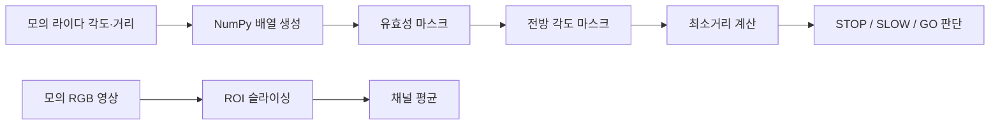

# 📘 05차시 — NumPy 배열 연산과 자율주행 센서 데이터 처리
> 자율주행 자동차 로봇을 활용한 피지컬 AI · 1시간 · 실습형 배포 교재
> **검증 범위:** NumPy 모의 데이터 처리 / 실제 알티노 AI 연동 미검증

## 목차
1. 차시 개요와 60분 운영
2. 자율주행 데이터 흐름과 NumPy의 위치
3. 설치 및 실행 환경 확인
4. Python 리스트와 ndarray 비교
5. 배열 생성·shape·ndim·dtype
6. 슬라이싱과 복사·뷰의 차이
7. 벡터 연산과 브로드캐스팅
8. 불리언 마스크와 유효성 검사
9. NaN과 통계값 계산의 함정
10. 각도 배열과 전방 섹터 선택
11. 전방 최소거리와 안전 판단 정책
12. 이동평균으로 측정값 안정화
13. 2차원·3차원 배열과 영상
14. ROI 선택과 채널 평균
15. 종합 실습: 센서→특징→판단
16. 자동 테스트와 실패 조건
17. 단위·자료형·축 오류 사례
18. 실습 체크리스트와 평가 기준
19. 핵심 정리·06차시 연결·공식 참고

## 1. 차시 개요와 60분 운영

**주제:** NumPy(넘파이, 다차원 배열 수치 계산 라이브러리)를 이용한 자율주행 센서 데이터 처리. **전제:** 실제 알티노 AI와 통신하지 않고, 모의 라이다 거리값과 작은 RGB(알지비, 빨강·초록·파랑) 영상을 처리한다. 앞 차시의 Python 변수·반복문·함수를 재사용한다. 다음 06차시 OpenCV(오픈씨브이, 컴퓨터 영상처리 라이브러리)로 연결한다.

| 시간 | 필수 활동 | 완료 증거 |
|---|---|---|
| 0~10분 | 배열·차원·자료형 이해 | `shape`, `dtype` 출력 |
| 10~20분 | 슬라이싱과 조건 마스크 | 전방 유효 거리만 선택 |
| 20~35분 | 결측값 제거와 최소거리 계산 | 전방 0.4m 검출 |
| 35~50분 | 안전 판단 함수와 영상 ROI | `STOP_OBSTACLE`, RGB 평균 |
| 50~60분 | 테스트 및 오류 점검 | 테스트 15개 통과 |

**선택 심화:** 이동평균 창 크기 비교, 시간축 라이다 데이터, RGB 채널 정규화. 심화는 기본 60분에 포함하지 않는다.

**안전:** 이 차시의 판단은 모의 데이터 기반 예시이며, 실제 로봇 주행 명령으로 바로 연결해서는 안 된다. 실제 적용에는 센서 시간초과·정지 우선순위·구동 인터록 및 현장 검증이 필요하다.


## 2. 자율주행 데이터 흐름과 NumPy의 위치

센서의 원시 값은 곧바로 모터 명령이 되지 않는다. 먼저 센서 데이터가 어떤 형식인지 확인하고, 비정상 측정값을 걸러내며, 필요한 방향의 값만 추출한 뒤 안전 규칙을 적용한다. NumPy는 **센서 값들을 배열 단위로 변환·필터링·집계**하는 중간 처리층이다.



**설계상의 구분:** `front_sector_min()`은 거리 특징을 추출한다. `obstacle_decision()`은 안전 정책을 판단한다. 둘을 분리하면 차후 센서 종류를 바꾸거나 임계값을 조정해도 전체 코드를 갈아엎을 필요가 없다. 실제 제어 인터페이스는 별도의 검증된 드라이버에서 담당한다.


## 3. 설치 및 실행 환경 확인

Python 3 및 NumPy가 설치된 환경에서 다음 명령을 실행한다. 패키지 설치는 시스템 전역이 아니라 가상환경을 권장한다.

```bash
python3 -m venv .venv          # 프로젝트 전용 가상환경 생성
source .venv/bin/activate     # Ubuntu에서 가상환경 활성화
python -m pip install numpy   # NumPy 설치
python -c "import numpy as np; print(np.__version__)"  # 설치 확인
```

Windows에서는 가상환경 활성화 방식이 다르다. 설치 명령은 실제 실습 PC의 Python 실행 파일 경로에 맞춘다. 이미 NumPy가 설치되어 있으면 재설치하지 않아도 된다. `python -m pip`는 현재 실행 중인 Python에 연결된 pip를 사용한다. 재현성 확보를 위해 버전과 실행 환경을 기록한다.

**확인:** NumPy 버전이 출력되면 준비 완료. `ModuleNotFoundError`가 발생하면 현재 Python과 설치에 사용한 Python이 같은지 확인한다.


## 4. Python 리스트와 ndarray 비교

Python 리스트는 여러 자료형을 담을 수 있는 범용 컨테이너다. `ndarray`(엔디어레이, N차원 배열)는 일반적으로 동일 자료형의 값들을 저장하고 배열 전체에 수치 연산을 적용한다. 리스트에서 `+`는 이어 붙이기지만 배열에서 `+`는 원소별 덧셈이다.

```python
import numpy as np
list_a = [1, 2, 3]
arr_a = np.array([1, 2, 3])
print(list_a + list_a)  # [1, 2, 3, 1, 2, 3]
print(arr_a + arr_a)    # [2 4 6]
```

센서 거리 100개를 0.1m 보정하는 상황을 생각한다. 리스트라면 반복문이 필요하지만 NumPy에서는 `arr_a + 0.1`처럼 배열 전체에 한 번에 적용한다. 단, 배열 연산은 단위와 범위가 올바를 때만 의미가 있다. cm 값을 m 값과 혼합하면 결과가 틀어진다.


## 5. 배열 생성·shape·ndim·dtype

`np.array()`는 데이터를 배열로 만든다. `shape`(셰이프, 축별 원소 수)는 배열 구조를 설명한다. `ndim`(엔딤, 차원 수)은 축의 개수이며 `dtype`(디타입, 저장 자료형)은 정수·실수 등 원소 표현을 나타낸다.

```python
import numpy as np
ranges = np.array([1.2, 0.8, 0.4], dtype=np.float64)
scan = np.array([[1.2, 0.8, 0.4], [1.0, 0.7, 0.3]])
print(ranges.shape, ranges.ndim, ranges.dtype)
print(scan.shape, scan.ndim)
```

**예상 출력:** `(3,) 1 float64`, `(2, 3) 2`. `scan`의 0축은 시간 프레임 2개, 1축은 각도 샘플 3개로 해석할 수 있다. 같은 숫자 배열이라도 축 의미를 정의하지 않으면 데이터를 올바르게 처리할 수 없다.

**실습:** `scan[1, 2]`가 무엇을 의미하는지 설명하고 출력값 0.3을 확인한다.


## 6. 슬라이싱과 복사·뷰의 차이

슬라이싱은 연속된 배열 일부를 가져오는 방법이다. `a[1:4]`는 인덱스 1, 2, 3을 선택하고 끝 인덱스 4는 포함하지 않는다. NumPy의 기본 슬라이스는 원본 메모리를 공유하는 **뷰(view, 뷰, 원본 배열을 참조하는 배열)**일 수 있으므로 수정 시 주의한다.

```python
import numpy as np
r = np.array([0.5, 0.7, 1.0, 1.3, 1.8])
part = r[1:4]
print(part)  # [0.7 1.  1.3]
part[0] = 9.0
print(r)     # [0.5 9.  1.  1.3 1.8]
```

원본을 보존하려면 `part = r[1:4].copy()`로 복사한다. `clean_ranges()`에서 입력을 `.copy()`하는 이유도 외부에서 전달받은 원시 측정값을 훼손하지 않기 위해서다. **실습:** 복사본을 수정했을 때 원본이 바뀌지 않는지 비교한다.


## 7. 벡터 연산과 브로드캐스팅

`broadcasting`(브로드캐스팅, 서로 다른 모양의 배열에 연산을 적용하는 규칙)은 크기가 호환되는 배열 간 원소별 연산을 허용한다. 예를 들어 각 센서 채널에 서로 다른 보정값을 더할 수 있다.

```python
import numpy as np
raw = np.array([[1.0, 2.0, 3.0], [1.5, 2.5, 3.5]])
offset = np.array([0.1, -0.1, 0.0])
print(raw + offset)
# [[1.1 1.9 3. ]
#  [1.6 2.4 3.5]]
```

`raw`는 `(2,3)`, `offset`은 `(3,)`이므로 마지막 축 길이가 일치한다. 반면 `(2,3)`과 `(2,)`는 일반적인 원소별 덧셈에서 마지막 축 길이가 달라 오류가 발생한다. 이 규칙을 모르면 영상의 채널 축과 공간 축을 혼동할 수 있다.

**실습:** RGB 영상 `(H,W,3)`에서 `[10,0,-10]` 보정 벡터를 적용할 때 정수 오버플로를 피하려면 먼저 충분한 범위의 정수형으로 변환하고 `np.clip()`을 적용한다.


## 8. 불리언 마스크와 유효성 검사

실제 거리 센서의 데이터에는 `NaN`(낸, 숫자가 아님), `inf`(인프, 무한대), 0, 음수, 측정 한계를 넘는 값이 섞일 수 있다. 이 값들을 무조건 0m로 해석하면 정지 판정이 과도하게 발생하고, 무조건 무시하면 장애물을 놓칠 수 있다. 교육용으로 **유효하지 않은 값은 NaN으로 표시하고 최종 판단에서는 유효 데이터 부재를 정지로 처리**한다.

```python
import numpy as np
ranges = np.array([0.4, np.nan, np.inf, 1.2, 0.0, 4.5])
mask = np.isfinite(ranges) & (ranges >= 0.05) & (ranges <= 4.0)
print(mask)           # [ True False False  True False False]
print(ranges[mask])   # [0.4 1.2]
```

`&`는 원소별 AND이며, 각 비교식을 괄호로 묶어 연산 우선순위를 명확하게 한다. `np.isfinite()`는 NaN과 양·음의 무한대를 제외한다. 범위 0.05~4.0m는 **본 실습의 가상 센서 조건**이며 실제 알티노 AI 라이다 사양으로 주장하지 않는다.


## 9. NaN과 통계값 계산의 함정

`np.min()`에 NaN이 포함되면 결과가 NaN으로 전파될 수 있다. `np.nanmin()`은 NaN을 제외하지만 **모든 값이 NaN인 경우 경고와 NaN**이 발생한다. 따라서 유효한 값이 하나라도 있는지 먼저 확인하는 설계가 안전하다.

```python
import numpy as np
x = np.array([0.8, np.nan, 0.4])
print(np.min(x))        # nan
print(np.nanmin(x))     # 0.4
valid = x[np.isfinite(x)]
print(valid.min() if valid.size else None)  # 0.4
```

평균은 이상치에 민감하고, 최솟값은 단일 노이즈에 민감하다. 전방 장애물 정지는 최소거리 기반이 직관적이지만, 실제 시스템에서는 센서 신뢰도와 연속 측정 확인을 추가해야 한다. **실습:** `[np.nan, np.inf]`만 있는 입력의 처리 결과가 `None`이 되는지 확인한다.


## 10. 각도 배열과 전방 섹터 선택

라이다는 각도와 거리가 쌍으로 주어질 수 있다. 여기서는 **0°를 차량 전방, 양·음의 각도를 좌우 방향**으로 정의한다. 실제 센서 좌표계가 이와 다르면 반드시 변환해야 한다. 전방 ±25°를 선택하면 전체 방향에서 전방 장애물 판단에 필요한 샘플만 남는다.

```python
import numpy as np
angles = np.array([-60, -30, -15, 0, 15, 30, 60])
ranges = np.array([2.0, 1.5, 0.8, 0.4, np.nan, 1.2, np.inf])
front = np.abs(angles) <= 25
valid = np.isfinite(ranges) & (ranges >= 0.05) & (ranges <= 4.0)
selected = ranges[front & valid]
print(selected)  # [0.8 0.4]
print(selected.min())  # 0.4
```

0° 주변을 선택한 결과 -15°와 0° 두 샘플이 남는다. 15°는 NaN이라 제외된다. `front_sector_min()`은 355°처럼 360° 경계에 있는 값을 -5°로 정규화하는 식도 포함한다. 각도 배열과 거리 배열의 크기가 다르면 예외를 발생시켜 조용한 오판정을 방지한다.


## 11. 전방 최소거리와 안전 판단 정책

실습에서 사용하는 가상 안전 정책은 다음과 같다. 유효 거리값이 없으면 `STOP_SENSOR_INVALID`, 0.45m 미만이면 `STOP_OBSTACLE`, 0.45m 이상 1.0m 미만이면 `SLOW`, 그 외는 `GO`를 반환한다. **경계값에서 비교 연산자 `<`를 사용한다는 사실**을 정확히 확인한다.

| 전방 최소거리 | 판정 | 설명 |
|---|---|---|
| None, NaN | STOP_SENSOR_INVALID | 측정 불능 → 안전 정지 |
| 0.30m | STOP_OBSTACLE | 정지 임계값보다 가까움 |
| 0.45m | SLOW | 경계는 감속 구간에 포함 |
| 0.70m | SLOW | 감속 구간 |
| 1.00m | GO | 진행 구간 시작 |

이 정책은 교육용이며 실제 주행 안전거리는 속도, 제동거리, 지연, 센서 오차를 반영하여 결정해야 한다. **실습:** 임계값 0.45m를 0.6m로 변경했을 때 0.5m 입력 판정이 어떻게 바뀌는지 확인한다.


## 12. 이동평균으로 측정값 안정화

연속 측정값이 흔들릴 때 최근 `window`개 값의 평균을 이용하면 급격한 변화가 완화된다. 그러나 평균은 실제 장애물의 갑작스러운 출현도 늦게 반영할 수 있으므로, 안전 정지 판단에 무조건 평균값만 사용해서는 안 된다.

```python
import numpy as np
samples = np.array([1.0, 1.2, 0.8, 1.1])
for i in range(samples.size):
    s = samples[max(0, i-2):i+1]
    print(round(float(s.mean()), 3))
# 1.0 / 1.1 / 1.0 / 1.033
```

전체 실습 함수 `moving_average()`는 NaN과 범위 밖 측정을 제외한다. 모든 값이 무효인 창은 NaN을 반환한다. 창 크기 3은 실습 예시이며 실제 센서의 샘플링 주기와 응답 지연을 고려한 설정은 아니다. **실습:** window=1과 window=3의 결과를 비교하고 어떤 경우에 장애물 탐지가 늦어지는지 토론한다.


## 13. 2차원·3차원 배열과 영상

카메라의 컬러 영상은 보통 높이 H, 너비 W, 채널 C로 구성된 3차원 배열로 표현할 수 있다. 이 실습은 RGB 채널 순서를 가정한다. OpenCV는 기본 이미지 처리에서 BGR(비지알, 파랑·초록·빨강) 순서를 흔히 사용하므로 06차시에서 반드시 구별한다.

```python
import numpy as np
img = np.zeros((6, 8, 3), dtype=np.uint8)
img[2:5, 3:7] = [200, 40, 20]
print(img.shape)      # (6, 8, 3)
print(img[2, 3])      # [200  40  20]
```

`img[y, x, channel]`에서 첫 번째 인덱스는 세로 위치다. 좌표 `(x=3,y=2)`를 `img[3,2]`로 입력하면 다른 픽셀을 읽게 된다. **실습:** 채널 0, 1, 2가 각각 어떤 색의 값인지 확인한다.


## 14. ROI 선택과 채널 평균

ROI(알오아이, 관심 영역)는 전체 영상 중 필요한 사각형 부분만 선택하는 기법이다. `img[y1:y2, x1:x2]`로 잘라낸 다음 `(0,1)` 축 평균을 계산하면 높이와 너비 방향을 줄이고 채널별 평균 3개만 남는다.

```python
roi = img[2:5, 3:7]
print(roi.shape)            # (3, 4, 3)
print(roi.mean(axis=(0,1))) # [200.  40.  20.]
```

`axis=(0,1)`의 의미는 영상의 행과 열을 평균내고 채널 축은 유지한다는 것이다. 좌표가 이미지 범위를 벗어나거나 빈 ROI를 만들면 평균이 NaN이 될 수 있다. 전체 실습 함수는 좌표의 순서·범위를 검사하여 `ValueError`를 발생시킨다. **실습:** ROI를 왼쪽 위 검은 영역으로 바꾸면 평균 `[0,0,0]`이 출력되는지 확인한다.


## 15. 종합 실습: 센서→특징→판단

**목표:** 각도·거리 배열에서 전방 장애물을 찾아 모의 주행 판단을 출력하고, 모의 영상의 ROI 색상 평균을 계산한다. 실습 코드는 `codes/ch05/numpy_sensor_lab.py`에 저장한다. 다음 코드는 모든 함수가 포함된 실제 배포 파일과 동일하다.

```python
"""05차시: 모의 센서 데이터 NumPy 분석. 실제 로봇 연결은 수행하지 않는다."""
import numpy as np


def clean_ranges(values, min_m=0.05, max_m=4.0):
    """NaN, inf, 측정 범위 밖 값은 NaN으로 통일한다."""
    data = np.asarray(values, dtype=np.float64).copy()
    valid = np.isfinite(data) & (data >= min_m) & (data <= max_m)
    data[~valid] = np.nan
    return data


def front_sector_min(angles_deg, ranges_m, half_width=25):
    """전방 0도 기준 ±half_width 내 유효 거리의 최소값을 반환한다."""
    angles = np.asarray(angles_deg, dtype=float)
    distances = clean_ranges(ranges_m)
    if angles.shape != distances.shape:
        raise ValueError('각도와 거리 배열의 크기가 다릅니다.')
    wrapped = (angles + 180) % 360 - 180
    mask = (np.abs(wrapped) <= half_width) & np.isfinite(distances)
    return float(np.min(distances[mask])) if np.any(mask) else None


def obstacle_decision(distance_m, stop_m=0.45, slow_m=1.0):
    """결측 시 안전 정지, 가까운 장애물 시 정지, 그 외 감속/진행."""
    if distance_m is None or not np.isfinite(distance_m):
        return 'STOP_SENSOR_INVALID'
    if distance_m < stop_m:
        return 'STOP_OBSTACLE'
    if distance_m < slow_m:
        return 'SLOW'
    return 'GO'


def moving_average(values, window=3):
    """1차원 데이터의 유효 값만 평균; 빈 구간은 NaN으로 둔다."""
    if window < 1:
        raise ValueError('window는 1 이상이어야 합니다.')
    arr = clean_ranges(values)
    out = np.empty(arr.size, dtype=float)
    for i in range(arr.size):
        segment = arr[max(0, i-window+1):i+1]
        valid = segment[np.isfinite(segment)]
        out[i] = np.mean(valid) if valid.size else np.nan
    return out


def image_roi_mean(image, x1, y1, x2, y2):
    """H×W×3 영상에서 관심영역 RGB 채널별 평균을 계산한다."""
    img = np.asarray(image)
    if img.ndim != 3 or img.shape[2] != 3:
        raise ValueError('영상 형식은 H×W×3이어야 합니다.')
    h, w, _ = img.shape
    if not (0 <= x1 < x2 <= w and 0 <= y1 < y2 <= h):
        raise ValueError('관심영역 좌표가 잘못되었습니다.')
    return img[y1:y2, x1:x2].mean(axis=(0, 1))


def run_demo():
    angles = np.array([-60, -30, -15, 0, 15, 30, 60])
    ranges = np.array([2.0, 1.5, 0.8, 0.4, np.nan, 1.2, np.inf])
    cleaned = clean_ranges(ranges)
    front = front_sector_min(angles, ranges)
    print('유효 측정:', np.isfinite(cleaned).sum(), '/', cleaned.size)
    print('전방 최소거리(m):', front)
    print('판단:', obstacle_decision(front))
    print('이동평균:', np.round(moving_average(ranges), 2))
    image = np.zeros((6, 8, 3), dtype=np.uint8)
    image[2:5, 3:7] = [200, 40, 20]
    print('ROI RGB 평균:', image_roi_mean(image, 3, 2, 7, 5))


if __name__ == '__main__':
    run_demo()
```

**실행 명령**

```bash
python codes/ch05/numpy_sensor_lab.py
```

**실행 결과**

```text
유효 측정: 5 / 7
전방 최소거리(m): 0.4
판단: STOP_OBSTACLE
이동평균: [2.   1.75 1.43 0.9  0.6  0.8  1.2 ]
ROI RGB 평균: [200.  40.  20.]
```

**코드 풀이 — 이 코드가 무엇을 하는가:** `clean_ranges`는 유효성 마스크를 만들고 원본을 보존한다. `front_sector_min`은 각도를 -180°~180° 범위로 변환해 전방 ±25°만 선택한다. `obstacle_decision`은 특징 추출 결과를 주행 정책에 연결한다. `moving_average`는 최근 유효 측정의 평균을 구한다. `image_roi_mean`은 RGB 영상의 지정된 사각형에서 채널별 평균을 반환한다. `run_demo`는 이들을 실제 장비 없이 연결해 확인한다.


## 16. 자동 테스트와 실패 조건

기본 예제가 한 번 실행되는 것만으로 신뢰성을 보장할 수 없다. 결측값, 각도 경계, 배열 길이 불일치, ROI 범위 오류, 정책 경계값을 개별 테스트해야 한다. 다음 테스트는 표준 `unittest`(유닛테스트, 단위 시험 프레임워크)로 작성되어 추가 설치가 필요 없다.

```python
import unittest
import numpy as np
from numpy_sensor_lab import (clean_ranges, front_sector_min, obstacle_decision,
                              moving_average, image_roi_mean)

class TestSensorLab(unittest.TestCase):
    def test_invalid_nan(self): self.assertTrue(np.isnan(clean_ranges([np.inf])[0]))
    def test_out_of_range(self): self.assertTrue(np.isnan(clean_ranges([0.0])[0]))
    def test_valid(self): self.assertEqual(clean_ranges([0.5])[0], 0.5)
    def test_front(self): self.assertEqual(front_sector_min([0, 90], [0.4, 0.2]), 0.4)
    def test_wrap(self): self.assertEqual(front_sector_min([355, 90], [0.7, 0.2]), 0.7)
    def test_no_front(self): self.assertIsNone(front_sector_min([90], [1.0]))
    def test_shape(self):
        with self.assertRaises(ValueError): front_sector_min([0, 1], [1])
    def test_stop_invalid(self): self.assertEqual(obstacle_decision(None), 'STOP_SENSOR_INVALID')
    def test_stop(self): self.assertEqual(obstacle_decision(0.3), 'STOP_OBSTACLE')
    def test_slow(self): self.assertEqual(obstacle_decision(0.7), 'SLOW')
    def test_go(self): self.assertEqual(obstacle_decision(1.2), 'GO')
    def test_moving(self): np.testing.assert_allclose(moving_average([1, 2, 3]), [1, 1.5, 2])
    def test_moving_bad(self):
        with self.assertRaises(ValueError): moving_average([1], 0)
    def test_roi(self):
        im=np.ones((4, 4, 3), dtype=np.uint8)*20
        np.testing.assert_array_equal(image_roi_mean(im, 1, 1, 3, 3), [20,20,20])
    def test_roi_bounds(self):
        with self.assertRaises(ValueError): image_roi_mean(np.zeros((2,2,3)),0,0,3,2)

if __name__ == '__main__': unittest.main()
```

**실행 명령:** `cd codes/ch05 && python -m unittest -v test_numpy_sensor_lab.py`

**예상 결과:** `Ran 15 tests` 및 `OK`. 실패 시 어떤 테스트가 실패했는지 먼저 읽고 함수·입력·기대값 중 어느 부분이 틀렸는지 확인한다. 자동 테스트는 NumPy 배열 처리 로직을 검증하지만 실제 센서 데이터 수집, 실시간 성능, 주행 안전성은 검증하지 않는다.


## 17. 단위·자료형·축 오류 사례

**사례 1 — cm와 m 혼용:** 40cm를 숫자 40으로 전달하면 4.0m 상한을 넘어 무효가 된다. 센서 수신 단계에서 `40 / 100`으로 변환해 0.4m로 전달한다.

**사례 2 — 정수 오버플로:** `uint8`에 250+20을 직접 더하면 기대한 270이 아니라 모듈러 결과가 나올 수 있다. 색상 보정은 먼저 `int16` 또는 `float32`로 바꾼 뒤 `np.clip(..., 0, 255).astype(np.uint8)`를 적용한다.

**사례 3 — 배열 축 혼동:** `(2,3)` 데이터에서 `axis=0` 평균은 각 열에 대해 두 행을 평균내고, `axis=1` 평균은 각 행의 세 열을 평균낸다. 시간축과 센서축이 반대로 저장되면 결과의 의미가 완전히 달라진다.

**사례 4 — 마스크 길이 불일치:** 각도 7개와 거리 6개를 비교하면 계산을 진행하지 말고 오류를 발생시킨다. **실습:** 각 사례에 대해 예상 출력과 실제 출력을 비교한다.


## 18. 실습 체크리스트와 평가 기준

| 점검 | 확인 방법 | 합격 기준 |
|---|---|---|
| 환경 | NumPy import 및 버전 출력 | 예외 없음 |
| 배열 구조 | shape·dtype 확인 | 지정된 축 해석 정확 |
| 결측 처리 | NaN/inf/0/4.5m 입력 | 유효값만 유지 |
| 전방 선택 | ±25° 범위 | 0.4m 반환 |
| 판단 | 0.4m 입력 | STOP_OBSTACLE |
| 영상 ROI | 3×4 픽셀 | [200,40,20] |
| 단위 테스트 | unittest 실행 | 15개 통과 |

**종합 확인 질문:** (1) `np.min()`과 `np.nanmin()`은 NaN이 있을 때 어떻게 다른가? (2) 전방에 유효값이 없으면 왜 안전 정지로 처리하는가? (3) `img[y1:y2,x1:x2]`에서 좌표 순서를 반대로 쓰면 어떤 문제가 생기는가? (4) 이동평균이 안전 제동에 불리할 수 있는 상황은 무엇인가?

**선택 심화 과제:** 각도 -180~179°의 360개 샘플을 만들고 전방·좌측·우측 3개 구간의 최소거리를 계산한다. 추가로 10프레임 데이터를 `(10,360)` 배열에 저장하여 프레임별 최소거리 변화 그래프를 그린다. 그래프는 기본 60분 실습에서 제외한다.


## 19. 핵심 정리·06차시 연결·공식 참고

- NumPy의 `ndarray`는 센서 값·영상 픽셀을 일정한 축과 자료형으로 처리하는 기본 도구다.
- `shape`·`dtype`·단위를 확인하지 않으면 계산 결과가 그럴듯해 보여도 의미가 틀릴 수 있다.
- 불리언 마스크로 비정상 거리와 관심 없는 방향을 제거한 뒤 최소거리 특징을 구한다.
- 특징 추출과 주행 정책을 함수로 분리하고, 센서 데이터가 없을 때는 안전한 실패 동작을 선택한다.
- 영상 ROI는 `[y, x, channel]` 순서로 선택하며, 다음 차시에서 OpenCV를 사용해 실제 이미지 처리로 확장한다.

**공식 참고자료(2026-11-04 확인)**

1. NumPy 공식 기본 개념: https://numpy.org/doc/stable/user/basics/
2. NumPy 공식 인덱싱: https://numpy.org/doc/stable/user/basics.indexing.html
3. NumPy 공식 브로드캐스팅: https://numpy.org/doc/stable/user/basics.broadcasting.html
4. Python 공식 unittest: https://docs.python.org/3/library/unittest.html
5. Python 공식 venv: https://docs.python.org/3/library/venv.html
6. 제조사 새온 제품 페이지: https://shop.saeon.co.kr/ (제품 정보 참고, 알티노 AI SDK API 검증 근거로 사용하지 않음)

**검증 범위:** 본 교재는 NumPy 및 모의 센서 처리의 실행 검증에 한정한다. 실제 알티노 AI 카메라·라이다 프로토콜, 장치 연결, 센서 사양 및 주행 동작은 미검증이다.

---

## 적대적 검증 반영 — 거리의 범위와 임계값 계약

전방 거리의 정상 범위와 위험 상황을 혼동하지 않는다. `-1.0m`는 가까운 장애물이 아니라 **측정 오류**로 처리한다. 정지 임계값이 감속 임계값보다 크거나 0 이하인 경우에는 설정 자체가 잘못되었으므로 `ValueError`를 반환한다.

| 입력 | 기대 상태 | 이유 |
|---|---|---|
| `None` | `STOP_SENSOR_INVALID` | 결측값 |
| `-1.0` | `STOP_SENSOR_INVALID` | 물리적으로 성립하지 않는 값 |
| `0.3` | `STOP_OBSTACLE` | 정지 임계값 미만 |
| `0.7` | `SLOW` | 감속 구간 |
| `stop_m=2.0, slow_m=1.0` | `ValueError` | 임계값 관계 오류 |

센서 모의 처리의 반환 문자열은 실제 모터 명령이 아니며, 정지·감속의 실제 거리 임계값은 실물 센서·속도·제동거리 시험으로 결정해야 한다.
