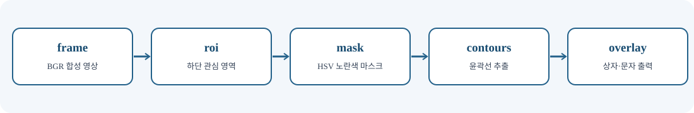
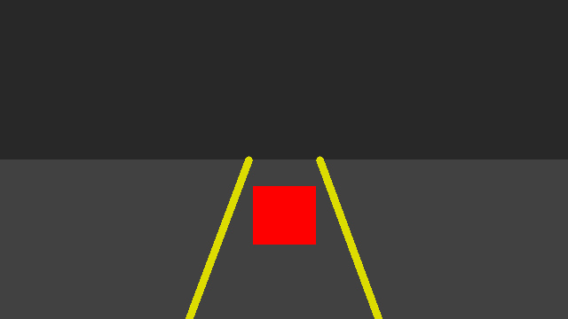
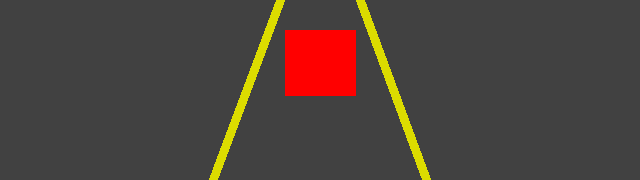
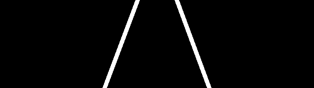
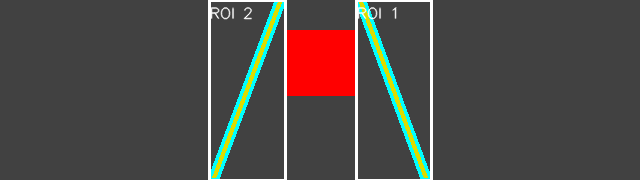

# 📘 06차시 — OpenCV 영상처리: 관심 영역·도형·문자·윤곽선

> 자율주행 자동차 로봇을 활용한 피지컬 AI · 1일차 16:00–17:00 · 필수 60분 / 선택 심화 별도
>
> **검증 범위:** 합성 영상 기반 Python 코드 실행 확인. 알티노 AI 제조사 SDK 및 실제 카메라·로봇 연동은 미검증.


<div class="page-section">

## 01. 개요와 60분 실습 운영

OpenCV(오픈씨브이, 공개 컴퓨터 비전 라이브러리)는 영상 데이터를 배열로 읽고 변환하며 물체의 색과 윤곽을 분석하는 도구다. 자율주행에서 카메라 영상은 직접 조향 명령이 아니라 **센서 관측값**이다. 영상 획득, 전처리, 특징 추출, 판단, 제어의 단계를 혼동하지 않는다. 이번 차시의 범위는 관심 영역(ROI), 사각형·문자 표시, 색 마스크, 윤곽선 검출이다. 학습 목표가 아닌 실제 수행 항목으로 각 단계의 입력·출력을 확인한다.

| 시간 | 수행 | 필수 산출물 |
|---|---|---|
| 0~10분 | 영상의 배열·좌표·색 순서 확인 | 영상 크기 설명 |
| 10~20분 | 합성 장면 생성 및 ROI 자르기 | `scene.png`, `roi.png` |
| 20~35분 | HSV 색 분리·이진 마스크 | `yellow_mask.png` |
| 35~50분 | 윤곽선·경계 상자·문자 표시 | `contours.png` |
| 50~60분 | 테스트·결과 해석·오류 확인 | 테스트 통과 기록 |

**필수 실습**은 제공된 합성 장면으로 완료한다. **선택 심화**는 실제 촬영 영상의 조도 변화와 오검출 분석이다. 로봇을 움직이는 제어 명령은 포함하지 않는다. 이는 실제 차량 주행의 안전성 검증과 영상처리 알고리즘 검증을 분리하기 위함이다.

</div>


<div class="page-section">

## 02. 전체 시스템에서 영상처리의 위치

로봇의 카메라는 연속적인 프레임을 제공하지만, 영상처리 결과만으로 주행 안전을 보장하지 않는다. 전방 장애물 감지는 라이다 등 다른 센서와 교차 검증해야 한다. 이번 장에서는 카메라 입력을 합성 영상으로 대체해 알고리즘을 재현한다. 실제 장비의 카메라 인터페이스는 제조사 SDK가 확인될 때만 연결한다.



`frame`은 BGR 영상 배열, `roi`는 하단 관심 영역, `mask`는 이진 색 마스크, `contours`는 윤곽선 좌표 목록, `overlay`는 결과를 그린 영상이다. 이 이름은 실습 코드의 실제 변수명과 동일하다. 데이터 흐름이 한 방향이므로 앞 단계의 오류가 뒤 단계로 전파된다. 예를 들어 ROI가 잘못되면 마스크가 정상이어도 원하는 물체가 누락된다.

| 단계 | 입력 | 출력 | 대표 오류 |
|---|---|---|---|
| 합성 영상 생성 | 크기 | BGR 배열 | 잘못된 크기 |
| ROI | 원본 배열, 좌표 | 잘린 배열 | 범위 초과 |
| HSV 변환 | BGR 배열 | HSV 배열 | 색 공간 혼동 |
| 마스크 | HSV, 임계값 | 0/255 배열 | 조명 변화 |
| 윤곽선 | 이진 마스크 | 점 좌표 | 작은 잡음 |
| 시각화 | 윤곽선·원본 | 표시 영상 | 좌표계 혼동 |

</div>


<div class="page-section">

## 03. 개발환경과 재현 가능한 실행

Python(파이썬, 프로그래밍 언어) 가상환경을 만들고 OpenCV와 NumPy를 설치한다. 이미 제공된 컴퓨터에 라이브러리가 설치되어 있으면 버전을 먼저 확인한다. 로봇 전용 프로그램을 변경하지 않고 별도 가상환경에서 실행하는 것이 안전하다.

```bash
python3 -m venv .venv                 # 독립 실행 환경 생성
source .venv/bin/activate           # 현재 셸에서 가상환경 활성화
python -m pip install numpy opencv-python  # 영상처리 패키지 설치
python -c "import cv2,numpy; print(cv2.__version__, numpy.__version__)"  # 버전 확인
python codes/ch06/opencv_vision_lab.py --out outputs/ch06  # 결과 PNG 생성
python -m unittest discover -s codes/ch06 -p 'test_*.py'  # 자동 테스트
```

원격 터미널이나 디스플레이가 없는 컴퓨터에서는 `cv2.imshow()`가 실패할 수 있다. 이번 예제는 `cv2.imwrite()`로 파일을 저장하므로 GUI(그래픽 사용자 인터페이스)가 필요하지 않다. 저장 경로는 명령의 `--out` 인자로 바꿀 수 있다. 입력 장치가 없는 환경에서도 전체 과정을 재현할 수 있다는 점이 기본 실습의 장점이다.

**확인:** PNG 파일 4개가 생성되고 테스트가 통과해야 한다. 설치가 실패하면 인터넷 접근·가상환경 활성화·Python 버전을 먼저 확인한다.

</div>


<div class="page-section">

## 04. 영상 배열·좌표·색 채널

디지털 컬러 영상은 보통 `(높이, 너비, 채널)` 구조의 3차원 배열이다. `frame.shape`가 `(360, 640, 3)`이면 세로 360픽셀, 가로 640픽셀, 색 채널 3개를 뜻한다. NumPy 인덱스의 첫 축은 세로 y, 둘째 축은 가로 x이다. 따라서 `frame[y, x]` 순서로 접근한다. 좌표를 `(x, y)`로 받는 OpenCV의 도형 함수와 순서가 다르므로 구분한다.

```python
frame = make_scene()          # BGR 형식의 360×640 컬러 영상
height, width = frame.shape[:2]
pixel = frame[0, 0]           # 배열 인덱스는 [y, x]
print(frame.shape, pixel)
```

**예상 결과:** `(360, 640, 3)`과 배경색을 나타내는 3원소 배열이 출력된다. OpenCV 기본 컬러 순서는 BGR(파랑·초록·빨강)이며 RGB(빨강·초록·파랑)와 다르다. 빨간색을 `(0, 0, 255)`로 지정하는 이유는 마지막 채널이 빨강이기 때문이다. Matplotlib 같은 도구에서 출력할 때는 필요하면 BGR→RGB 변환을 수행한다.

영상은 `uint8` 배열이며 한 채널의 표현 범위는 0~255다. 다른 자료형을 사용하면 일부 함수의 기대 입력과 달라 오류가 생길 수 있다. 본 예제에서는 처음부터 자료형을 고정한다.

</div>


<div class="page-section">

## 05. 합성 장면 생성과 도형 그리기

실습용 영상에는 어두운 배경, 회색 도로, 노란 경계선 두 개, 빨간 사각형 하나를 넣는다. 노란색은 이후 색 분리와 윤곽선 검출의 대상이고 빨간 사각형은 색 선택의 비교 대상이다. 실제 도로 영상은 조명·그림자·반사 때문에 색이 일정하지 않지만 합성 장면은 입력이 고정되어 반복 실험에 적합하다.

```python
image = np.full((360, 640, 3), (40, 40, 40), dtype=np.uint8)
cv2.rectangle(image, (0, 180), (639, 359), (65, 65, 65), -1)
cv2.line(image, (213, 359), (280, 180), (0, 220, 220), 8)
cv2.line(image, (426, 359), (360, 180), (0, 220, 220), 8)
cv2.rectangle(image, (285, 210), (355, 275), (0, 0, 255), -1)
```

`cv2.rectangle()`의 마지막 인자 `-1`은 내부를 채운다. `cv2.line()`의 마지막 인자 `8`은 선 두께다. `(x, y)` 좌표는 왼쪽 위가 원점이고 오른쪽으로 x, 아래쪽으로 y가 증가한다. 화면의 y축이 수학 좌표계와 반대라는 점을 유의한다.



**확인:** 좌우의 노란 선과 중앙의 빨간 사각형이 보여야 한다. 결과가 다른 경우 BGR 채널 순서와 좌표를 확인한다.

</div>


<div class="page-section">

## 06. ROI: 관심 영역 설정과 배열 슬라이싱

ROI(알오아이, 관심 영역)는 영상에서 분석할 부분을 제한하는 방법이다. 도로 경계선이 주로 영상 하단에 나타난다는 가정 아래 아래쪽 180픽셀을 선택한다. 이는 계산량을 줄이지만 위쪽에 나타난 대상은 검출하지 못할 수 있다. 따라서 관심 영역의 범위는 목적에 맞게 정해야 한다.

```python
roi = extract_roi(frame, x=0, y=180, width=640, height=180)
print(roi.shape)              # (180, 640, 3)
```

실제 함수 내부의 `image[y:y + height, x:x + width].copy()`는 세로 구간을 먼저, 가로 구간을 나중에 선택한다. `.copy()`를 호출하면 원본과 메모리를 분리해 ROI에 그린 결과가 원본을 바꾸지 않는다. `x + width`가 영상 너비를 초과하면 예외를 발생시키므로 잘못된 인덱스가 조용히 잘리는 문제를 예방한다.



**실습 변형:** `y=220`, `height=140`으로 바꾸고 노란 선의 검출 길이가 줄어드는지 관찰한다. 같은 화면이라도 ROI가 달라지면 뒤 단계의 윤곽선 크기가 달라진다. 이것이 영상처리에서 전처리 설정을 기록해야 하는 이유다.

</div>


<div class="page-section">

## 07. BGR에서 HSV로 색 공간 변환

HSV(에이치에스브이, 색상·채도·명도)는 색상(H), 채도(S), 밝기(V)를 분리해 표현한다. OpenCV의 8비트 HSV에서 H는 일반적으로 0~179, S와 V는 0~255 범위를 사용한다. 빨강·노랑·초록을 RGB 수치로 직접 구분하는 것보다 색상 성분을 따로 조절하기 편하다. 다만 그림자와 노출 변화가 심하면 HSV도 완벽한 해결책은 아니다.

```python
hsv = cv2.cvtColor(roi, cv2.COLOR_BGR2HSV)
lower = np.array([18, 80, 80], dtype=np.uint8)
upper = np.array([38, 255, 255], dtype=np.uint8)
mask = cv2.inRange(hsv, lower, upper)
```

노란색을 대상으로 H를 18~38로 설정했다. 이 범위는 **교육용 합성 영상에 맞춘 예시**이지 모든 카메라·조명에서 통용되는 표준값이 아니다. 채도·밝기의 하한을 80으로 설정하면 매우 어두운 픽셀을 배제할 수 있지만 어두운 실제 노란 선도 놓칠 수 있다. 현장에서는 여러 프레임을 수집하여 오검출과 미검출을 함께 평가한다.

**확인:** 빨간 사각형은 노란색 마스크에 포함되지 않아야 한다. 실제 이미지에서 결과가 좋지 않으면 먼저 색 순서가 BGR인지 확인한다.

</div>


<div class="page-section">

## 08. 이진 마스크와 픽셀 단위 판단

`cv2.inRange()`는 조건을 만족하는 픽셀에 255, 그렇지 않은 픽셀에 0을 지정한다. 결과 `mask`는 2차원 `uint8` 배열이다. 흰색 영역이 검출 대상이며 검은색 영역은 배경이다. 따라서 `np.count_nonzero(mask)`는 검출된 픽셀 수를 세는 데 사용할 수 있다. 이 수치만으로 대상의 위치나 종류를 알 수는 없다.

```python
mask = color_mask_bgr(roi)
print(mask.shape, mask.dtype)
print(np.unique(mask))
```

**예상 결과:** `(180, 640)`, `uint8`, `[0, 255]`가 출력된다. `mask.shape`에 색 채널이 없는 이유는 픽셀별 통과 여부만 담기 때문이다. 영상 크기가 바뀌면 픽셀 수 비교도 달라지므로 단순 픽셀 수 대신 영상 면적 대비 비율을 계산하는 방법도 있다.



**실습 변형:** H 범위를 `[25, 80, 80]`~`[30, 255, 255]`로 좁혀 본다. 노란 선의 일부가 사라지면 임계값이 너무 엄격하다는 뜻이다. 반대로 범위를 지나치게 넓히면 도로 배경이 검출될 수 있다.

</div>


<div class="page-section">

## 09. 윤곽선 검출과 잡음 필터링

윤곽선은 이진 마스크에서 연결된 영역의 경계를 점들의 집합으로 표현한다. `cv2.findContours()`는 외곽선을 추출할 때 사용한다. `cv2.RETR_EXTERNAL`은 가장 바깥 윤곽선만 가져오며 `cv2.CHAIN_APPROX_SIMPLE`은 불필요한 중간 점을 줄인다. 원본 마스크를 직접 그리는 것이 아니라 반환된 윤곽선 목록을 별도로 활용한다.

```python
found, _ = cv2.findContours(mask, cv2.RETR_EXTERNAL,
                            cv2.CHAIN_APPROX_SIMPLE)
contours = [c for c in found if cv2.contourArea(c) >= 80]
contours.sort(key=cv2.contourArea, reverse=True)
```

`cv2.contourArea()`는 윤곽선이 둘러싼 면적을 계산한다. 작은 잡음을 제거하려고 면적 80픽셀² 이상만 유지한다. 이 값도 해상도와 대상 크기에 따라 달라지는 예시값이다. 길고 얇은 선은 면적이 작게 나올 수 있어 작은 면적 필터가 항상 적절하지는 않다.

이번 합성 영상에서는 노란 선 두 개가 각각 분리되어 윤곽선 2개가 검출된다. 이 결과는 차선이 두 개라는 의미가 아니라 **노란 연결 영역이 두 개**라는 의미다. 실제 차선 검출은 기하학적 일관성, 원근, 시간적 안정성 등을 추가로 확인해야 한다.

</div>


<div class="page-section">

## 10. 경계 상자와 문자 표시

검출 결과를 사람이 확인하려면 윤곽선만 표시하는 것보다 경계 상자와 번호를 함께 그리는 것이 유용하다. `cv2.boundingRect()`는 윤곽선을 둘러싼 축 정렬 사각형의 `(x, y, w, h)`를 돌려준다. 이 좌표는 ROI 내부 좌표이므로 원본 전체 영상에 그릴 때는 ROI의 시작 좌표를 더해야 한다.

```python
output = roi.copy()
for index, contour in enumerate(contours, start=1):
    x, y, w, h = cv2.boundingRect(contour)
    cv2.rectangle(output, (x, y), (x + w, y + h), (255, 255, 255), 2)
    cv2.putText(output, f'ROI {index}', (x, max(18, y - 6)),
                cv2.FONT_HERSHEY_SIMPLEX, 0.5, (255, 255, 255), 1)
```

OpenCV의 기본 `putText()` 글꼴은 한글을 안정적으로 렌더링하지 못하므로 예제는 `ROI 1`처럼 영문·숫자를 사용한다. 한글 안내는 교재 본문이나 별도 렌더러로 표시한다. `max(18, y - 6)`은 문자가 영상 위쪽으로 잘리는 것을 완화한다.



**확인:** 두 개의 노란 선에 흰 경계 상자와 `ROI` 번호가 표시된다. 상자가 빨간 사각형을 둘러싸면 색 범위 설정을 다시 점검한다.

</div>


<div class="page-section">

## 11. 종합 실습: 실행 결과·예외·자동 테스트

제공된 전체 프로그램은 `make_scene()` → `extract_roi()` → `color_mask_bgr()` → `contours_from_mask()` → `annotate()` → `run()` 순서로 동작한다. 실제 함수명을 그림·본문·코드에서 동일하게 사용했다. 함수별 입력·출력을 분리하면 단계별 단위 테스트를 만들 수 있다. 다음은 실행 확인용 명령이다.

```bash
python codes/ch06/opencv_vision_lab.py --out outputs/ch06
python -m unittest discover -s codes/ch06 -p 'test_*.py' -v
```

**기준 출력:** `frame=(360, 640, 3), roi=(180, 640, 3), contours=2`와 PNG 파일 4개의 이름이 출력된다. 테스트는 영상 크기·자료형·잘못된 크기·ROI 범위·복사 여부·마스크 자료형·이진값·노란 픽셀·윤곽선·출력 파일 등을 검사한다. 테스트가 통과해도 실제 카메라 입력이나 로봇 제어까지 검증한 것은 아니다.

**오류 점검:** `ModuleNotFoundError`는 설치 환경을 확인한다. 이미지가 저장되지 않으면 출력 폴더 권한과 경로를 확인한다. 윤곽선이 0개면 ROI, HSV 범위, 마스크를 순서대로 확인한다. 상자 좌표가 어긋나면 ROI 좌표와 원본 좌표를 혼동했는지 확인한다.

**안전:** 영상에서 물체를 찾았다는 사실을 곧바로 주행 명령으로 변환하지 않는다. 실제 주행 실습은 별도의 안전 승인과 센서 검증을 요구한다.

</div>


<div class="page-section">

## 12. 평가·선택 심화·다음 차시 연결

**필수 확인 과제:** (1) 영상 배열의 세 축을 설명한다. (2) BGR의 빨강 값이 `(0,0,255)`인 이유를 설명한다. (3) ROI가 원본을 복사하는 이유를 설명한다. (4) 마스크의 0과 255를 해석한다. (5) 윤곽선 개수와 실제 차선 개수가 같다고 단정할 수 없는 이유를 설명한다. (6) 테스트 15개가 모두 통과하는지 확인한다.

**선택 심화 A — 임계값 민감도:** H의 상·하한을 각각 5씩 바꾸고 마스크의 흰색 픽셀 수와 윤곽선 개수를 비교한다. 기준 영상과 바뀐 결과를 나란히 저장한다. **선택 심화 B — 실제 이미지:** 라이선스가 허용된 도로 사진을 준비하여 같은 처리를 적용한다. 실제 이미지에서는 ROI 위치·조명·차선 색상·원근이 달라지므로 기본값을 그대로 신뢰하지 않는다. **선택 심화 C — 잡음:** 작은 노란 점을 추가한 뒤 `min_area`를 조절하고 잡음이 제거되는지 관찰한다.

**다음 차시 연결:** 07차시에서는 영상처리와 구분되는 딥러닝 학습 개념을 다룬다. 이번 차시의 색 임계값과 윤곽선 검출은 사람이 직접 규칙을 설정하는 방식이다. 딥러닝에서는 데이터를 통해 모델 파라미터를 학습한다. 두 접근은 서로 배타적이지 않으며 실제 시스템에서는 함께 사용될 수 있다.

**공식 참고:** OpenCV-Python 튜토리얼(색 공간 변환·윤곽선·도형 그리기), NumPy 배열 인덱싱, Python 가상환경 문서를 우선한다. 출처 링크와 검증 한계는 마지막 절에 명시한다.

</div>


<div class="page-section">

## 13. 전체 실행 코드 — `opencv_vision_lab.py`

아래 코드는 합성 장면 생성부터 이미지 저장까지 독립적으로 실행된다. 입력 파일이나 로봇 장비가 없어도 동작한다. `--out` 옵션으로 결과 저장 위치를 선택한다.

```python
"""06차시: 합성 영상 기반 OpenCV 영상처리 실습. 카메라·로봇 API 사용 없음."""
from pathlib import Path
import argparse
import cv2
import numpy as np


def make_scene(width=640, height=360):
    """BGR 영상에 관심 영역, 노란 도형, 빨간 표지판을 생성한다."""
    if width < 100 or height < 100:
        raise ValueError('영상 크기는 가로·세로 각각 100 이상이어야 합니다.')
    image = np.full((height, width, 3), (40, 40, 40), dtype=np.uint8)
    cv2.rectangle(image, (0, height // 2), (width - 1, height - 1), (65, 65, 65), -1)
    cv2.line(image, (width // 3, height - 1), (width // 2 - 40, height // 2), (0, 220, 220), 8)
    cv2.line(image, (width * 2 // 3, height - 1), (width // 2 + 40, height // 2), (0, 220, 220), 8)
    cv2.rectangle(image, (width // 2 - 35, height // 2 + 30), (width // 2 + 35, height // 2 + 95), (0, 0, 255), -1)
    return image


def extract_roi(image, x, y, width, height):
    """배열의 [y:y+h, x:x+w] 영역을 복사한다. 영상 경계를 검사한다."""
    if image is None or image.ndim not in (2, 3):
        raise ValueError('2차원 또는 3차원 영상 배열이 필요합니다.')
    ih, iw = image.shape[:2]
    if x < 0 or y < 0 or width <= 0 or height <= 0 or x + width > iw or y + height > ih:
        raise ValueError('관심 영역이 영상 범위를 벗어났습니다.')
    return image[y:y + height, x:x + width].copy()


def color_mask_bgr(image):
    """BGR을 HSV로 변환하고 노란색 영역을 이진 마스크로 분리한다."""
    if image is None or image.ndim != 3 or image.shape[2] != 3:
        raise ValueError('3채널 BGR 영상이 필요합니다.')
    hsv = cv2.cvtColor(image, cv2.COLOR_BGR2HSV)
    lower = np.array([18, 80, 80], dtype=np.uint8)
    upper = np.array([38, 255, 255], dtype=np.uint8)
    return cv2.inRange(hsv, lower, upper)


def contours_from_mask(mask, min_area=80.0):
    """외곽 윤곽선을 찾고 면적이 작은 잡음을 제외한다."""
    if mask is None or mask.ndim != 2 or mask.dtype != np.uint8:
        raise ValueError('uint8 단일 채널 마스크가 필요합니다.')
    if min_area < 0:
        raise ValueError('최소 면적은 0 이상이어야 합니다.')
    found, _ = cv2.findContours(mask, cv2.RETR_EXTERNAL, cv2.CHAIN_APPROX_SIMPLE)
    return sorted((c for c in found if cv2.contourArea(c) >= min_area),
                  key=cv2.contourArea, reverse=True)


def annotate(image, contours):
    """윤곽선, 경계 사각형, 영어 안내 문자를 원본의 복사본에 표시한다."""
    output = image.copy()
    cv2.drawContours(output, contours, -1, (255, 255, 0), 2)
    for index, contour in enumerate(contours, start=1):
        x, y, w, h = cv2.boundingRect(contour)
        cv2.rectangle(output, (x, y), (x + w, y + h), (255, 255, 255), 2)
        cv2.putText(output, f'ROI {index}', (x, max(18, y - 6)),
                    cv2.FONT_HERSHEY_SIMPLEX, 0.5, (255, 255, 255), 1, cv2.LINE_AA)
    return output


def run(out_dir):
    """GUI 없이 결과 PNG를 저장하므로 서버·원격 터미널에서도 실행 가능하다."""
    target = Path(out_dir)
    target.mkdir(parents=True, exist_ok=True)
    frame = make_scene()
    roi = extract_roi(frame, 0, 180, 640, 180)
    mask = color_mask_bgr(roi)
    contours = contours_from_mask(mask)
    overlay = annotate(roi, contours)
    outputs = {'scene.png': frame, 'roi.png': roi,
               'yellow_mask.png': mask, 'contours.png': overlay}
    for name, image in outputs.items():
        if not cv2.imwrite(str(target / name), image):
            raise OSError(f'이미지 저장 실패: {name}')
    print(f'frame={frame.shape}, roi={roi.shape}, contours={len(contours)}')
    print('saved=' + ', '.join(outputs))
    return len(contours)


if __name__ == '__main__':
    parser = argparse.ArgumentParser(description='06차시 OpenCV 영상처리 실습')
    parser.add_argument('--out', default='outputs', help='결과 이미지 저장 폴더')
    args = parser.parse_args()
    run(args.out)

```

</div>

<div class="page-section">

## 14. 전체 자동 테스트 코드 — `test_opencv_vision_lab.py`

이 테스트는 합성 영상의 불변 조건과 오류 처리를 확인한다. 테스트가 통과한 범위는 코드 내부 동작이며 실물 센서나 실제 주행을 보증하지 않는다.

```python
"""외부 장비 없이 실행되는 06차시 회귀 테스트."""
import tempfile
import unittest
from pathlib import Path
import numpy as np
from opencv_vision_lab import (make_scene, extract_roi, color_mask_bgr,
                               contours_from_mask, annotate, run)

class VisionTests(unittest.TestCase):
    def setUp(self):
        self.frame = make_scene()

    def test_shape(self): self.assertEqual(self.frame.shape, (360, 640, 3))
    def test_dtype(self): self.assertEqual(self.frame.dtype, np.uint8)
    def test_invalid_scene(self):
        with self.assertRaises(ValueError): make_scene(10, 10)
    def test_roi_shape(self): self.assertEqual(extract_roi(self.frame, 0, 180, 640, 180).shape, (180, 640, 3))
    def test_roi_copy(self):
        roi = extract_roi(self.frame, 0, 180, 100, 100)
        roi[:] = 0
        self.assertFalse(np.all(self.frame[180:280, :100] == 0))
    def test_roi_bounds(self):
        with self.assertRaises(ValueError): extract_roi(self.frame, 620, 200, 30, 30)
    def test_roi_negative(self):
        with self.assertRaises(ValueError): extract_roi(self.frame, -1, 0, 30, 30)
    def test_mask_dtype(self): self.assertEqual(color_mask_bgr(self.frame).dtype, np.uint8)
    def test_mask_binary(self): self.assertTrue(set(np.unique(color_mask_bgr(self.frame))).issubset({0, 255}))
    def test_mask_has_yellow(self): self.assertGreater(np.count_nonzero(color_mask_bgr(self.frame)), 100)
    def test_invalid_mask(self):
        with self.assertRaises(ValueError): contours_from_mask(self.frame)
    def test_negative_area(self):
        with self.assertRaises(ValueError): contours_from_mask(color_mask_bgr(self.frame), -1)
    def test_contour_detect(self): self.assertGreaterEqual(len(contours_from_mask(color_mask_bgr(self.frame))), 2)
    def test_annotate_shape(self): self.assertEqual(annotate(self.frame, []).shape, self.frame.shape)
    def test_save(self):
        with tempfile.TemporaryDirectory() as d:
            self.assertGreaterEqual(run(d), 2)
            self.assertEqual(len(list(Path(d).glob('*.png'))), 4)

if __name__ == '__main__': unittest.main()

```

</div>

<div class="page-section">

## 15. 기술 근거와 검증 경계

- OpenCV 공식 문서 — 색 공간 변환: https://docs.opencv.org/4.x/df/d9d/tutorial_py_colorspaces.html
- OpenCV 공식 문서 — 윤곽선: https://docs.opencv.org/4.x/d4/d73/tutorial_py_contours_begin.html
- OpenCV 공식 문서 — 도형 그리기: https://docs.opencv.org/4.x/dc/da5/tutorial_py_drawing_functions.html
- NumPy 공식 문서 — 배열 인덱싱: https://numpy.org/doc/stable/user/basics.indexing.html
- Python 공식 문서 — 가상환경: https://docs.python.org/3/library/venv.html

**검증 경계:** 합성 영상 기반 알고리즘과 단위 테스트는 실제 실행했다. OpenCV 문서 URL은 공식 자료의 참조 주소이며, 이번 실행에서 각 페이지의 최신 내용을 실시간 대조하지는 않았다. 제조사 SDK·실물 카메라·라이다·차량 제어는 미검증이다. 합성 영상의 차선 모양은 실제 도로 차선 인식의 성능 지표가 아니다.

**재현 환경:** Python 3, OpenCV 4.13.0, NumPy 2.3.5에서 실행했다. 다른 환경에서는 설치 가능한 패키지 버전과 결과를 별도 확인한다.

</div>
