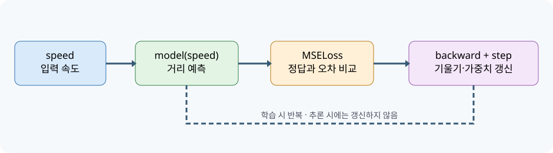

# 📘 07차시 — 딥러닝 기본 원리: 선형회귀와 심층 신경망

> 자율주행 자동차 로봇을 활용한 피지컬 AI · 2일차 09:00–10:00 · 필수 실습 60분 / 선택 심화 별도
>
> **검증 범위:** PyTorch CPU 환경에서 합성 데이터 학습·평가 및 자동 테스트. 알티노 AI 제조사 SDK·실제 주행·실차 안전 성능은 미검증.

## 01. 차시 개요 및 실습 운영표

이번 차시는 앞선 Python·NumPy·OpenCV 차시의 배열과 센서 처리 결과를 **학습 가능한 모델**로 연결한다. 사람이 정한 조건문으로 모든 판단을 작성하는 방식과 달리, 머신러닝은 입력·정답 사례로부터 매개변수를 조정한다. 단, 학습 모델의 예측은 물리적 안전 제약이나 실제 로봇 제어 명령을 대신하지 않는다. 여기서는 자율주행 차량의 '속도에 따른 교육용 목표 거리'를 예측하는 합성 문제를 사용한다. 이 값은 실제 제동거리 공식이나 안전 정지거리 기준이 아니다.

| 시간 | 필수 수행 | 확인 산출물 |
|---|---|---|
| 0~10분 | 데이터·정답·모델·손실 이해 | 데이터 표와 구조도 |
| 10~20분 | 합성 데이터 생성·학습/평가 분리 | 입력 160개, 학습 128개, 평가 32개 |
| 20~35분 | 선형회귀 모델 학습 | 손실 감소 확인 |
| 35~50분 | 1→8→1 신경망 학습 | 두 모델 평가값 비교 |
| 50~60분 | 평가 지표·출력 파일·자동 테스트 확인 | JSON·CSV 및 테스트 통과 |

**선택 심화:** 학습률·은닉층 크기·잡음 수준을 바꾸고 학습 결과를 비교한다. 실제 차량 구동, 카메라 실시간 추론 및 대형 영상 학습은 이번 60분 필수 실습에서 제외한다.

## 02. 전체 시스템에서 딥러닝이 담당하는 역할

센서 → 데이터 전처리 → 특징/입력 구성 → 모델 예측 → 검증된 판단 로직 → 제어기 → 구동부의 순서로 기능을 나눈다. 모델 출력이 직접 모터에 연결되면 오인식·센서 오류·학습 범위 밖 입력에서 위험해질 수 있다. 따라서 모델은 **관측·추정 계층**에 두고, 제어 계층에는 별도 제한·감시·비상정지 기능이 필요하다.



그림의 `speed`, `model(speed)`, `MSELoss`, `backward`, `step`은 실습 코드의 실제 데이터·연산에 대응한다. `train()`은 학습 데이터에서 오차를 줄이고 `evaluate()`는 분리한 평가 데이터로 일반화 정도를 확인한다. 학습과 추론을 구별하는 것이 이번 차시의 핵심이다. 추론은 이미 결정된 가중치를 사용해 출력을 계산하며 일반적으로 역전파나 최적화 단계가 없다.

## 03. 머신러닝·딥러닝·신경망의 관계

머신러닝(Machine Learning, 기계학습)은 사례로부터 규칙 또는 매개변수를 학습하는 방법을 포괄한다. 딥러닝(Deep Learning, 심층학습)은 여러 층을 가진 신경망을 주로 활용하는 머신러닝의 한 갈래다. 신경망의 층 수가 늘었다고 모든 문제에서 성능이 좋아지는 것은 아니다. 입력과 출력의 관계가 단순한 직선이면 선형회귀가 더 적절할 수 있다.

| 방법 | 특징 | 이번 차시의 예 |
|---|---|---|
| 규칙 기반 | 사람이 임계값과 분기 직접 설정 | `speed > 5`이면 경고 |
| 선형회귀 | 입력의 선형 결합을 학습 | `y = wx + b` |
| 다층 퍼셉트론(MLP) | 선형 변환과 비선형 활성화를 반복 | 1→8→1 신경망 |
| 합성곱 신경망(CNN) | 영상의 공간적 특징을 학습 | 이후 이미지 분류·객체 인식 차시 연결 |

선형회귀는 '딥러닝보다 낮은 단계'라는 뜻이 아니라, 간단하고 해석하기 쉬운 비교 기준이다. 실제 시스템에서는 문제 복잡도·학습 데이터량·실행 속도·설명 가능성·안전 요구를 함께 고려해 모델을 선정한다.

## 04. 합성 데이터와 물리적 의미의 한계

실습에서는 속도 `speed`를 0~8m/s 범위에서 생성하고 교육용 목표값 `target`을 `0.4 + 0.08 × speed + noise`로 만든다. `noise`는 측정 오차처럼 보이는 작은 난수다. 목표는 모델이 직선 관계를 복원할 수 있는지 확인하는 것이며, **0.4와 0.08은 실제 차량에서 측정하거나 승인받은 안전 상수가 아니다.**

| 속도 | 잡음 없는 교육용 정답 | 해석 |
|---:|---:|---|
| 0m/s | 0.40m | 모델의 절편 설명용 |
| 2m/s | 0.56m | 속도가 2 증가하면 0.16 증가 |
| 4m/s | 0.72m | 입력과 출력의 선형 관계 |
| 8m/s | 1.04m | 학습 입력 범위의 상단 |

현실의 제동거리는 반응 시간, 노면 마찰, 경사, 타이어, 제동 시스템, 제어 지연 등에 따라 달라진다. 이상화한 일정 감속 모델에서는 제동거리 항이 속도의 제곱에 비례한다. 따라서 이번 합성 식을 실제 주행 안전거리 계산에 사용하는 것은 기술적으로 잘못이다. 이후 로봇 실습에서는 실제 측정값과 안전 규정을 바탕으로 별도 제어 기준을 검증해야 한다.

## 05. 데이터 배열·자료형·형상 이해

`make_dataset()`은 `speed`와 `target`을 각각 `(160, 1)` 모양의 `torch.Tensor`로 만든다. 첫 번째 차원 160은 표본 개수, 두 번째 차원 1은 특징 수다. `float32`는 신경망 학습에 흔히 사용하는 실수 자료형이다. `np.random.default_rng(seed)`는 합성 데이터의 재현성을 위해 난수 발생기를 명시적으로 만든다.

```python
speed, target = make_dataset(n=160, seed=7)
print(speed.shape, target.shape)
# torch.Size([160, 1]) torch.Size([160, 1])
```

표본 1개는 '속도 입력 1개와 목표 거리 1개'의 짝이다. 입력과 정답의 표본 순서가 어긋나면 학습 대상 자체가 바뀐다. 학습 데이터에서 입력만 섞고 정답을 섞지 않는 실수를 피하기 위해 `split_dataset()`에서는 같은 무작위 인덱스를 입력과 정답에 함께 적용한다. `torch.randperm()`은 중복 없는 무작위 순서를 생성한다.

## 06. 학습용·평가용 데이터 분리

모델을 만든 뒤 같은 데이터로만 정확도를 재면, 단순 암기나 데이터 누출을 발견하기 어렵다. 여기서는 160개 중 128개(80%)를 학습에, 32개(20%)를 최종 평가에 사용한다. 평가 데이터는 `train()`에 넣지 않는다. `torch.Generator().manual_seed(11)`로 데이터 분할을 재현 가능하게 만든다.

```python
train_set, test_set = split_dataset(speed, target)
print(len(train_set[0]), len(test_set[0]))
# 128 32
```

학습 중 모델 구조·학습률을 반복 조정하면서 평가 데이터를 계속 참고하면 평가 데이터도 사실상 개발에 사용된다. 실무에서는 학습(train)·검증(validation)·시험(test) 세 집합으로 나누고 최종 시험 데이터는 모델 선택에 사용하지 않는다. 이번 차시는 60분 제한으로 두 집합만 사용하며, 이 한계를 명시한다. 이미지 데이터에서는 같은 장면의 연속 프레임을 무작위로 분리하면 데이터 누출이 발생할 수 있으므로 촬영 구간이나 주행 세션 단위 분할을 고려해야 한다.

## 07. 선형회귀의 계산 구조

선형회귀 모델의 예측은 `ŷ = wx + b`로 나타낸다. `x`는 속도, `w`는 학습되는 기울기, `b`는 학습되는 절편, `ŷ`는 예측값이다. 예를 들어 `w`가 0.08이고 `b`가 0.40이면 속도 4에 대한 예측은 0.72가 된다. 학습 시작 시에는 `w`, `b`가 이 값으로 설정되어 있지 않으며, 오차를 줄이는 과정에서 조정된다.

```python
linear = torch.nn.Linear(1, 1)
# 입력 특징 1개를 출력 1개로 변환하는 학습 가능 선형층
prediction = linear(torch.tensor([[4.0]]))
```

`Linear(1, 1)`의 학습 매개변수는 가중치 1개와 편향 1개로 총 2개다. 입력이 여러 특징을 가진다면 출력에 영향을 주는 가중치 수도 늘어난다. 실제 차량의 제어 변수를 학습할 때는 단위와 입력 범위를 먼저 정해야 하며, 속도(m/s)와 속도(km/h)를 혼용하면 같은 숫자라도 물리적으로 전혀 다른 뜻이 된다.

## 08. 손실 함수와 평균제곱오차

손실 함수(Loss Function, 오차를 수치화하는 함수)는 예측과 정답의 차이를 학습 가능한 수치로 만든다. 평균제곱오차(MSE, Mean Squared Error)는 각 예측 오차를 제곱한 후 평균을 낸다. `MSE = (1/N) × Σ(ŷᵢ − yᵢ)²`이다. 예측 0.5, 0.8과 정답 0.4, 1.0이 있으면 오차는 0.1과 -0.2이며 제곱은 0.01과 0.04이다. 평균은 0.025가 된다.

```python
loss_fn = torch.nn.MSELoss()
loss = loss_fn(prediction, target_batch)
```

제곱하기 때문에 큰 오차의 영향이 더 커진다. MSE의 단위는 목표값 단위의 제곱이며, 목표가 m라면 MSE 단위는 m²이다. 평균절대오차(MAE, Mean Absolute Error)는 절댓값의 평균으로 목표 단위(m)를 그대로 유지하므로 결과 해석이 쉬울 수 있다. 본 실습에서는 학습에 MSE를 사용하고 평가 결과에 MSE와 MAE를 모두 기록한다.

## 09. 경사하강법과 역전파

가중치의 변화가 손실을 어떻게 바꾸는지 알려주는 값이 기울기(gradient)다. PyTorch의 자동미분은 연산 그래프를 추적해 `loss.backward()` 호출 시 각 매개변수의 기울기를 계산한다. 최적화기(optimizer)는 이 기울기를 사용해 매개변수를 조정한다. `Adam`은 모멘트 추정값을 이용하는 대표적인 최적화기이며, 본 예제는 `lr=0.025`를 사용한다.

```python
optimizer.zero_grad()  # 이전 반복의 기울기 누적 제거
loss.backward()        # 연산 그래프를 따라 기울기 계산
optimizer.step()       # 가중치와 편향 갱신
```

`zero_grad()`를 생략하면 기본적으로 기울기가 누적되어 의도하지 않은 갱신이 일어날 수 있다. `backward()`는 매개변수를 직접 갱신하지 않으며 `step()`이 갱신을 수행한다. 학습률이 너무 크면 손실이 진동하거나 발산하고, 너무 작으면 제한된 반복 횟수 내에 충분히 학습하지 못할 수 있다. 실습에서는 매 반복의 손실을 `history`에 저장해 처음과 마지막을 비교한다.

## 10. 선형회귀 학습 루프의 실제 동작

`train()`은 매 반복에서 입력 전체를 모델에 넣고 예측을 계산한다. 이어서 MSE 손실을 계산하고 기울기를 구해 가중치를 갱신한다. 이번 데이터 128개는 작으므로 한 번에 처리하는 전체 배치 학습을 사용한다. 영상 데이터처럼 규모가 크면 미니배치 데이터로더를 사용하는 방식이 일반적이다.

```python
for _ in range(epochs):
    model.train()
    pred = model(x)
    loss = loss_fn(pred, y)
    optimizer.zero_grad()
    loss.backward()
    optimizer.step()
    history.append(float(loss.detach()))
```

`model.train()`은 학습 모드 전환이다. 드롭아웃·배치정규화 같은 층이 있을 때 동작에 영향을 준다. 이번 선형층에는 해당 층이 없지만 학습과 평가 코드를 구분하기 위해 명시한다. `loss.detach()`는 추적 중인 연산 그래프에서 분리된 손실 값을 기록하는 용도다. 이때의 손실 감소는 학습 데이터에 대한 최적화 결과이며, 독립 평가 데이터의 오차 감소를 자동으로 보장하지 않는다.

## 11. 다층 퍼셉트론의 구조와 비선형성

MLP(Multi-Layer Perceptron, 다층 퍼셉트론)는 선형층과 비선형 활성화 함수를 결합한다. 이번 구조는 입력 1개 → 은닉 뉴런 8개 → 출력 1개다. `ReLU`는 입력이 0보다 작으면 0을 출력하고, 0 이상이면 입력을 그대로 통과시킨다. 비선형성이 없으면 여러 선형층을 겹쳐도 전체가 하나의 선형 변환과 동등해질 수 있다.

```python
def build_mlp():
    return nn.Sequential(
        nn.Linear(1, 8),  # 입력 속도 1개 → 은닉 특징 8개
        nn.ReLU(),        # 비선형 활성화
        nn.Linear(8, 1)   # 은닉 특징 8개 → 예측 거리 1개
    )
```

첫 번째 선형층의 매개변수는 가중치 8개와 편향 8개로 16개, 마지막 층은 가중치 8개와 편향 1개로 9개이므로 전체는 25개다. 선형회귀의 2개보다 많다. 하지만 합성 데이터의 정답 생성 관계는 직선이므로 더 많은 매개변수를 가진 MLP가 반드시 더 작은 시험 오차를 보이지 않는다. **복잡한 모델의 장점은 복잡한 관계를 표현할 수 있다는 가능성이지 항상 더 높은 정확도라는 보장이 아니다.**

## 12. 평가 지표와 결과 해석

`evaluate()`는 `model.eval()`과 `torch.no_grad()`를 사용해 학습과 다른 모드에서 예측한다. `no_grad()`는 평가 중 불필요한 자동미분 그래프를 만들지 않도록 한다. 결과는 MSE와 MAE로 저장한다. 실행 검증 환경에서는 선형회귀의 시험 MAE가 약 0.019m, MLP의 시험 MAE도 약 0.019m로 나타났다. 이는 난수 시드와 설치 버전·실행 환경에 따라 소폭 달라질 수 있다.

| 항목 | 선형회귀 | MLP | 해석 |
|---|---:|---:|---|
| 학습 표본 | 128 | 128 | 동일한 학습 집합 |
| 평가 표본 | 32 | 32 | 동일한 평가 집합 |
| 시험 MSE | 약 0.00054 | 약 0.00054 | 제곱오차의 평균 |
| 시험 MAE | 약 0.019m | 약 0.019m | 평균 절대 오차 |

두 모델이 비슷한 성능을 보인 것은 데이터가 선형 관계로 생성되었기 때문이다. 시험 오차가 낮더라도 실제 차량에 적용 가능한 안전 모델이라는 뜻은 아니다. 특히 실제 제동거리·장애물 회피·보행자 안전 같은 고위험 기능에는 현장 데이터와 엄격한 독립 검증, 비상정지 로직이 필요하다.

## 13. 따라 하기 — 설치·실행·출력 파일

아래 명령은 Ubuntu(우분투, 리눅스 운영체제)에서 Python 3과 `venv`가 설치되어 있다는 전제다. 먼저 `codes/ch07` 폴더로 이동한다. 기존 가상환경이 있으면 새 환경을 만들지 않고 해당 환경을 사용할 수 있다. PyTorch의 설치 명령은 CPU·GPU·운영체제에 따라 달라질 수 있으므로 공식 설치 선택기를 확인한다.

```bash
python3 -m venv .venv                 # 독립된 Python 실행 환경 생성
source .venv/bin/activate            # 가상환경 활성화
python -m pip install numpy torch    # 수치 배열 및 딥러닝 패키지 설치
python deep_learning_lab.py --outdir outputs  # 합성 데이터 학습·평가 실행
python -m unittest -v test_deep_learning_lab.py  # 자동 테스트 실행
```

실행 후 `outputs/metrics.json`에는 학습·평가 표본 수와 MSE·MAE, 손실의 시작/종료 값이 기록된다. `outputs/predictions.csv`에는 속도 0, 4, 8m/s에 대한 두 모델의 예측이 저장된다. `metrics.json`은 정량 결과를 확인하기 위한 파일이고 `predictions.csv`는 스프레드시트에서 입력과 예측의 관계를 비교하기 위한 파일이다. 두 파일은 실습에서 직접 생성하므로 경로가 없으면 `--outdir` 옵션을 확인한다.

## 14. 전체 실행 코드 — 데이터 생성부터 평가까지

아래 코드는 배포 패키지의 `codes/ch07/deep_learning_lab.py` 전체 내용과 동일하다. 코드가 길어도 함수별 역할을 구분해 읽으면 된다. `make_dataset()`은 정답 데이터를 만들고, `split_dataset()`은 학습·평가 데이터를 나누며, `train()`은 가중치를 갱신하고, `evaluate()`는 시험 지표를 계산한다. `run()`은 전체 실행 흐름을 묶는다.

```python
"""CH07: deterministic CPU-only linear regression and neural network practice."""
import argparse
import json
from pathlib import Path
import numpy as np
import torch
from torch import nn


def seed_all(seed=7):
    np.random.seed(seed)
    torch.manual_seed(seed)


def make_dataset(n=160, seed=7):
    """Synthetic target: stop distance (m) = 0.4 + 0.08 * speed (m/s)."""
    if n < 16:
        raise ValueError('n must be >= 16')
    rng = np.random.default_rng(seed)
    speed = rng.uniform(0.0, 8.0, size=(n, 1)).astype(np.float32)
    noise = rng.normal(0, 0.025, size=(n, 1)).astype(np.float32)
    target = 0.4 + 0.08 * speed + noise
    return torch.from_numpy(speed), torch.from_numpy(target)


def split_dataset(x, y, train_ratio=0.8):
    """Preserve a reproducible shuffled hold-out; no overlap."""
    g = torch.Generator().manual_seed(11)
    idx = torch.randperm(len(x), generator=g)
    cut = int(len(x) * train_ratio)
    return (x[idx[:cut]], y[idx[:cut]]), (x[idx[cut:]], y[idx[cut:]])


def train(model, train_set, epochs=300, lr=0.03):
    x, y = train_set
    loss_fn = nn.MSELoss()
    optimizer = torch.optim.Adam(model.parameters(), lr=lr)
    history = []
    for _ in range(epochs):
        model.train()
        pred = model(x)
        loss = loss_fn(pred, y)
        optimizer.zero_grad()
        loss.backward()
        optimizer.step()
        history.append(float(loss.detach()))
    return history


def evaluate(model, data):
    model.eval()
    with torch.no_grad():
        x, y = data
        pred = model(x)
        mse = torch.mean((pred - y) ** 2).item()
        mae = torch.mean(torch.abs(pred - y)).item()
    return {'mse': round(mse, 6), 'mae': round(mae, 6)}


def build_mlp():
    return nn.Sequential(nn.Linear(1, 8), nn.ReLU(), nn.Linear(8, 1))


def run(outdir='outputs'):
    seed_all()
    x, y = make_dataset()
    train_set, test_set = split_dataset(x, y)
    linear = nn.Linear(1, 1)
    linear_history = train(linear, train_set, epochs=400, lr=0.025)
    seed_all()
    mlp = build_mlp()
    mlp_history = train(mlp, train_set, epochs=400, lr=0.025)
    metrics = {
        'train_count': len(train_set[0]), 'test_count': len(test_set[0]),
        'linear': evaluate(linear, test_set), 'mlp': evaluate(mlp, test_set),
        'linear_first_last_loss': [round(linear_history[0], 6), round(linear_history[-1], 6)],
        'mlp_first_last_loss': [round(mlp_history[0], 6), round(mlp_history[-1], 6)],
    }
    outdir = Path(outdir)
    outdir.mkdir(parents=True, exist_ok=True)
    (outdir / 'metrics.json').write_text(json.dumps(metrics, indent=2), encoding='utf-8')
    with torch.no_grad():
        speeds = torch.tensor([[0.0], [4.0], [8.0]])
        rows = ['speed_mps,linear_m,mlp_m']
        for speed, a, b in zip(speeds, linear(speeds), mlp(speeds)):
            rows.append(f'{speed.item():.1f},{a.item():.4f},{b.item():.4f}')
    (outdir / 'predictions.csv').write_text('\n'.join(rows) + '\n', encoding='utf-8')
    print(json.dumps(metrics, ensure_ascii=False, indent=2))
    return metrics


if __name__ == '__main__':
    parser = argparse.ArgumentParser()
    parser.add_argument('--outdir', default='outputs')
    args = parser.parse_args()
    run(args.outdir)

```

## 15. 테스트·오류 점검·실험 기록

자동 테스트는 ① 입력·정답 배열 모양 ② 난수 재현성 ③ 학습·평가 개수 ④ 잘못된 표본 개수 예외 ⑤ MLP 출력 모양 ⑥ 학습 손실 감소 ⑦ 평가 지표의 비음수 조건 ⑧ 전체 실행 및 파일 생성·허용 오차를 확인한다. 테스트가 통과했다는 사실은 코드의 해당 조건이 충족되었다는 뜻이며, 모든 물리적 조건을 검증했다는 의미는 아니다.

| 증상 | 원인 후보 | 조치 |
|---|---|---|
| `ModuleNotFoundError: torch` | 다른 Python 환경 실행 | `which python`, `python -m pip show torch` 확인 |
| 손실이 `nan`으로 변함 | 과도한 학습률·잘못된 입력 | 입력 범위·유한값·학습률 확인 |
| 예측 모양 오류 | `(N,)`과 `(N,1)` 혼동 | `tensor.shape` 출력 후 입력 정렬 |
| CPU에서 실행이 느림 | 패키지 초기화·과도한 반복 | 첫 실행 시간을 분리해 측정 |
| 결과 파일 없음 | 다른 작업 디렉터리 | `--outdir outputs`와 현재 경로 확인 |
| 평가 오차가 더 큼 | 표본 분할·잡음·과적합 | 학습·평가 데이터 분리와 지표 확인 |

**적대적 점검:** 선형 관계에서 MLP가 항상 우월하다는 주장을 금지한다. 교육용 목표 거리를 실제 제동거리로 해석하지 않는다. 동일 시험 집합으로 반복적인 모델 선택을 하지 않는다. 실물 제어 미검증을 문서에 명시한다. 안전 임계값과 주행 허용 조건을 이번 학습 모델의 예측값으로 대체하지 않는다.

## 16. 선택 심화 — 조건을 바꾸어 재실험

**실험 A — 학습률:** `lr=0.025`를 `0.0025`와 `0.1`로 각각 바꾸고 손실 감소 속도를 비교한다. 너무 높은 학습률에서 손실이 불안정해질 수 있다. 실험 결과가 달라지면 처음과 마지막 손실을 함께 기록한다.

**실험 B — 비선형 데이터:** 목표값 생성 식에 속도의 제곱 항을 추가한 뒤 선형회귀와 MLP의 시험 MAE를 비교한다. 다만 표본 수·잡음·학습 반복 횟수에 따라 결과가 달라질 수 있으므로 'MLP가 반드시 이긴다'는 결론을 미리 정하지 않는다.

**실험 C — 과적합:** 표본 수를 줄이거나 은닉 뉴런 수를 크게 늘려 학습 오차와 시험 오차를 비교한다. 학습 오차만 감소하고 시험 오차가 커지는 현상을 관찰한다. 실제 영상 인식 모델에서는 촬영 환경·조도·배경·카메라 각도 차이가 일반화 성능을 크게 바꿀 수 있다.

## 17. 다음 차시 연결과 핵심 정리

이번 차시의 입력은 숫자 1개였지만 다음 08차시에서는 영상의 픽셀 또는 추출 특징이 입력이 된다. 모델의 출력도 연속 거리값에서 이미지 클래스별 점수로 바뀐다. 회귀는 연속값을 예측하고 분류는 범주를 예측한다. 입력과 출력이 달라져도 **데이터 준비 → 학습·평가 분리 → 모델 정의 → 손실 계산 → 역전파 → 평가**라는 기본 흐름은 이어진다.

핵심 확인 질문: ① 학습과 추론의 차이는 무엇인가? ② `zero_grad`, `backward`, `step`의 역할은 무엇인가? ③ 선형 데이터에서 MLP가 반드시 우수하지 않은 이유는 무엇인가? ④ 시험 MAE 0.019m가 실제 주행 안전을 보장하지 않는 이유는 무엇인가? 각 질문에 모델 구조·데이터 조건·물리적 안전을 연결해 답한다.

## 18. 공식 참고자료 및 검증 범위

- [PyTorch 공식 시작 안내](https://pytorch.org/get-started/locally/) — 운영체제·CPU/GPU별 설치 선택
- [PyTorch `nn.Linear` 문서](https://docs.pytorch.org/docs/stable/generated/torch.nn.Linear.html) — 선형층 입력·출력 및 매개변수
- [PyTorch `MSELoss` 문서](https://docs.pytorch.org/docs/stable/generated/torch.nn.MSELoss.html) — 평균제곱오차
- [PyTorch Autograd 튜토리얼](https://docs.pytorch.org/tutorials/beginner/basics/autogradqs_tutorial.html) — 자동미분과 역전파
- [PyTorch Optimizer 문서](https://docs.pytorch.org/docs/stable/optim.html) — 매개변수 갱신
- [NumPy 난수 생성 문서](https://numpy.org/doc/stable/reference/random/generator.html) — 재현 가능한 합성 데이터
- [Python `venv` 문서](https://docs.python.org/3/library/venv.html) — 가상환경 구성

**검증 완료:** 합성 데이터 기반 CPU 코드, 자동 테스트, 결과 파일 생성. **미검증:** 알티노 AI 전용 SDK, Jetson 탑재 환경에서의 동일 실행, 실제 카메라·라이다 데이터 학습, 실물 주행 및 안전성. 실제 로봇에 적용하기 전에 제조사 제공 인터페이스와 전기적·기계적 안전 조건을 별도 확인해야 한다.

## 19. 수치 예제 — 손실을 직접 계산하고 모델 갱신을 추적

학습을 단순히 `train()` 함수 호출로 이해하지 않도록 표본 3개를 이용해 계산 과정을 확인한다. 정답이 각각 0.40, 0.56, 0.72이고 모델 예측이 0.45, 0.50, 0.80이라고 가정한다. 표본별 오차는 0.05, -0.06, 0.08이다. 제곱 오차는 0.0025, 0.0036, 0.0064이고 합계는 0.0125이다. 따라서 세 표본의 MSE는 약 0.004167m²이다. 모델의 출력이 정답과 완전히 같다면 MSE는 0이다. 그러나 학습 데이터에 대한 MSE가 0이라고 해서 새로운 환경에서도 오차가 0이라는 뜻은 아니다.

| 표본 | 속도(m/s) | 정답(m) | 예측(m) | 오차(m) | 제곱오차(m²) |
|---|---:|---:|---:|---:|---:|
| A | 0 | 0.40 | 0.45 | +0.05 | 0.0025 |
| B | 2 | 0.56 | 0.50 | -0.06 | 0.0036 |
| C | 4 | 0.72 | 0.80 | +0.08 | 0.0064 |
| 합계 | — | — | — | — | 0.0125 |

다음 코드를 별도 Python 셸에서 실행하면 같은 계산을 재현할 수 있다. `torch.tensor`의 기본 부동소수점 표현 때문에 출력 마지막 자리에서 반올림 차이가 발생할 수 있다. 수학적 결과와 컴퓨터의 근삿값을 구별한다.

```python
import torch

target = torch.tensor([0.40, 0.56, 0.72])
pred = torch.tensor([0.45, 0.50, 0.80])
error = pred - target
squared = error ** 2
mse = squared.mean()
print('오차:', error)
print('제곱오차:', squared)
print('MSE:', round(mse.item(), 6))
# MSE: 0.004167
```

이 예제에서 `error`는 정답과 예측의 차이를 가진 길이 3의 배열이다. `error ** 2`는 각 원소를 독립적으로 제곱하는 요소별 연산이다. `mean()`은 원소 수로 나누어 평균을 계산한다. 이러한 텐서 연산은 앞선 NumPy 차시에서 배운 배열 연산과 개념적으로 연결된다. 다만 PyTorch의 텐서는 자동미분과 GPU 계산을 지원한다는 점에서 추가 기능을 가진다.

## 20. 모델 매개변수와 입력 범위의 관계

선형회귀에서 학습되는 매개변수는 `weight`와 `bias`이다. 학습이 완료된 후 `linear.weight`와 `linear.bias`를 출력하면 모델이 찾아낸 직선의 기울기와 절편을 관찰할 수 있다. 데이터에 잡음이 포함되어 있으므로 정확히 0.08과 0.40이 나오지 않을 수 있다. `print(linear.weight.item(), linear.bias.item())`는 스칼라 매개변수의 현재 값을 확인하는 명령이다. 이 코드는 `run()` 내부에서 선형 모델을 학습한 직후 실행해야 한다.

모델이 학습한 범위를 벗어난 입력은 외삽(extrapolation)이다. 예를 들어 0~8m/s에서만 학습한 모델에 20m/s를 넣으면 선형회귀는 계산 결과를 반환하지만 그 예측을 신뢰할 근거가 부족하다. 특히 신경망은 학습 범위 밖에서 예상하지 못한 값을 낼 수 있다. 모델의 출력값이 존재한다는 사실과 출력값이 안전하고 정확하다는 판단은 다르다.

실습에서는 입력을 정규화하지 않았지만 입력 변수의 단위가 여러 개로 늘어나면 특징별 크기 차이가 학습을 방해할 수 있다. 예를 들어 속도는 0~8, 거리 센서는 0~2000, 영상 픽셀 값은 0~255의 범위를 가진다. 이를 하나의 신경망에 직접 입력하면 어떤 특징의 값이 수치적으로 큰지에 따라 최적화가 불안정해질 수 있다. 학습 데이터에서 구한 평균·표준편차로 입력을 표준화하고, 평가·추론에도 동일한 변환을 적용하는 방법이 있다. 평가 데이터 전체를 미리 사용해 평균·표준편차를 구하면 데이터 누출이 발생할 수 있으므로 변환 기준은 학습 데이터에서 결정해야 한다.

## 21. 회귀와 분류의 손실 함수 비교

이번 실습은 연속 거리값을 예측하므로 회귀 문제다. 회귀에서 흔히 쓰는 손실은 MSE나 MAE이다. 다음 차시의 이미지 분류에서는 각 클래스의 점수를 출력하고 정답 클래스와 비교하는 방식이 필요하다. PyTorch에서는 다중 클래스 분류에 `CrossEntropyLoss`를 흔히 사용한다. 이 손실은 모델의 로짓(logit, 정규화 전 클래스 점수)과 정답 클래스 인덱스를 입력받는 경우가 일반적이다. 따라서 회귀 코드의 `MSELoss`를 분류 문제에 무조건 그대로 사용하는 것은 적절하지 않다.

| 항목 | 이번 차시: 회귀 | 다음 차시: 분류 |
|---|---|---|
| 입력 | 속도 수치 1개 | 이미지 또는 이미지 특징 |
| 정답 | 연속 거리값 | 클래스 번호 |
| 출력층 | 뉴런 1개 | 클래스 수에 대응하는 출력 |
| 대표 손실 | `MSELoss` | `CrossEntropyLoss` |
| 대표 지표 | MAE, MSE | 정확도, 정밀도, 재현율 |
| 오류 사례 | 실제값보다 0.2m 크게 예측 | 정지 표지판을 다른 클래스로 분류 |

실제 자율주행에서는 회귀와 분류가 함께 사용될 수 있다. 카메라로 신호등의 색을 분류하면서 다른 모델이 차선 위치를 연속값으로 추정하는 것이 한 예다. 그러나 각 모델의 출력은 확률·거리·좌표 등 의미와 단위가 다르다. 서로 다른 출력값을 그대로 더하거나 같은 임계값으로 비교하지 않고, 데이터 형식과 신뢰도 해석을 먼저 정의해야 한다.

## 22. 종합 점검표와 실습 기록 양식

실습을 완료하면 다음 표에 실제 실행값을 기록한다. 코드가 동작하더라도 학습 데이터와 평가 데이터의 개수가 잘못되었거나 출력 파일을 확인하지 않았다면 실습 완료로 처리하지 않는다. 예상값은 동일한 시드와 CPU 실행 환경에서의 참고값이다. 패키지 버전에 따른 작은 수치 차이는 허용하되, 오차가 크게 증가하면 원인을 확인한다.

| 점검 | 기대 결과 | 실제 확인 |
|---|---|---|
| `speed.shape` | `(160, 1)` | 기록 |
| `target.shape` | `(160, 1)` | 기록 |
| 학습 표본 수 | 128개 | 기록 |
| 평가 표본 수 | 32개 | 기록 |
| 선형회귀 손실 | 시작보다 종료가 작음 | 기록 |
| MLP 손실 | 시작보다 종료가 작음 | 기록 |
| 선형회귀 MAE | 약 0.019m | 기록 |
| MLP MAE | 약 0.019m | 기록 |
| `metrics.json` | 생성됨 | 기록 |
| `predictions.csv` | 생성됨 | 기록 |
| 자동 테스트 | 8개 통과 | 기록 |

**실습 보고 문장 예시:** "합성 데이터 160개를 128개 학습과 32개 평가로 나누어 두 모델을 학습했다. 두 모델의 평가 MAE는 약 0.019m였다. 단순 선형 관계에서는 복잡한 MLP가 선형회귀보다 우수하다고 단정할 수 없었다. 이 결과는 실제 알티노 AI 주행 성능 검증이 아니다." 이처럼 데이터 조건, 비교 결과, 적용 한계를 한 문단 안에 기록한다.

## 23. 안전성·재현성·공개 배포 전 확인

딥러닝 모델은 학습 시점의 데이터 분포와 다르게 동작할 수 있다. 실제 주행 로봇에 연결할 경우 모델 예측값을 제어기에 전달하기 전에 유효 입력 범위, 결측값, 센서 갱신 주기, 통신 지연, 명령 유효 시간, 최대 속도, 긴급 정지 조건을 별도로 검증해야 한다. 학습 데이터에서 좋은 수치를 얻었다는 사실만으로 제어 허용 범위를 확대해서는 안 된다.

배포 패키지에는 실행 코드, 테스트 코드, 결과 파일, 교재와 구조도를 포함한다. 가상환경 폴더나 사용자의 홈 경로, 인증 토큰, 장비의 내부 네트워크 주소는 포함하지 않는다. 교재의 실습 명령은 프로젝트 상대경로를 사용한다. 사용자가 파일을 다른 디렉터리로 옮겨도 코드와 데이터의 관계가 유지되는지 확인한다. 실제 장비 캡처 화면을 나중에 추가한다면 사용자 이름·계정·시리얼 번호·네트워크 정보가 포함되지 않도록 먼저 검토한다.
