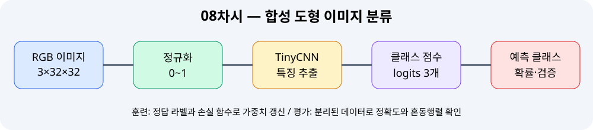

# 📘 08차시 — 이미지 분류와 CNN 모델 학습

> 자율주행 자동차 로봇을 활용한 피지컬 AI · 2일차 10:00–11:00 · 필수 실습 60분 / 선택 심화 별도
>
> **검증 범위:** 합성 도형 기반 PyTorch CPU 학습·자동 테스트. 실제 알티노 AI 카메라·Jetson·로봇 구동은 미검증.

## 01. 차시 개요 및 60분 운영

이번 차시는 07차시에서 배운 학습 루프를 **이미지 입력**으로 확장한다. 도형을 그린 RGB 이미지로 원·사각형·삼각형을 구분하는 작은 CNN(Convolutional Neural Network, 합성곱 신경망)을 만든다. 도로 영상의 신호등·표지판을 곧바로 인식하는 것이 아니라 **이미지 분류의 기본 개념을 재현**하는 실습이다.

| 구간 | 필수 작업 | 확인 결과 |
|---|---|---|
| 0~10분 | 이미지 분류·정답·데이터 누수 이해 | 입력/라벨 표 |
| 10~20분 | 합성 이미지 생성·훈련/평가 분리 | 클래스별 표본 수 |
| 20~40분 | CNN 학습·손실 관찰 | epoch 로그 |
| 40~50분 | 예측·정확도·혼동행렬 | metrics.json |
| 50~60분 | 자동 테스트·오류 점검 | 11개 테스트 |

**선택 심화:** 이미지 회전·밝기 변화·클래스 불균형 실험은 필수 60분 이후에 수행한다. 실제 알티노 AI의 카메라, Jetson GPU, 제조사 API는 이 실습에서 사용하지 않는다.

## 02. 자율주행 시스템에서 이미지 분류의 위치

카메라가 생성하는 영상은 보통 높이×너비×채널의 배열이다. 전처리 단계에서 모델이 기대하는 입력 크기와 색 순서를 맞춘다. 분류기는 **이미지 전체가 어떤 클래스에 속하는지** 점수를 출력한다. 하나의 영상에 여러 객체가 있는 경우 위치를 찾는 객체 검출과는 다르다.



| 단계 | 입력 | 출력 | 주의점 |
|---|---|---|---|
| 카메라/이미지 | RGB 픽셀 | 이미지 배열 | BGR/RGB 혼동 방지 |
| 정규화 | 0~255 | 0.0~1.0 | 훈련/추론 동일 적용 |
| CNN | 3×32×32 | 클래스 점수 3개 | 점수는 확률이 아님 |
| Softmax | 클래스 점수 | 합계 1인 값 | 높은 확률도 정답 보장 아님 |
| 검증 | 예측·정답 | 정확도·혼동행렬 | 실제 환경 성능과 구별 |

**제어 분리:** 모델의 예측값을 직접 모터 명령으로 보내지 않는다. 실제 로봇에서는 별도의 안전 감시와 상태 판단 계층이 필요하다.

## 03. 분류·검출·분할의 차이

이미지 분류는 **무엇이 있는가**, 객체 검출은 **무엇이 어디에 있는가**, 인스턴스 분할은 **객체별 픽셀은 어디인가**를 묻는다. 본 차시의 32×32 이미지에는 의도적으로 하나의 도형만 배치한다. 이 가정이 깨지면 분류 결과를 물체의 위치 정보로 해석할 수 없다.

| 구분 | 대표 출력 | 활용 예시 | 후속 차시 |
|---|---|---|---|
| 분류 | `triangle` | 잘라낸 표지판 종류 분류 | 08 |
| 검출 | 라벨+경계 상자 | 영상 속 표지판 위치 | 09 |
| 인스턴스 분할 | 라벨+개별 마스크 | 겹친 객체별 영역 | 10 |

실제 교통신호등의 색상과 모양은 조명, 반사, 날씨, 카메라 노출에 영향을 받는다. 합성 도형 실습 결과를 실차 신호등 인식 정확도로 표시하지 않는다.

## 04. 데이터셋과 라벨의 의미

지도학습에는 입력 이미지 `x`와 정답 라벨 `y`가 한 쌍으로 필요하다. 이번 실습은 `circle → 0`, `square → 1`, `triangle → 2`를 사용한다. 클래스 인덱스는 물리적 의미가 아니라 코드가 정한 정수 표기다.

**합성 데이터 생성 규칙:** 32×32 RGB 이미지, 어두운 배경, 밝은 도형, ±3픽셀 위치 변화, 7~10픽셀 반경·반폭, 색상 밝기 변화. 각 클래스당 40개로 전체 120개를 생성한다. 원본 도형의 위치·크기 변화가 훈련에 반영되지만 실제 도로 사진의 다양성을 대표하지는 않는다.

| 클래스 | 정답 | 생성 함수 | 주의 사항 |
|---|---:|---|---|
| 원 | 0 | `draw.ellipse()` | 픽셀화로 경계가 매끄럽지 않음 |
| 사각형 | 1 | `draw.rectangle()` | 직사각형이 아니라 정사각형에 가까운 표본 |
| 삼각형 | 2 | `draw.polygon()` | 꼭짓점이 위를 향하도록 고정 |

**데이터 누수:** 동일한 원본을 복제·증강하여 훈련/평가 양쪽에 넣으면 평가가 부풀려질 수 있다. 실제 이미지 데이터에서는 원본 이미지 또는 촬영 장면·주행 구간 단위로 분리해야 한다.

## 05. 이미지 배열과 텐서 차원

PIL 이미지의 배열은 `(H,W,C)` 순서이지만 PyTorch의 `Conv2d`는 `(N,C,H,W)` 순서다. `N`은 배치 크기, `C`는 색 채널, `H`와 `W`는 높이와 너비다.

```python
arr = np.asarray(im, dtype=np.float32) / 255.0
chw = np.transpose(arr, (2, 0, 1))  # HWC → CHW
```

이 예제에서 한 장의 배열은 `(3,32,32)`, 120장을 쌓으면 `(120,3,32,32)`가 된다. `float32`를 쓰면 모델 가중치와 입력 자료형을 맞추기 쉽다. 픽셀 0은 검정, 1에 가까운 값은 높은 밝기다. 단, 정규화는 실제 영상의 색 보정이나 조도 변화 문제를 모두 해결하지 못한다.

**실습 확인:** `dataset(40)` 호출 후 `x.shape`, `x.min()`, `x.max()`, `y.unique(return_counts=True)`를 출력한다. 채널 순서가 틀리면 합성곱 층에서 채널 수 불일치 오류가 발생한다.

## 06. CNN 구조와 계산 흐름

이번 모델의 흐름은 `Conv2d(3→8) → ReLU → MaxPool2d(2) → Conv2d(8→16) → ReLU → AdaptiveAvgPool2d(4×4) → Flatten → Linear(256→3)`이다.

| 층 | 출력 형상(배치 제외) | 역할 |
|---|---|---|
| 입력 | 3×32×32 | RGB 원본 |
| Conv 3→8 | 8×32×32 | 8개 특징맵 |
| MaxPool | 8×16×16 | 공간 해상도 축소 |
| Conv 8→16 | 16×16×16 | 특징 결합 |
| AdaptiveAvgPool | 16×4×4 | 고정 크기로 요약 |
| Flatten | 256 | 1차원 특징 벡터 |
| Linear | 3 | 세 클래스 점수 |

**합성곱의 의미:** 작은 커널이 주변 픽셀과 가중치 곱셈·합산을 반복해 경계와 모양 관련 특징을 만든다. `ReLU`는 음수 출력을 0으로 바꾸어 비선형성을 추가한다. 풀링은 특징맵을 줄여 계산량을 낮추지만 세밀한 위치 정보도 줄인다. 모델의 크기가 작다고 해서 실제 도로 영상에서도 안정적이라는 의미는 아니다.

## 07. 손실 함수와 학습 루프

모델은 세 개의 실수 점수(logits)를 출력한다. `CrossEntropyLoss`는 이 점수와 정수 라벨을 입력받아 정답 클래스에 높은 점수를 주도록 학습한다. 따라서 학습 전에 logits에 Softmax를 별도로 적용하지 않는다.

```python
optimizer.zero_grad()             # 이전 미분값 초기화
loss = loss_fn(model(x[tr]), y[tr])
loss.backward()                   # 역전파로 기울기 계산
optimizer.step()                  # 가중치 갱신
```

손실이 감소해도 반드시 평가 정확도가 증가하는 것은 아니다. 모델이 훈련 데이터의 특정 배경이나 위치를 암기할 수 있기 때문이다. 학습률 `0.006`, 학습 횟수 `50 epoch`는 작은 합성 데이터의 교육용 설정이다. 다른 CPU·PyTorch 버전에서는 수치가 달라질 수 있다.

**확인 질문:** `optimizer.zero_grad()`를 생략하면 어떤 문제가 생기는가? 기본적으로 이전 단계의 기울기가 누적되므로 의도하지 않은 갱신이 발생할 수 있다.

## 08. 훈련 데이터와 평가 데이터 분리

`split_indices()`는 클래스별로 표본을 섞고 80%를 훈련에, 20%를 평가에 배정한다. 전체 120개 기준 훈련 96개, 평가 24개이며 각 클래스 평가 표본은 8개다.

```python
tr, te = split_indices(y)
assert set(tr).isdisjoint(te)
print(len(tr), len(te))  # 96 24
```

**왜 클래스별 분리인가?** 우연히 한 클래스가 평가에 거의 들어가지 않는 문제를 줄이기 위해서다. 여기서는 도형 생성 시드가 표본별로 다르다. 실제 데이터에서는 시드가 다르다는 사실만으로 장면 독립성이 보장되지는 않는다. 같은 촬영 구간의 연속 프레임은 비슷하므로 촬영 구간 단위 분리가 필요하다.

**검증 범위:** 평가셋은 학습 가중치 갱신에 사용하지 않는다. 다만 반복적으로 평가 결과를 보며 모델 구조를 조정하면 평가셋에 간접 과적합할 수 있으므로 최종 별도 테스트셋이 바람직하다.

## 09. 실습 1 — 파일 생성 및 실행 환경

**준비물:** Python 3, NumPy, Pillow, PyTorch. 이 차시는 웹캠·라이다·로봇 본체 없이 실행할 수 있다. 기존 07차시 가상환경이 있다면 재사용한다.

```bash
python -m venv .venv                 # 독립 가상환경 생성
source .venv/bin/activate          # Ubuntu 가상환경 활성화
python -m pip install numpy pillow torch  # 필수 패키지 설치
python codes/ch08/image_classifier_lab.py --out outputs/ch08
```

`pip` 설치 시 PyTorch는 CPU 또는 GPU 배포 환경에 따라 공식 설치 명령이 다르다. Jetson의 패키지 설치는 일반 PC의 pip 명령을 무조건 적용하지 말고 NVIDIA 공식 호환 정보를 확인해야 한다. 파일이 없다면 제공 패키지의 `codes/ch08/image_classifier_lab.py`를 먼저 배치한다.

**실행 확인:** `epoch 01 loss=...`부터 `epoch 50 loss=...`까지 표시되고 `outputs/ch08/metrics.json`, `tinycnn_weights.pt`, `sample_circle.png`가 생성되어야 한다.

## 10. 실습 2 — 합성 이미지 생성과 라벨 확인

`make_image(label, seed)`는 같은 `label`과 `seed`에 대해 동일한 도형 이미지를 생성한다. 실제 데이터셋 다운로드가 필요 없으므로 네트워크 없이 재현할 수 있다.

```python
from image_classifier_lab import make_image, dataset
im = make_image(0, seed=2026)
im.save('circle_example.png')
x, y = dataset(n_per_class=40)
print(x.shape, y.shape)
```

**예상 결과:** `torch.Size([120, 3, 32, 32]) torch.Size([120])`. 이미지 파일을 열어 원 모양이 보이는지 확인한다. `seed`를 바꾸면 위치·크기·색이 달라지지만 클래스가 원이라는 점은 유지된다.

**오류 점검:** Pillow가 설치되지 않으면 `ModuleNotFoundError: No module named 'PIL'`이 발생한다. `python -m pip install pillow`로 현재 실행 환경에 설치한다. 실행 위치가 다르면 저장 파일의 상대경로도 달라지므로 출력 디렉터리를 명시하는 편이 안전하다.

## 11. 실습 3 — 학습·저장·결과 해석

아래 명령으로 학습한다. 전체 코드는 별도 파일로 제공하며, 교재 끝의 부록에도 빠짐없이 수록한다.

```bash
python codes/ch08/image_classifier_lab.py --out outputs/ch08 --epochs 50
```

**주요 출력:** 훈련 96개, 평가 24개, 클래스 3종, 평가 정확도, 3×3 혼동행렬. 정확도는 환경에 따라 달라지므로 특정 수치를 합격 기준으로 고정하지 않는다.

| 출력 파일 | 목적 | 확인 방법 |
|---|---|---|
| `tinycnn_weights.pt` | 학습 가중치 저장 | 파일 존재 확인 |
| `metrics.json` | 평가 지표 저장 | 정확도·혼동행렬 확인 |
| `sample_circle.png` | 샘플 이미지 | 도형과 배경 확인 |

**주의:** `torch.save(model.state_dict())`는 모델 구조 자체를 저장하지 않는다. 다시 읽을 때 같은 `TinyCNN` 클래스를 먼저 생성하고 `load_state_dict`를 호출해야 한다. 출처가 불명확한 모델 파일을 무조건 로드하지 않는다.

## 12. 실습 4 — 예측과 Softmax

모델의 `argmax(dim=1)`은 가장 큰 클래스 점수의 인덱스를 반환한다. `torch.softmax(logits, dim=1)`은 클래스별 값을 합계 1인 형태로 변환한다.

```python
model.eval()
with torch.no_grad():
    logits = model(x[te])
    pred = logits.argmax(dim=1)
    probs = torch.softmax(logits, dim=1)
```

`model.eval()`은 평가 모드로 전환한다. 이 모델에는 Dropout이나 BatchNorm이 없지만, 다른 모델에서는 평가 모드가 결과에 직접 영향을 줄 수 있다. `torch.no_grad()`는 평가 중 불필요한 기울기 추적을 방지한다.

**확률 해석의 함정:** Softmax 값 0.99가 곧 실제 환경에서 99%의 정답 확률이라는 뜻은 아니다. 학습 데이터가 단순하거나 분포가 달라지면 과신할 수 있다. 실제 차량 제어에는 신뢰도 보정, 미확인 클래스 처리, 안전 규칙 등이 필요하다.

## 13. 실습 5 — 정확도와 혼동행렬

정확도는 `맞힌 표본 수 / 전체 평가 표본 수`이다. 혼동행렬은 **행이 실제 클래스, 열이 예측 클래스**다. 예를 들어 실제 삼각형 8개 중 6개를 삼각형으로 맞히고 2개를 사각형으로 분류했다면 삼각형 행의 대각선 값은 6, 사각형 열 값은 2가 된다.

```python
acc = (pred == y[te]).float().mean().item()
cm = confusion_matrix(y[te].tolist(), pred.tolist())
print('accuracy:', round(acc, 4))
print(cm)
```

| 지표 | 의미 | 한계 |
|---|---|---|
| Accuracy | 전체 정답 비율 | 클래스 불균형에 취약 |
| Precision | 해당 클래스로 예측한 것 중 정답 비율 | 미검출을 직접 나타내지 않음 |
| Recall | 실제 해당 클래스 중 맞힌 비율 | 오검출을 직접 나타내지 않음 |
| Confusion Matrix | 어떤 클래스를 서로 혼동하는지 | 표본 수가 적으면 불안정 |

**실습 확인:** 혼동행렬 전체 합은 평가 데이터 24개와 같아야 한다. 클래스별 8개씩 평가했다면 각 행 합은 8이다.

## 14. 실습 6 — 자동 테스트와 재현성

자동 테스트는 이미지 생성, 데이터 차원, 픽셀 범위, 클래스별 분할, 모델 출력 차원, 혼동행렬 계산, 저장 파일 생성 등을 확인한다.

```bash
python -m unittest discover -s codes/ch08 -p 'test_*.py' -v
```

**재현성:** `torch.manual_seed(42)`와 `np.random.seed(42)`는 무작위 요소를 일부 고정한다. 그러나 모든 장비·라이브러리 버전에서 비트 단위 동일한 결과를 보장하지는 않는다. 본 실습은 CPU 환경에서 검증하며, Jetson GPU의 성능과 결과를 대신하지 않는다.

**실습 변형:** `--epochs 1`과 `--epochs 50`의 결과를 비교한다. 학습 횟수가 늘어도 반드시 평가 성능이 단조 증가하지 않는다는 점을 확인한다.

## 15. 실습 7 — 오류 진단과 수정

| 증상 | 원인 후보 | 조치 |
|---|---|---|
| `No module named torch` | 다른 Python 환경 사용 | 활성화 환경과 `python -m pip` 확인 |
| `Expected 3 channels` | HWC/CHW 순서 혼동 | `(N,3,32,32)` 확인 |
| `target out of bounds` | 라벨이 0~2 밖 | 클래스 인덱스 확인 |
| loss가 NaN | 비정상 값·학습률 | 입력 범위·학습률 점검 |
| 정확도 저하 | 초기화·데이터·학습 부족 | 데이터 분포·학습 곡선 점검 |
| 파일이 보이지 않음 | 실행 경로가 다름 | `--out` 절대/상대경로 확인 |
| 이미지 색이 이상함 | RGB/BGR 혼동 | OpenCV 변환 여부 확인 |

**오류 해결 순서:** 입력 shape → dtype → 값 범위 → 라벨 범위 → 손실 값 → 예측 분포 → 평가 데이터 분리 순서로 확인한다. 오류 메시지를 무작정 숨기거나 예외를 전부 무시하지 않는다.

## 16. 종합 실습 — 분류 결과를 안전하게 활용하기

**과제:** 합성 도형 이미지 120개를 생성하고 CNN으로 분류한 뒤 `metrics.json`을 읽어 클래스별 오분류를 정리한다. 이 결과를 09차시 객체 검출과 연결한다.

**제출물:** 실행 명령, 학습 로그, 이미지 1개, `metrics.json`, 혼동행렬 해석 3문장, 자동 테스트 결과.

**판정 기준:** (1) 입력과 라벨 구조 설명 가능, (2) 훈련/평가 데이터 분리, (3) 코드 실행 및 출력 파일 생성, (4) 혼동행렬 합계 확인, (5) 합성 데이터의 한계 설명. 정확도 100%를 필수 통과 기준으로 사용하지 않는다.

**선택 심화:** 배경색·노이즈·회전·가림을 추가하여 성능 변화를 비교한다. 단, 평가용 이미지를 보며 반복 조정한 경우 별도 최종 테스트 데이터를 마련한다. 로봇 실제 주행 제어는 수행하지 않는다.

## 17. 안전·윤리·적용 한계

합성 도형의 분류 성능은 실제 도로 표지판, 보행자, 차량, 신호등의 검출 성능을 대변하지 않는다. 도형은 단일 객체·균일 배경·제한된 변화만 포함한다. 실제 도로에는 역광·야간·눈비·움직임 흐림·가림·거리 변화가 존재한다.

모델 출력은 관측 자료의 하나이며, 실제 로봇에 적용하려면 (1) 센서 상태 진단, (2) 오인식 처리, (3) 속도 제한, (4) 비상 정지, (5) 시험장 안전 구획, (6) 운영자 감독이 필요하다. 제조사 SDK의 실제 제어 API는 확인되지 않았으므로 본 교재는 모터·조향 명령을 포함하지 않는다.

학습 이미지의 라이선스와 개인정보도 점검한다. 이 차시의 합성 도형은 프로그램으로 직접 생성하므로 외부 인물 사진을 사용하지 않는다.

## 18. 핵심 정리 및 다음 차시

1. 이미지 분류는 전체 이미지에 하나의 클래스 점수를 부여한다.
2. RGB 이미지 배열을 `(N,C,H,W)`로 정리해야 CNN 입력과 맞는다.
3. 학습에는 정답 라벨과 손실 함수, 역전파가 필요하다.
4. 훈련 데이터와 평가 데이터는 분리해야 한다.
5. 정확도만 보지 말고 혼동행렬로 오분류 방향을 분석한다.
6. 높은 합성 데이터 정확도는 실제 도로에서의 안전 성능이 아니다.

**09차시 연결:** 한 이미지 안에 객체가 여러 개 나타나면 분류만으로 위치를 알 수 없다. 다음 차시에서는 경계 상자와 클래스 라벨을 함께 출력하는 객체 검출을 다룬다.

## 19. 공식 참고문헌 및 버전 확인

- [PyTorch — CrossEntropyLoss](https://docs.pytorch.org/docs/stable/generated/torch.nn.CrossEntropyLoss.html): 원시 logits와 정수 라벨을 사용하는 손실 함수.
- [PyTorch — Conv2d](https://docs.pytorch.org/docs/stable/generated/torch.nn.Conv2d.html): 합성곱 입력·출력 형상과 인자.
- [PyTorch — Saving and Loading Models](https://docs.pytorch.org/tutorials/beginner/saving_loading_models.html): `state_dict` 저장·복원 방식.
- [NumPy — transpose](https://numpy.org/doc/stable/reference/generated/numpy.transpose.html): 배열 축 순서 변경.
- [Pillow — ImageDraw](https://pillow.readthedocs.io/en/stable/reference/ImageDraw.html): 합성 도형 그리기.
- [Python — unittest](https://docs.python.org/3/library/unittest.html): 자동 테스트.
- [NVIDIA Jetson Developer Guide](https://docs.nvidia.com/jetson/): Jetson 설치 및 지원 환경 확인 출발점.

**검증 범위:** 공식 API의 일반적 사용법을 기준으로 코드를 작성했으며, 제조사 알티노 AI SDK·Jetson 하드웨어 호환성은 미검증이다. 링크와 문서 내용은 실제 교재 배포 시 다시 확인한다.

## 20. 부록 A — 전체 Python 실행 코드

아래는 제공되는 `codes/ch08/image_classifier_lab.py`의 전체 소스다. 실행 전 파일명과 작업 디렉터리를 확인한다.

```python
"""08차시: 외부 데이터 없이 합성 도형 3종을 학습하는 이미지 분류."""
from pathlib import Path
import argparse, json, random
import numpy as np
import torch
from torch import nn
from PIL import Image, ImageDraw

LABELS = ('circle', 'square', 'triangle')

def make_image(label, seed, size=32):
    """각 클래스의 위치·크기·밝기를 달리한 RGB 합성 이미지를 생성한다."""
    rng = random.Random(seed)
    im = Image.new('RGB', (size, size), (18, 23, 31))
    draw = ImageDraw.Draw(im)
    offset_x, offset_y = rng.randint(-3, 3), rng.randint(-3, 3)
    half = rng.randint(7, 10)
    cx, cy = size//2+offset_x, size//2+offset_y
    color = (rng.randint(170,255), rng.randint(160,245), rng.randint(150,235))
    if label == 0:
        draw.ellipse((cx-half, cy-half, cx+half, cy+half), fill=color)
    elif label == 1:
        draw.rectangle((cx-half, cy-half, cx+half, cy+half), fill=color)
    elif label == 2:
        draw.polygon([(cx,cy-half),(cx-half,cy+half),(cx+half,cy+half)],fill=color)
    else:
        raise ValueError('label must be 0, 1 or 2')
    return im

def dataset(n_per_class=40, seed=2026):
    """학습/평가를 분리하기 전에 서로 다른 시드로 표본을 만든다."""
    images, labels = [], []
    for cls in range(3):
        for i in range(n_per_class):
            im = make_image(cls, seed+cls*10000+i)
            a = np.asarray(im, dtype=np.float32) / 255.0
            images.append(np.transpose(a, (2,0,1)))
            labels.append(cls)
    return torch.tensor(np.stack(images)), torch.tensor(labels, dtype=torch.long)

class TinyCNN(nn.Module):
    """3x32x32 → 특징맵 → 3개 클래스 점수(logits)."""
    def __init__(self):
        super().__init__()
        self.features = nn.Sequential(nn.Conv2d(3,8,3,padding=1),nn.ReLU(),
            nn.MaxPool2d(2),nn.Conv2d(8,16,3,padding=1),nn.ReLU(),
            nn.AdaptiveAvgPool2d((4,4)))
        self.classifier = nn.Linear(16*4*4, 3)
    def forward(self,x):
        return self.classifier(torch.flatten(self.features(x),1))

def split_indices(labels, train_ratio=0.8, seed=77):
    """각 클래스별 80:20 분리. 동일 원본의 증강본이 양쪽에 들어가지 않도록 설계."""
    g=torch.Generator().manual_seed(seed)
    train, test=[],[]
    for c in range(3):
        ids=torch.where(labels==c)[0]
        ids=ids[torch.randperm(len(ids),generator=g)].tolist()
        cut=int(len(ids)*train_ratio)
        train.extend(ids[:cut]); test.extend(ids[cut:])
    return train,test

def confusion_matrix(y_true,y_pred,n=3):
    """행은 실제 클래스, 열은 예측 클래스."""
    m=np.zeros((n,n),dtype=int)
    for t,p in zip(y_true,y_pred): m[int(t),int(p)]+=1
    return m

def train_demo(out_dir, epochs=50, n_per_class=40):
    torch.manual_seed(42); np.random.seed(42)
    torch.set_num_threads(1)
    x,y=dataset(n_per_class=n_per_class)
    tr,te=split_indices(y)
    model=TinyCNN(); optimizer=torch.optim.Adam(model.parameters(),lr=0.006)
    loss_fn=nn.CrossEntropyLoss()
    for epoch in range(epochs):
        model.train(); optimizer.zero_grad()
        loss=loss_fn(model(x[tr]),y[tr]);loss.backward();optimizer.step()
        print(f'epoch {epoch+1:02d} loss={loss.item():.4f}')
    model.eval()
    with torch.no_grad():
        logits=model(x[te]);pred=logits.argmax(1)
        acc=(pred==y[te]).float().mean().item()
        cm=confusion_matrix(y[te].tolist(),pred.tolist())
        probs=torch.softmax(logits,dim=1)
    out=Path(out_dir);out.mkdir(parents=True,exist_ok=True)
    torch.save(model.state_dict(),out/'tinycnn_weights.pt')
    Image.fromarray((x[0].permute(1,2,0).numpy()*255).astype('uint8')).resize((256,256)).save(out/'sample_circle.png')
    report={'classes':list(LABELS),'train_count':len(tr),'test_count':len(te),
        'accuracy':round(acc,4),'confusion_matrix':cm.tolist(),
        'first_prediction':LABELS[int(pred[0])],
        'first_confidence':round(float(probs[0].max()),4),
        'note':'합성 도형 평가 정확도이며 실제 도로 객체 성능이 아님'}
    (out/'metrics.json').write_text(json.dumps(report,ensure_ascii=False,indent=2),encoding='utf-8')
    print(json.dumps(report,ensure_ascii=False,indent=2))
    return report

if __name__=='__main__':
    parser=argparse.ArgumentParser()
    parser.add_argument('--out',default='outputs/ch08')
    parser.add_argument('--epochs',type=int,default=50)
    args=parser.parse_args()
    train_demo(args.out,epochs=args.epochs)
```

## 21. 부록 B — 전체 자동 테스트 코드

아래는 `codes/ch08/test_image_classifier_lab.py`의 전체 코드다. 11개 테스트로 데이터·모델·출력을 점검한다.

```python
import unittest
import torch
from image_classifier_lab import LABELS, make_image, dataset, TinyCNN, split_indices, confusion_matrix, train_demo
from tempfile import TemporaryDirectory
from pathlib import Path

class TestImageClassification(unittest.TestCase):
    def test_classes(self): self.assertEqual(len(LABELS),3)
    def test_image_size(self): self.assertEqual(make_image(0,1).size,(32,32))
    def test_invalid_label(self):
        with self.assertRaises(ValueError): make_image(9,1)
    def test_dataset_shape(self):
        x,y=dataset(5);self.assertEqual(tuple(x.shape),(15,3,32,32));self.assertEqual(tuple(y.shape),(15,))
    def test_value_range(self):
        x,_=dataset(2);self.assertGreaterEqual(x.min().item(),0);self.assertLessEqual(x.max().item(),1)
    def test_model_shape(self): self.assertEqual(tuple(TinyCNN()(torch.zeros(2,3,32,32)).shape),(2,3))
    def test_split_disjoint(self):
        _,y=dataset(10);tr,te=split_indices(y);self.assertEqual(len(tr),24);self.assertEqual(len(te),6);self.assertFalse(set(tr)&set(te))
    def test_split_stratified(self):
        _,y=dataset(10);tr,te=split_indices(y);self.assertEqual([int((y[te]==i).sum()) for i in range(3)],[2,2,2])
    def test_confusion(self): self.assertEqual(confusion_matrix([0,1,2],[0,2,2]).tolist(),[[1,0,0],[0,0,1],[0,0,1]])
    def test_deterministic_images(self): self.assertEqual(make_image(0,1).tobytes(),make_image(0,1).tobytes())
    def test_train_outputs(self):
        with TemporaryDirectory() as d:
            r=train_demo(d,epochs=3,n_per_class=10)
            self.assertEqual(r['test_count'],6)
            self.assertTrue((Path(d)/'metrics.json').exists())
            self.assertTrue((Path(d)/'tinycnn_weights.pt').exists())
            self.assertTrue((Path(d)/'sample_circle.png').exists())
if __name__=='__main__': unittest.main()
```

## 22. 부록 C — 추가 실험 기록표

아래 표를 복사해 학습 실험을 기록한다. 학습 횟수와 데이터 수가 다르면 평가셋 크기와 성능 변동도 함께 기록한다.

| 실험 | epoch | 클래스당 이미지 | 평가 개수 | Accuracy | 관찰 |
|---|---:|---:|---:|---:|---|
| 기본 | 50 | 40 | 24 | 실행값 기입 | 기본 기준 |
| 실험 A | 1 | 40 | 24 | 실행값 기입 | 과소학습 확인 |
| 실험 B | 20 | 40 | 24 | 실행값 기입 | 학습 횟수 영향 |
| 실험 C | 50 | 10 | 6 | 실행값 기입 | 표본 수 영향 |

**분석 질문:** 정확도가 동일해도 혼동행렬이 달라질 수 있는가? 그렇다. 같은 정답 개수라도 어떤 클래스를 틀렸는지에 따라 혼동행렬은 달라진다. 실제 자율주행 시스템에서는 위험한 클래스를 놓치는 비용이 서로 다를 수 있으므로 정확도 하나로 평가하지 않는다.

