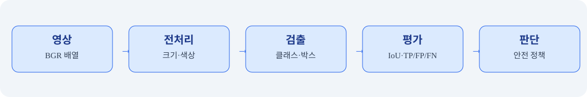
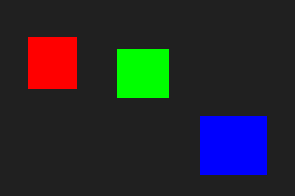
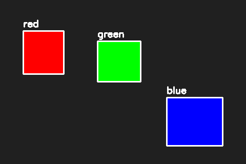
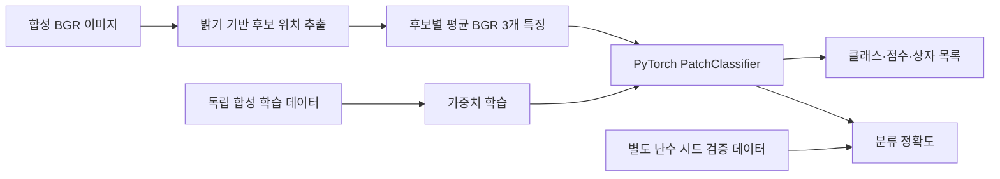

# 📘 09차시 — 객체 검출과 AI 모델 이해

> 자율주행 자동차 로봇을 활용한 피지컬 AI · 2일차 · 필수 실습 60분 / 선택 심화 별도

> **검증 범위:** 합성 이미지 기반 색상 검출 기준선·13개 자동 테스트. 신경망 학습·실물 알티노 AI 제어는 미검증.


## 01. 차시 개요와 60분 운영

이번 차시는 08차시의 이미지 전체 분류를 확장해 한 장면에서 **여러 객체의 위치와 종류**를 함께 찾는 객체 검출(Object Detection, 오브젝트 디텍션·객체 위치 탐지)을 다룬다. 실제 도로 영상의 신호등이나 보행자 인식 성능을 주장하지 않으며, 인공적으로 만든 도형 장면에서 검출 원리·좌표·평가 방법을 재현한다. 기본 실습은 제조사 SDK와 GPU 없이 실행할 수 있도록 구성했다.

| 시간 | 필수 활동 | 산출물 |
|---|---|---|
| 0~10분 | 분류와 검출 차이, 바운딩 박스 이해 | 좌표 도식 |
| 10~20분 | 합성 영상과 정답 박스 생성 | scene.png |
| 20~35분 | 색상 마스크·연결영역으로 객체 위치 탐지 | detections.png |
| 35~45분 | IoU·정밀도·재현율 계산 | results.json |
| 45~55분 | 자동 테스트·실패 사례 | 테스트 로그 |
| 55~60분 | 안전·오류 점검·다음 차시 연결 | 점검표 |

**선택 심화:** 조명 변화, 객체 겹침, 사전 학습 객체 검출 모델 적용은 60분 이후 수행한다. 이 실습의 색상 검출기는 AI 신경망이 아니며, 객체 검출 작업을 이해하기 위한 결정적 기준선이다.


## 02. 자율주행에서 객체 검출이 필요한 이유

차량 전방 영상에는 신호등, 표지판, 차량, 보행자, 장애물이 동시에 나타난다. 이미지 분류가 한 장의 대표 범주를 반환하는 데 비해 검출은 여러 개의 **클래스·위치·점수**를 반환한다. 차량 제어에서는 검출 결과를 바로 조향 명령으로 변환하지 않고 추적, 거리 추정, 위험 판단, 안전 감시를 별도 단계로 둔다.



| 계층 | 입력 | 출력 | 검증 관점 |
|---|---|---|---|
| 영상 획득 | 카메라 프레임 | BGR/RGB 배열 | 해상도·색 순서 |
| 전처리 | 원본 프레임 | 모델 입력 | 크기·정규화 |
| 검출 | 영상 | 클래스·박스·점수 | 오검출·누락 |
| 후처리 | 후보 박스 | 최종 객체 목록 | 중복 제거 |
| 판단 | 객체 목록·센서 | 안전 상태 | 미검출 시 안전 처리 |
| 구동 | 검증된 명령 | 모터 출력 | 긴급 정지 |

라이다의 거리 정보와 영상의 객체 위치는 좌표계가 다르므로 단순한 픽셀 위치만으로 실제 거리를 확정할 수 없다. 카메라 보정, 센서 시간 동기화, 외부 파라미터가 필요하다.


## 03. 객체 검출의 출력 형식과 좌표계

검출 결과는 보통 `{label, box, score}` 구조를 갖는다. `label`은 클래스 이름, `box`는 위치, `score`는 신경망 예측 신뢰도이다. 이번 기준선은 신경망 점수를 계산하지 않으므로 `score: null`로 저장한다. 임의의 0.99 점수를 넣어 AI 추론처럼 꾸미지 않는다.

박스는 `XYXY` 형식 `[x1, y1, x2, y2]`로 저장한다. 왼쪽 위가 `(0,0)`이고 오른쪽으로 x, 아래쪽으로 y가 증가한다. 좌상단 좌표는 포함하고 우하단 좌표는 제외하는 **반열린 구간**을 사용하므로 너비는 `x2-x1`, 높이는 `y2-y1`이다.

| 좌표 | 의미 | 예시 |
|---|---|---|
| x1, y1 | 왼쪽 위 | 45, 60 |
| x2, y2 | 오른쪽 아래 경계 | 125, 145 |
| 너비 | x2-x1 | 80px |
| 높이 | y2-y1 | 85px |
| 면적 | 너비×높이 | 6800px² |

정규화 좌표를 사용하는 모델은 이미지 폭과 높이로 나누어 0~1 범위로 나타낼 수 있다. 다른 라이브러리에서는 중심점과 너비·높이 형식을 사용하기도 하므로 인터페이스 경계에서 반드시 형식을 변환한다.


## 04. 검출 모델과 교육용 기준선 구분

YOLO(욜로, 한 번에 객체 위치와 클래스를 추론하는 계열)와 Faster R-CNN(패스터 알씨엔엔, 영역 제안 기반 객체 검출기)은 신경망으로 영상 특징을 학습한다. 이 과정의 09차시 기본 코드는 **색상 분리와 연결요소 분석**을 사용하므로 학습 데이터나 가중치 파일이 필요하지 않다. 이 차이를 명확히 해야 실습 성공을 AI 모델 검증으로 오해하지 않는다.

| 비교 | 색상 기반 기준선 | 학습 기반 검출 |
|---|---|---|
| 학습 | 필요 없음 | 대개 필요 |
| 입력 | BGR 이미지 | 모델 정의에 따른 이미지 텐서 |
| 객체 정의 | 미리 정한 색상 | 학습한 클래스 |
| 출력 점수 | 없음 | 모델 점수 |
| 실패 사례 | 색 변화·배경 혼동 | 도메인 이동·데이터 편향 |
| 장점 | 빠르고 해석 가능 | 복잡한 객체 인식 가능 |

신경망 모델을 적용할 때는 모델 출처, 라이선스, 가중치 버전, 입력 크기, 클래스 목록, 후처리 설정을 모두 기록해야 재현 가능하다.


## 05. 환경 구성과 파일 구조

Python 3, NumPy(넘파이, 배열 연산), OpenCV(오픈씨브이, 영상처리)를 사용한다. 예제는 실제 카메라를 열지 않으므로 PC의 운영체제에 관계없이 재현하기 쉽다. 명령은 프로젝트 루트에서 실행하는 기준이다.

```bash
python -m venv .venv             # 프로젝트 전용 가상환경 생성
source .venv/bin/activate       # Ubuntu에서 가상환경 활성화
python -m pip install numpy opencv-python-headless
python codes/ch09/object_detection_lab.py
python -m unittest discover -s codes/ch09 -p 'test_*.py' -v
```

Windows에서는 가상환경 활성화 명령이 다르다. 서버나 GUI 없는 환경에서는 `opencv-python-headless`가 적합하며, 같은 가상환경에 OpenCV GUI 패키지와 headless 패키지를 동시에 설치하지 않는다.

| 파일 | 역할 |
|---|---|
| object_detection_lab.py | 장면 생성·검출·평가·시각화 |
| test_object_detection_lab.py | 단위 테스트 13개 |
| output/scene.png | 합성 원본 |
| output/detections.png | 박스 시각화 |
| output/results.json | 정답·예측·평가 지표 |

예제는 장비 제어 코드와 분리되어 있으며 파일을 실행해도 모터에 명령을 보내지 않는다.


## 06. 합성 영상과 정답 박스 만들기

검출 성능을 평가하려면 예측과 별도로 작성된 **정답(ground truth, 그라운드 트루스·기준 라벨)**이 필요하다. 이번 장면에는 빨강·초록·파랑 사각형을 하나씩 배치한다. 정답은 색상 이름과 사각형 좌표의 목록이다.

```python
import numpy as np
import cv2

image = np.full((320, 480, 3), 32, dtype=np.uint8)
cv2.rectangle(image, (45, 60), (124, 144), (0, 0, 255), -1)
print(image.shape)  # (320, 480, 3)
```

OpenCV의 기본 색 순서는 BGR(비지알, 파랑·초록·빨강)이다. 따라서 `(0,0,255)`가 빨강이다. 마지막 인자 `-1`은 사각형 내부를 채운다는 뜻이다. `np.full`은 모든 픽셀을 일정한 어두운 값으로 초기화한다.

**코드 풀이:** `image.shape`는 높이 320, 너비 480, 채널 3을 나타낸다. 오른쪽 아래 경계는 125·145지만 `cv2.rectangle`에 넣는 마지막 픽셀 좌표는 124·144로 1을 뺀다. 이를 지키지 않으면 예측과 정답 면적에 한 픽셀 차이가 생긴다.




## 07. 색상 마스크와 연결영역 추출

색상 마스크는 각 픽셀이 목표 색상과 충분히 가까운지를 0 또는 1로 표시한다. RGB/BGR 채널 차이의 최대값이 허용 오차 이하인 경우만 선택한다. 실제 조명 변화가 심한 영상에는 단순한 채널 차이보다 HSV(에이치에스브이, 색상·채도·명도) 공간이나 학습 기반 검출기가 필요할 수 있다.

```python
color = np.array((0, 0, 255), dtype=np.int16)
delta = np.abs(image.astype(np.int16) - color)
mask = (np.max(delta, axis=2) <= 12).astype(np.uint8)
count, labels, stats, centers = cv2.connectedComponentsWithStats(mask, 8)
```

`uint8` 픽셀에서 직접 뺄셈하면 음수가 순환할 수 있으므로 부호 있는 `int16`으로 바꾼다. `axis=2`는 세 색 채널을 비교한다. 연결영역 분석은 서로 붙은 픽셀 묶음의 왼쪽 위 좌표, 폭, 높이, 면적을 반환한다. 인덱스 0은 배경이므로 제외한다.

작은 잡음은 최소 면적 `min_area`로 제거한다. 반대로 가까운 객체가 하나의 연결영역으로 붙으면 하나의 박스로 합쳐지는 한계가 있다. 따라서 이 결과는 실제 일반 객체 검출기가 아니다.


## 08. 검출 박스 표시와 결과 읽기

`detect_colors()`는 색상별 연결영역을 검사하여 박스 목록을 반환한다. `annotate()`는 원본을 복사한 뒤 검출 박스와 클래스 문자열을 표시한다. 원본을 보존하면 검출 결과와 시각화를 비교하기 쉽다.

```python
from object_detection_lab import make_scene, detect_colors, annotate
image, truth = make_scene()
found = detect_colors(image)
print([(x['label'], x['box']) for x in found])
preview = annotate(image, found)
```

**예상 출력:** `[('red', [45, 60, 125, 145]), ('green', [190, 80, 275, 160]), ('blue', [325, 190, 435, 285])]`. 이 출력은 고정된 합성 장면에서만 재현된다.



결과 영상에서 흰색 사각형은 검출된 위치를, 문자열은 사전에 지정한 색상 이름을 의미한다. 문자열은 신경망이 판단한 실제 물체 종류가 아니다. 이미지에 신호등 모양을 그려도 그것을 교통 신호의 의미로 해석하려면 추가 분류와 상태 판단이 필요하다.


## 09. IoU 계산과 일대일 매칭

IoU(아이오유, 교집합 면적을 합집합 면적으로 나눈 비율)는 예측 박스와 정답 박스가 얼마나 겹치는지 평가한다. `IoU = 교집합 / (예측 면적 + 정답 면적 - 교집합)`이다. 완전히 같으면 1, 전혀 겹치지 않으면 0이다.

```python
from object_detection_lab import iou
print(iou([0, 0, 10, 10], [5, 5, 15, 15]))
# 교집합 25 / 합집합 175 → 약 0.142857
```

같은 정답을 여러 예측 박스가 중복으로 맞혔다고 세면 정확도가 과장된다. 따라서 평가 시 이미 매칭된 정답은 재사용하지 않는 **일대일 매칭**을 적용한다. 이번 코드는 클래스가 같고 IoU가 0.5 이상인 예측을 참양성(TP)으로 인정한다. 다수 후보가 있는 경우 가장 높은 IoU를 우선 선택하는 단순한 그리디 평가이며, 대규모 벤치마크의 정식 mAP 평가 구현을 대체하지 않는다.

IoU 임계값을 0.75로 높이면 위치가 조금만 어긋나도 실패할 수 있다. 검출기의 비교에서는 반드시 사용한 IoU 임계값을 함께 표기한다.


## 10. 정밀도·재현율과 오검출 분석

정밀도(Precision, 프리시전·예측한 것 중 정답 비율)는 `TP/(TP+FP)`이고 재현율(Recall, 리콜·실제 정답 중 찾은 비율)은 `TP/(TP+FN)`이다. FP는 오검출, FN은 미검출이다. 객체가 하나도 없는 장면에서는 분모가 0일 수 있으므로 지표의 정의와 예외 처리 방식을 명시한다.

| 상황 | TP | FP | FN | 정밀도 | 재현율 |
|---|---:|---:|---:|---:|---:|
| 세 객체 모두 검출 | 3 | 0 | 0 | 1.00 | 1.00 |
| 2개 검출·1개 누락 | 2 | 0 | 1 | 1.00 | 0.67 |
| 2개 검출·오검출 1개 | 2 | 1 | 1 | 0.67 | 0.67 |

이번 합성 장면은 빨강·초록·파랑 세 객체가 모두 정확히 검출되어 `TP=3, FP=0, FN=0`이다. 이 값은 **고정된 합성 데이터 한 장의 결과**이지 실제 도로에서의 100% 성능이 아니다.

**실패 실험:** `min_area=100000`으로 설정하면 작은 영역이 모두 제외된다. 테스트에서는 검출 0개를 확인한다. 반대로 임계값을 지나치게 낮추면 노이즈가 검출될 수 있다.


## 11. 전체 실행 코드와 자동 테스트

아래는 복사 후 바로 실행 가능한 **전체 파일**이다. 코드에 있는 `make_scene`은 이미지 생성, `detect_colors`는 객체 위치 탐지, `iou`는 박스 겹침, `evaluate`는 평가, `annotate`는 결과 표시를 담당한다. 각 함수의 입력과 출력이 분리되어 있어 10차시 인스턴스 분할로 확장하기 쉽다.

```python
"""교육용 합성 이미지의 색상 기반 객체 검출. 실제 로봇 제어 없음."""
from pathlib import Path
import json
import cv2
import numpy as np

LABELS = {'red': (0, 0, 255), 'green': (0, 255, 0), 'blue': (255, 0, 0)}


def make_scene():
    """BGR 320x480 영상과 정답 바운딩 박스를 만든다."""
    image = np.full((320, 480, 3), 32, dtype=np.uint8)
    objects = [('red', (45, 60, 125, 145)), ('green', (190, 80, 275, 160)),
               ('blue', (325, 190, 435, 285))]
    for name, (x1, y1, x2, y2) in objects:
        cv2.rectangle(image, (x1, y1), (x2-1, y2-1), LABELS[name], -1)
    return image, [{'label': n, 'box': list(b)} for n, b in objects]


def detect_colors(image, min_area=200):
    """색상별 마스크→연결영역→좌표를 반환한다. AI 모델이 아님."""
    if image is None or image.ndim != 3 or image.shape[2] != 3:
        raise ValueError('BGR 3채널 이미지가 필요합니다')
    found = []
    for label, bgr in LABELS.items():
        color = np.array(bgr, dtype=np.int16)
        delta = np.abs(image.astype(np.int16) - color)
        mask = (np.max(delta, axis=2) <= 12).astype(np.uint8)
        count, _, stats, _ = cv2.connectedComponentsWithStats(mask, connectivity=8)
        for i in range(1, count):
            x, y, w, h, area = [int(v) for v in stats[i]]
            if area >= min_area:
                found.append({'label': label, 'box': [x, y, x+w, y+h],
                              'area': area, 'score': None})
    return sorted(found, key=lambda d: d['box'][0])


def iou(a, b):
    """두 XYXY 박스의 Intersection over Union 계산."""
    x1, y1 = max(a[0], b[0]), max(a[1], b[1])
    x2, y2 = min(a[2], b[2]), min(a[3], b[3])
    inter = max(0, x2-x1) * max(0, y2-y1)
    area_a = max(0, a[2]-a[0]) * max(0, a[3]-a[1])
    area_b = max(0, b[2]-b[0]) * max(0, b[3]-b[1])
    union = area_a + area_b - inter
    return inter / union if union else 0.0


def evaluate(predictions, ground_truth, threshold=0.5):
    """동일 클래스, IoU 임계값 기준 일대일 매칭."""
    matched = set()
    tp = 0
    for pred in predictions:
        candidates = [(iou(pred['box'], gt['box']), j) for j, gt in enumerate(ground_truth)
                      if j not in matched and pred['label'] == gt['label']]
        if candidates:
            overlap, idx = max(candidates)
            if overlap >= threshold:
                matched.add(idx)
                tp += 1
    fp = len(predictions)-tp
    fn = len(ground_truth)-tp
    return {'TP': tp, 'FP': fp, 'FN': fn,
            'precision': tp/(tp+fp) if tp+fp else 0.0,
            'recall': tp/(tp+fn) if tp+fn else 0.0}


def annotate(image, detections):
    result = image.copy()
    for obj in detections:
        x1, y1, x2, y2 = obj['box']
        cv2.rectangle(result, (x1, y1), (x2-1, y2-1), (255, 255, 255), 2)
        cv2.putText(result, obj['label'], (x1, max(20, y1-8)),
                    cv2.FONT_HERSHEY_SIMPLEX, .6, (255, 255, 255), 2)
    return result


def main():
    out = Path(__file__).resolve().parent / 'output'
    out.mkdir(exist_ok=True)
    image, truth = make_scene()
    predictions = detect_colors(image)
    metrics = evaluate(predictions, truth)
    cv2.imwrite(str(out/'scene.png'), image)
    cv2.imwrite(str(out/'detections.png'), annotate(image, predictions))
    (out/'results.json').write_text(json.dumps({'predictions': predictions,
          'truth': truth, 'metrics': metrics}, ensure_ascii=False, indent=2), encoding='utf-8')
    print(json.dumps(metrics, ensure_ascii=False))


if __name__ == '__main__':
    main()
```

자동 테스트는 영상 크기, 정답 수, 색상 순서, 박스 개수, IoU 경계값, 오검출·미검출, 잘못된 입력, 최소 면적 조건을 검증한다. 전체 테스트 파일도 패키지에 포함한다.

```python
import unittest
import numpy as np
from object_detection_lab import make_scene, detect_colors, iou, evaluate, annotate

class TestDetector(unittest.TestCase):
    def setUp(self):
        self.image, self.truth = make_scene()
    def test_shape(self): self.assertEqual(self.image.shape, (320, 480, 3))
    def test_ground_truth(self): self.assertEqual(len(self.truth), 3)
    def test_detection_count(self): self.assertEqual(len(detect_colors(self.image)), 3)
    def test_labels(self): self.assertEqual([x['label'] for x in detect_colors(self.image)], ['red', 'green', 'blue'])
    def test_exact_iou(self): self.assertEqual(iou([0,0,10,10], [0,0,10,10]), 1)
    def test_disjoint_iou(self): self.assertEqual(iou([0,0,10,10], [20,20,30,30]), 0)
    def test_zero_iou(self): self.assertEqual(iou([0,0,0,0], [0,0,0,0]), 0)
    def test_metrics(self): self.assertEqual(evaluate(detect_colors(self.image), self.truth)['TP'], 3)
    def test_false_positive(self): self.assertEqual(evaluate([{'label':'red','box':[0,0,10,10]}], self.truth)['FP'], 1)
    def test_false_negative(self): self.assertEqual(evaluate([], self.truth)['FN'], 3)
    def test_annotation(self): self.assertEqual(annotate(self.image, detect_colors(self.image)).shape, self.image.shape)
    def test_bad_input(self):
        with self.assertRaises(ValueError): detect_colors(np.zeros((3,3)))
    def test_min_area(self): self.assertEqual(len(detect_colors(self.image, 100000)), 0)

if __name__ == '__main__': unittest.main()
```

**실행 결과:** 13개 테스트 통과. 장비 제어 기능은 존재하지 않는다.


## 12. 종합 실습·오류 점검·후속 확장

**종합 실습:** 합성 장면을 생성하고 3개 색상 객체를 검출한 뒤, 결과 영상과 JSON 파일을 저장한다. 정답과 예측을 비교하여 IoU와 TP·FP·FN을 확인한다. 최종적으로 `output/scene.png`, `output/detections.png`, `output/results.json`의 존재와 내용을 점검한다.

| 오류 또는 위험 | 원인 | 확인 및 조치 |
|---|---|---|
| `ModuleNotFoundError: cv2` | OpenCV 미설치 | 활성 가상환경에서 pip 설치 |
| 이미지가 흑백으로 보임 | BGR/RGB 혼동 | 색 채널 순서 점검 |
| 박스 크기 1픽셀 차이 | 경계 포함 방식 혼동 | XYXY 반열린 구간 사용 |
| 객체가 검출되지 않음 | 색상·면적 임계값 부적합 | 마스크와 영역 크기 확인 |
| 한 객체가 여러 박스로 나뉨 | 색상 단절·잡음 | 전처리·형태학 연산 검토 |
| 실제 카메라 영상 오류 | 드라이버·권한·SDK 문제 | 제조사 문서 확인 후 별도 시험 |

**안전 원칙:** 모델이나 색상 검출 결과만으로 실물 로봇을 자동 구동하지 않는다. 실제 주행을 시도할 경우 저속·분리된 시험구역·긴급정지·관찰자를 확보하고 제조사 제어 명령을 검증해야 한다. 이번 장의 실물 카메라·라이다·모터 연결은 미검증이다.

**10차시 연결:** 객체 검출은 사각형 위치를 반환하지만 인스턴스 분할은 각 객체의 픽셀별 마스크를 반환한다. 다음 차시에서는 같은 합성 장면을 활용하여 바운딩 박스와 마스크의 차이를 비교한다.

**공식 참고자료:** [OpenCV 공식 문서](https://docs.opencv.org/4.x/), [NumPy 공식 문서](https://numpy.org/doc/stable/), [PyTorch 객체 검출 튜토리얼](https://docs.pytorch.org/tutorials/intermediate/torchvision_tutorial.html), [Python unittest 문서](https://docs.python.org/3/library/unittest.html). 링크는 교육용 공식 문서로, 제조사 알티노 AI SDK 검증을 대신하지 않는다.


## 13. 선택 심화 — AI 모델 학습을 객체 후보 분류에 실제 결합하기

필수 60분 실습의 `detect_colors()`는 색상 임계값으로 직접 클래스와 상자를 추출하는 규칙 기반 기준선이었다. 그 결과가 정확하더라도 가중치 학습을 수행한 객체 검출 인공지능은 아니다. 원본 과정 안내서의 **클래스 생성·AI 학습·모델 만들기** 항목과 연결하기 위해 별도의 PyTorch(파이토치, 딥러닝 프레임워크) 학습형 확장 예제를 제공한다. 다음의 실험은 **밝기 기준 후보 상자 생성 → 학습된 작은 신경망으로 후보 클래스 분류**를 결합한 하이브리드 구조다. YOLO나 Faster R-CNN과 같은 종단 간 학습형 객체 검출기를 구현했다고 주장하지 않는다.

### 13-1. 처리 구조와 데이터 흐름



학습 입력은 RGB가 아니라 **BGR 순서의 3차원 실수 벡터**이다. 프로그램에서는 합성 색상 자료를 학습용 난수 시드 29로 생성하고, 평가용 난수 시드 301로 별도 생성한다. 모델은 `Linear(3,16) → ReLU → Linear(16,4)`이며, 출력 4개는 배경·빨강·초록·파랑에 대한 로짓이다. 손실함수는 다중 클래스 교차 엔트로피를 사용한다. `Adam` 옵티마이저는 이 손실을 줄이도록 가중치를 갱신한다.

| 구분 | 기본 실습 | 선택 확장 |
|---|---|---|
| 상자 생성 | 색상별 마스크 | 밝기 연결요소 후보 |
| 클래스 판정 | 색상 임계값 | 학습된 신경망 |
| 가중치 학습 | 없음 | 합성 BGR 특징으로 수행 |
| 출력 점수 | `None` | 소프트맥스 분류 점수 |
| 한계 | 조명·색상 변화 | 후보 생성 실패·도메인 변화 |

### 13-2. 학습형 후보 분류 전체 Python 코드

파일: `codes/ch09/hybrid_learned_detector.py`. 기본 실습 코드 `object_detection_lab.py`의 `make_scene()`을 재사용한다. 이 실습은 별도의 딥러닝 패키지 설치가 필요하다. 모의 장면, 모델 클래스, 독립 데이터, 학습, 예측, JSON 저장의 전체 코드이다.

```python
"""09차시 선택 심화: 결정적 후보 박스 + PyTorch 학습형 색상 클래스 분류.
실제 객체 검출 신경망/YOLO가 아니며, 알티노 AI 제어 명령이 없다.
"""
import json
from pathlib import Path
import cv2
import numpy as np
import torch
from torch import nn
from object_detection_lab import make_scene, iou

NAMES = ('background', 'red', 'green', 'blue')


class PatchClassifier(nn.Module):
    """평균 BGR 세 수치를 입력받아 4개 클래스의 logit을 예측."""
    def __init__(self):
        super().__init__()
        self.network = nn.Sequential(nn.Linear(3, 16), nn.ReLU(), nn.Linear(16, 4))

    def forward(self, x):
        return self.network(x)


def make_training_set(seed=29, samples_per_class=80):
    """학습용 합성 BGR 특징. 고정 시연 장면과 별도로 생성한다."""
    rng = np.random.default_rng(seed)
    x, y = [], []
    for label in range(4):
        for _ in range(samples_per_class):
            feature = rng.uniform(0.05, 0.25, size=3)
            if label:
                feature[[2, 1, 0][label-1]] = rng.uniform(0.68, 1.0)  # BGR 우세 채널
            x.append(feature.astype('float32'))
            y.append(label)
    idx = rng.permutation(len(y))
    return torch.tensor(np.array(x)[idx]), torch.tensor(np.array(y, dtype='int64')[idx])


def train_model(epochs=120):
    """고정 난수와 독립 생성 평가 데이터 사용. GPU/인터넷 불필요."""
    torch.manual_seed(29)
    model = PatchClassifier()
    x, y = make_training_set(29)
    optimizer = torch.optim.Adam(model.parameters(), lr=0.06)
    for _ in range(epochs):
        optimizer.zero_grad()
        loss = nn.functional.cross_entropy(model(x), y)
        loss.backward()
        optimizer.step()
    model.eval()
    vx, vy = make_training_set(301, samples_per_class=20)
    with torch.no_grad():
        accuracy = (model(vx).argmax(dim=1) == vy).float().mean().item()
    return model, accuracy


def detect_hybrid(image, model, min_area=200):
    """밝기 마스크로 후보 박스, 학습 모델로 후보 색상 클래스를 추정한다."""
    if image is None or image.ndim != 3 or image.shape[2] != 3:
        raise ValueError('BGR 이미지가 필요합니다')
    foreground = (np.max(image, axis=2) > 150).astype('uint8')
    n, ids, stats, _ = cv2.connectedComponentsWithStats(foreground, 8)
    boxes = []
    with torch.no_grad():
        for k in range(1, n):
            left, top, width, height, area = [int(v) for v in stats[k]]
            if area < min_area:
                continue
            patch = image[top:top+height, left:left+width]
            mask = ids[top:top+height, left:left+width] == k
            feature = patch[mask].astype('float32').mean(axis=0) / 255.0
            probs = model(torch.tensor(feature)[None]).softmax(dim=1)[0]
            label = int(probs.argmax())
            if label != 0:
                boxes.append({'label': NAMES[label],
                              'box': [left, top, left+width, top+height],
                              'score': float(probs[label])})
    return sorted(boxes, key=lambda box: box['box'][0])


def run_demo():
    model, validation_acc = train_model()
    image, truth = make_scene()
    predictions = detect_hybrid(image, model)
    print('독립 합성 특징 검증 정확도:', f'{validation_acc:.1%}')
    print('학습형 클래스 분류가 결합된 후보:', [(d['label'],d['box']) for d in predictions])
    output = {'validation_accuracy': validation_acc,
              'predictions': predictions, 'ground_truth': truth}
    path = Path(__file__).parent/'output'/'hybrid_result.json'
    path.parent.mkdir(parents=True, exist_ok=True)
    path.write_text(json.dumps(output, ensure_ascii=False, indent=2), encoding='utf-8')
    return output


if __name__ == '__main__':
    run_demo()
```

**실행 명령:**

```bash
python codes/ch09/hybrid_learned_detector.py
python -m unittest discover -s codes/ch09 -p 'test_*.py' -v
```

검증된 합성 평가 자료의 클래스 정확도는 100%였고, 고정 시연 장면의 후보 3개는 `red`, `green`, `blue`로 분류되었다. 이는 충분히 단순하고 동일한 색 분포로 생성된 소규모 합성 자료에 한정된 결과다. **실제 신호등, 보행자, 차량 인식 정확도를 의미하지 않는다.** 데이터가 바뀌면 결과도 달라질 수 있으며, 평가 자료 자체가 소규모라는 한계가 있다.

### 13-3. 학습 결과를 검증할 때의 질문

1. 모델 학습에 사용하지 않은 데이터로 정확도를 구했는가? 현재 코드는 별도 난수 시드를 사용하지만 색상 생성 규칙 자체는 동일하다. 실제 조명 변화나 물체 모양의 분포 변화를 검증하지 않는다.
2. 소프트맥스 점수는 실제 물체일 확률인가? 아니다. 후보 영역의 신경망 출력 분포일 뿐이며 보정되지 않았다.
3. 같은 색상 물체가 겹쳐 하나의 후보 영역이 되면 어떻게 되는가? 후보 상자가 먼저 실패하므로 분류 모델이 이를 복구할 수 없다.
4. AI 객체 검출기로 확장하려면 무엇이 필요한가? 다중 객체 정답 박스와 클래스가 포함된 데이터셋, 사전 학습 모델 또는 검출 신경망, 검증 데이터, 추론 후처리, 실제 카메라 인터페이스가 필요하다.

### 13-4. 공식 기준과 후속 연결

학습형 객체 검출을 본격적으로 수행할 때는 [PyTorch TorchVision 객체 검출 미세조정 공식 가이드](https://docs.pytorch.org/tutorials/intermediate/torchvision_tutorial.html)의 데이터셋 인터페이스·박스 형식·학습 스크립트 개념을 참고한다. 이 가이드는 Mask R-CNN을 이용한 실제 신경망 검출 및 인스턴스 분할 학습 예제를 포함한다. 다만 본 차시의 하이브리드 실습은 그 모델을 다운로드·학습한 것이 아니다.

**10차시 연결:** 바운딩 박스는 객체 위치의 사각형만 나타낸다. 다음 차시는 각 객체가 차지하는 픽셀별 영역을 마스크로 만들고, 학습형 픽셀 분류와 개별 객체 인스턴스 구분의 관계까지 확장한다. 필수 실습 60분을 마친 경우에만 이 선택 실습을 진행한다.

