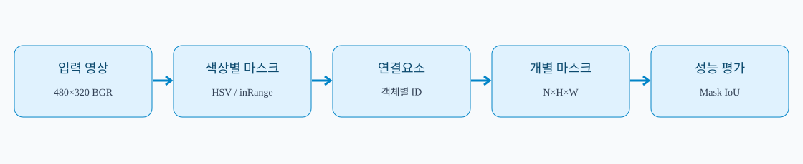
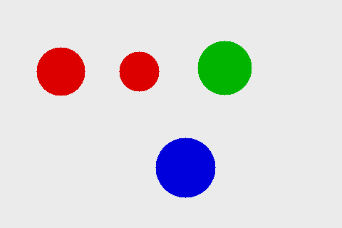
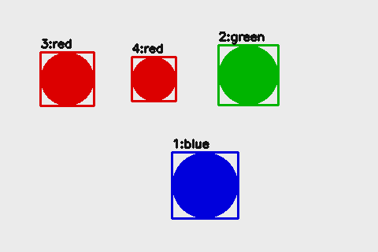

# 📘 10차시 — 인스턴스 분할과 객체별 마스크 분석

> 자율주행 자동차 로봇을 활용한 피지컬 AI · 필수 실습 60분 / 선택 심화 별도

> **검증 범위:** 합성 이미지·OpenCV 결정적 기준선·자동 테스트. 학습형 AI/실물 알티노 AI 미검증.

## 01. 차시 개요 및 운영 계획

08차시는 한 장의 이미지에 대표 클래스를 부여하는 분류, 09차시는 각 객체의 바운딩 박스를 구하는 검출을 다루었다. 10차시는 각 객체가 차지하는 **픽셀 집합**을 독립된 마스크로 산출한다. 같은 빨간 물체가 두 개라면 마스크도 두 개여야 한다. 본 실습은 제조사 장비에 의존하지 않는 합성 장면으로 원리를 재현한다. 학습된 신경망이 아니라 OpenCV의 색상 임계값·연결요소 분석을 이용하는 **결정적 기준선**이다.

| 시간 | 필수 실습 | 확인 산출물 |
|---|---|---|
| 0~10분 | 분류·검출·의미/인스턴스 분할 비교 | 개념 정리 |
| 10~20분 | 합성 이미지와 정답 마스크 생성 | scene.png |
| 20~35분 | 색상 분할·연결요소·객체별 마스크 | mask_01~04.png |
| 35~45분 | 시각화·박스·객체 면적 | instances.png |
| 45~55분 | Mask IoU·정밀도·재현율·자동 테스트 | results.json |
| 55~60분 | 실패 사례·안전·오류 점검 | 점검 기록 |

선택 심화(60분 이후): 접촉·겹침·그림자 장면을 추가하고 학습형 인스턴스 분할 모델과 비교한다. 기본 실습 완료에 심화 실습은 필요하지 않다.

## 02. 자율주행과 픽셀 단위 분할

주행 중에는 장애물의 중심 위치만이 아니라 **실제 영상에서 차지하는 범위**가 중요하다. 바운딩 박스는 물체 주변 배경도 포함할 수 있고, 마스크는 물체 윤곽을 더 정밀하게 표현한다. 그러나 픽셀 마스크만으로 물체의 실제 거리·충돌 가능성을 알 수 없다. 카메라 보정, 라이다 또는 깊이 센서, 시간 동기화, 좌표 변환이 별도로 필요하다.



| 단계 | 입력 | 출력 | 검증 사항 |
|---|---|---|---|
| 카메라 | 영상 프레임 | BGR 배열 | 색 순서·프레임 시간 |
| 후보 마스크 | HSV 영상 | 클래스별 이진 마스크 | 조명 변화·임계값 |
| 개체 분리 | 이진 마스크 | 연결요소별 마스크 | 접촉 객체 합쳐짐 |
| 후처리 | 개별 마스크 | 박스·면적·라벨 | 작은 노이즈 제거 |
| 평가 | 예측/정답 | Mask IoU·TP/FP/FN | 일대일 매칭 |
| 안전 판단 | 마스크·거리 | 위험 상태 | 센서 오류 시 정지 |

## 03. 세 가지 영상 인식 과제 비교

**이미지 분류**는 전체 영상 하나에 레이블을 부여한다. **객체 검출**은 객체마다 직사각형 좌표와 클래스를 반환한다. **의미 분할(Semantic Segmentation, 시맨틱 세그멘테이션·의미별 픽셀 분류)**은 같은 종류의 픽셀을 동일 클래스에 묶는다. **인스턴스 분할(Instance Segmentation, 인스턴스 세그멘테이션·개체별 픽셀 분리)**은 같은 클래스여도 개체마다 별도 식별자를 부여한다.

예를 들어 빨간 원 두 개가 떨어져 있을 때 의미 분할은 하나의 빨간색 마스크를 반환할 수 있지만, 인스턴스 분할은 원 A와 원 B의 두 마스크를 반환한다. 픽셀 단위로 나누는 것과 객체 단위로 구별하는 것을 동시에 수행한다.

| 결과 | 이미지 분류 | 객체 검출 | 의미 분할 | 인스턴스 분할 |
|---|---|---|---|---|
| 클래스 | 있음 | 있음 | 픽셀마다 | 객체마다 |
| 위치 | 없음 | 사각형 | 픽셀 | 픽셀 |
| 동일 클래스 개체 구별 | 불가 | 가능 | 보통 불가 | 가능 |
| 대표 출력 | label | box,label | H×W label map | N×H×W masks |

## 04. 픽셀 좌표와 마스크 표현

이미지 배열 `image[y, x, channel]`에서 y는 행(위→아래), x는 열(왼쪽→오른쪽)이다. 높이 H=320, 너비 W=480인 영상은 `(320,480,3)` 배열이다. 단일 객체의 마스크는 `(320,480)`이며 픽셀 값 1은 객체 내부, 0은 배경이다. 파일로 저장할 때는 1을 255로 확대해 흰색으로 표현한다.

박스 `[x1,y1,x2,y2]`는 좌상단 포함·우하단 제외 구간이다. 따라서 폭은 `x2-x1`, 높이는 `y2-y1`이다. OpenCV의 `connectedComponentsWithStats()`가 반환한 `(x,y,w,h)`를 변환할 때 이 규칙을 사용한다.

면적은 `np.count_nonzero(mask)` 또는 연결요소 통계의 `area`로 계산한다. 픽셀 면적을 제곱미터로 오해하지 않는다. 동일한 객체라도 카메라 거리와 투영에 따라 영상 면적이 변한다.

## 05. 합성 영상과 정답 생성

`make_scene()`은 밝은 배경의 480×320 BGR 이미지에 빨간 원 두 개, 초록 원 하나, 파란 원 하나를 그린다. 동시에 각각의 원을 독립적인 8비트 정답 마스크에 그린다. `cv2.circle(mask, center, radius, 255, -1)`에서 마지막 `-1`은 내부를 채우라는 의미다.

**실습 절차:** ① 코드의 `COLORS`와 원 중심을 확인한다. ② 프로그램을 실행해 `outputs/scene.png`를 연다. ③ 두 빨간 원이 서로 분리되어 있는지 확인한다. ④ 정답 마스크 수가 4개인지 검사한다.



**실행 예상:** 영상 크기 `(320,480,3)`, 정답 객체 4개. 이 데이터는 임의 합성 데이터이며 실제 자율주행 도로 데이터가 아니다.

## 06. HSV 색상 변환과 클래스별 임계값

OpenCV에서 BGR을 HSV(에이치에스브이, 색상·채도·명도)로 변환하면 특정 색상 영역을 추출하기 쉽다. `cv2.cvtColor(image, cv2.COLOR_BGR2HSV)`를 사용한다. OpenCV의 8비트 HSV에서 H는 일반적으로 0~179 범위이다. 빨강은 H 값이 범위의 양 끝에 걸칠 수 있으므로 **두 개의 구간을 합친다**.

`cv2.inRange(hsv, lower, upper)`는 조건을 만족하는 픽셀을 255, 나머지를 0으로 만든다. 빨강은 `0~10`과 `170~179`, 초록은 `35~85`, 파랑은 `95~135`를 교육용으로 사용한다. 이 범위는 합성 영상에서만 검증되었고 현장 조명에 대한 보편적인 기준이 아니다.

**확인:** BGR과 RGB를 바꿔 읽으면 색상 검출이 실패할 수 있다. 마스크가 전부 0이면 색 순서, 색상 범위, 채도, 밝기를 먼저 점검한다.

## 07. 연결요소 분석과 개체별 분리

색상별 마스크를 얻어도 빨간 원 두 개는 같은 이진 이미지에 들어 있다. `cv2.connectedComponentsWithStats(binary, 8)`은 인접한 전경 픽셀을 하나의 연결요소로 묶는다. 반환값은 구성요소 수, 각 픽셀의 레이블, 박스·면적 통계, 중심점이다. 인덱스 0은 배경이므로 `range(1,n)`을 순회한다.

`ids == i`는 i번째 객체만 참인 불리언 배열이며 `astype(np.uint8)`로 0·1 마스크를 만든다. `min_area=100`보다 작은 요소는 노이즈로 간주해 제외한다. 객체가 서로 닿으면 연결요소 하나로 합쳐질 수 있다. **이 방식은 접촉 객체를 항상 분리하는 일반적인 인스턴스 분할 모델이 아니다.**

**실습:** 빨간 원 중심을 가깝게 바꿔 서로 접하게 한 뒤 검출 객체 수를 비교한다. 예상: 빨간 두 원이 하나의 요소로 합쳐질 수 있다.

## 08. 개체별 시각화와 결과 파일

`visualize()`는 각 인스턴스 마스크를 반투명하게 덧칠하고 바운딩 박스와 `번호:클래스`를 표시한다. 반투명 합성은 원본 픽셀과 표시 색상의 가중평균을 계산한다. 번호는 검출 결과의 정렬 순서에 따라 부여되므로 시간에 따라 유지되는 **추적 ID가 아니다**.



**실습:** `outputs/instances.png`에서 4개 객체가 개별 번호를 갖는지 확인한다. `mask_01.png`부터 `mask_04.png`까지 각각 하나의 흰색 객체만 표시하는지 확인한다. `results.json`에는 클래스·박스·면적만 저장하고 큰 픽셀 배열을 JSON에 중복 저장하지 않는다.

## 09. Mask IoU 수식과 해석

IoU(아이오유, 교집합/합집합 비율)는 예측 마스크 P와 정답 마스크 G의 겹침을 평가한다.

**Mask IoU = |P ∩ G| / |P ∪ G|**

교집합은 두 마스크가 모두 참인 픽셀 수, 합집합은 적어도 한쪽이 참인 픽셀 수이다. 값은 0~1이며 1은 완전 일치이다. `mask_iou()`는 `np.logical_and`, `np.logical_or`를 이용한다. 서로 크기가 다른 마스크는 비교할 수 없으므로 예외 처리한다. 두 마스크가 모두 비어 있으면 이 실습에서는 IoU를 0으로 정의한다. 평가 라이브러리마다 공집합 정책이 다를 수 있으므로 반드시 정의를 명시한다.

**손계산 예:** 예측 픽셀 6개, 정답 픽셀 5개, 교집합 4개라면 합집합은 6+5−4=7개이고 IoU는 4/7≈0.571이다. 단순히 박스가 겹친다고 마스크가 겹치는 것은 아니다.

## 10. 객체 매칭·정밀도·재현율

여러 객체가 있을 때는 예측 하나가 정답 여러 개와 중복 매칭되지 않도록 **일대일 매칭**해야 한다. 이번 `evaluate()`는 같은 클래스이며 Mask IoU가 0.5 이상인 후보를 만들고, IoU가 큰 순서대로 매칭한다. 이미 사용한 예측·정답은 다시 사용하지 않는다. 이는 교육용 탐욕적 매칭으로, 모든 벤치마크의 표준 평가 방식과 동일하다고 주장하지 않는다.

TP(참양성)는 일치한 객체, FP(거짓양성)는 매칭되지 않은 예측, FN(거짓음성)은 놓친 정답이다. **정밀도 = TP/(TP+FP)**, **재현율 = TP/(TP+FN)**. 분모가 0이면 이번 예제에서는 0으로 정의한다. 클래스별 AP(평균 정밀도)와 COCO mAP는 여러 신뢰도 및 IoU 임계값에 걸친 평가가 필요하므로 이번 고정 장면 결과와 구별한다.

**실행 결과:** TP=4, FP=0, FN=0, 정밀도 1.0, 재현율 1.0. 이는 단일 합성 장면에만 해당하며 실도로 성능을 나타내지 않는다.

## 11. 전체 Python 실습 코드

다음 코드는 독립 파일 `codes/ch10/instance_segmentation_lab.py`의 전체 내용이다. 기존 09차시 코드 없이 실행 가능하다. OpenCV와 NumPy만 사용하며 제조사 SDK나 네트워크가 필요하지 않다.

```python
"""교육용 합성 객체 인스턴스 분할: 학습된 AI 모델이 아님."""
import json
from pathlib import Path
import cv2
import numpy as np

COLORS = {'red': (0, 0, 220), 'green': (0, 180, 0), 'blue': (220, 0, 0)}


def make_scene():
    """분리된 원형 객체 4개와 참조 마스크를 생성한다."""
    img = np.full((320, 480, 3), 235, dtype=np.uint8)
    objects = [('red', (85, 100), 34), ('red', (195, 100), 28),
               ('green', (315, 95), 38), ('blue', (260, 235), 42)]
    masks = []
    for name, center, radius in objects:
        mask = np.zeros(img.shape[:2], np.uint8)
        cv2.circle(mask, center, radius, 255, -1)
        cv2.circle(img, center, radius, COLORS[name], -1)
        masks.append({'label': name, 'mask': mask})
    return img, masks


def segment_instances(image, min_area=100):
    """색상별 이진 마스크에서 연결된 객체를 개별 인스턴스로 분리한다."""
    if image is None or image.ndim != 3 or image.shape[2] != 3:
        raise ValueError('BGR 3채널 영상이 필요합니다')
    if min_area < 1:
        raise ValueError('min_area는 1 이상이어야 합니다')
    hsv = cv2.cvtColor(image, cv2.COLOR_BGR2HSV)
    ranges = {
        'red': [((0, 100, 80), (10, 255, 255)), ((170, 100, 80), (179, 255, 255))],
        'green': [((35, 80, 60), (85, 255, 255))],
        'blue': [((95, 80, 60), (135, 255, 255))]
    }
    found = []
    for label, bands in ranges.items():
        binary = np.zeros(image.shape[:2], dtype=np.uint8)
        for lo, hi in bands:
            binary = cv2.bitwise_or(binary, cv2.inRange(hsv, np.array(lo), np.array(hi)))
        n, ids, stats, _ = cv2.connectedComponentsWithStats(binary, 8)
        for i in range(1, n):
            x, y, w, h, area = map(int, stats[i])
            if area < min_area:
                continue
            found.append({'label': label, 'box': [x, y, x+w, y+h],
                          'area': area, 'mask': (ids == i).astype(np.uint8)})
    return sorted(found, key=lambda item: (item['label'], item['box'][0]))


def mask_iou(a, b):
    """픽셀 단위 IoU. 공집합 두 개의 IoU는 0으로 정의한다."""
    a, b = np.asarray(a, dtype=bool), np.asarray(b, dtype=bool)
    if a.shape != b.shape:
        raise ValueError('마스크 크기가 서로 다릅니다')
    union = np.logical_or(a, b).sum()
    return float(np.logical_and(a, b).sum() / union) if union else 0.0


def evaluate(predictions, truth, threshold=0.5):
    """클래스 일치 + mask IoU 임계값으로 일대일 매칭한다."""
    candidates = []
    for p, pred in enumerate(predictions):
        for t, gt in enumerate(truth):
            if pred['label'] == gt['label']:
                score = mask_iou(pred['mask'], gt['mask'])
                if score >= threshold:
                    candidates.append((score, p, t))
    matched_p, matched_t = set(), set()
    for _, p, t in sorted(candidates, reverse=True):
        if p not in matched_p and t not in matched_t:
            matched_p.add(p)
            matched_t.add(t)
    tp = len(matched_p)
    fp = len(predictions) - tp
    fn = len(truth) - tp
    return {'tp': tp, 'fp': fp, 'fn': fn,
            'precision': tp / (tp + fp) if tp + fp else 0.0,
            'recall': tp / (tp + fn) if tp + fn else 0.0}


def visualize(image, instances):
    overlay = image.copy()
    for i, item in enumerate(instances, 1):
        color = COLORS[item['label']]
        mask = item['mask'].astype(bool)
        overlay[mask] = (0.4 * overlay[mask] + 0.6 * np.array(color)).astype(np.uint8)
        x1, y1, x2, y2 = item['box']
        cv2.rectangle(overlay, (x1, y1), (x2-1, y2-1), color, 2)
        cv2.putText(overlay, f"{i}:{item['label']}", (x1, max(16, y1-6)),
                    cv2.FONT_HERSHEY_SIMPLEX, 0.5, (20, 20, 20), 2)
    return overlay


def main(output_dir='outputs'):
    folder = Path(output_dir)
    folder.mkdir(parents=True, exist_ok=True)
    image, truth = make_scene()
    pred = segment_instances(image)
    report = evaluate(pred, truth)
    report['count'] = len(pred)
    report['objects'] = [{'label': p['label'], 'box': p['box'], 'area': p['area']}
                         for p in pred]
    cv2.imwrite(str(folder / 'scene.png'), image)
    cv2.imwrite(str(folder / 'instances.png'), visualize(image, pred))
    for i, item in enumerate(pred, 1):
        cv2.imwrite(str(folder / f'mask_{i:02d}.png'), item['mask'] * 255)
    (folder / 'results.json').write_text(json.dumps(report, ensure_ascii=False, indent=2), encoding='utf-8')
    print(json.dumps(report, ensure_ascii=False, indent=2))
    return report


if __name__ == '__main__':
    main()
```

**코드 풀이 — 이 코드가 무엇을 하는가:** `make_scene()`은 영상과 정답을 함께 생성하고, `segment_instances()`는 색상별 마스크를 연결요소로 분해한다. `mask_iou()`는 픽셀 겹침을 측정하고, `evaluate()`는 같은 클래스의 예측·정답을 일대일로 대응한다. `main()`은 결과 이미지·마스크·JSON을 저장한다. 모터 제어 함수는 포함하지 않는다.

## 12. 실행 환경 및 단계별 따라하기

Python 3 환경에서 가상환경을 만든 뒤 NumPy와 OpenCV를 설치한다. 터미널 명령은 다음과 같다.

```bash
python3 -m venv .venv                # 프로젝트 전용 Python 환경 생성
source .venv/bin/activate           # 현재 터미널에 가상환경 적용
python -m pip install numpy opencv-python  # 배열·영상 처리 라이브러리 설치
cd codes/ch10                       # 10차시 코드 폴더로 이동
python instance_segmentation_lab.py # 합성 영상 생성·분할·평가
python -m unittest -v test_instance_segmentation_lab.py # 자동 검증
```

**주의:** 이미 `codes/ch10` 폴더에 있다면 `cd`를 다시 실행하지 않는다. GUI 없는 서버에서는 `opencv-python-headless`를 `opencv-python` 대신 선택할 수 있으나 둘을 중복 설치하지 않는다. 이 코드는 `cv2.imshow()`를 사용하지 않으므로 파일 출력만으로 확인할 수 있다.

**출력 파일:** `outputs/scene.png`, `instances.png`, `mask_01.png`~`mask_04.png`, `results.json`. 저장 권한이 없으면 쓰기 가능한 디렉터리에서 실행한다.

## 13. 자동 테스트 전체 코드

아래는 `codes/ch10/test_instance_segmentation_lab.py`의 전체 내용이다. 입력 형식, 객체 수, 빨강 개체 분리, 마스크 값, 면적, IoU, 빈 결과, 잘못된 입력을 검증한다.

```python
import unittest
import numpy as np
from instance_segmentation_lab import make_scene, segment_instances, mask_iou, evaluate

class SegmentationTests(unittest.TestCase):
    def setUp(self):
        self.img, self.gt = make_scene()
        self.pred = segment_instances(self.img)

    def test_shape(self): self.assertEqual(self.img.shape, (320, 480, 3))
    def test_truth_count(self): self.assertEqual(len(self.gt), 4)
    def test_count(self): self.assertEqual(len(self.pred), 4)
    def test_red_separated(self): self.assertEqual(sum(x['label']=='red' for x in self.pred), 2)
    def test_green(self): self.assertEqual(sum(x['label']=='green' for x in self.pred), 1)
    def test_blue(self): self.assertEqual(sum(x['label']=='blue' for x in self.pred), 1)
    def test_mask_binary(self): self.assertTrue(all(set(np.unique(x['mask'])) <= {0,1} for x in self.pred))
    def test_mask_size(self): self.assertTrue(all(x['mask'].shape == self.img.shape[:2] for x in self.pred))
    def test_area(self): self.assertTrue(all(x['area'] > 100 for x in self.pred))
    def test_perfect_iou(self): self.assertEqual(mask_iou(self.gt[0]['mask'], self.gt[0]['mask']), 1)
    def test_empty_iou(self): self.assertEqual(mask_iou(np.zeros((3,3)), np.zeros((3,3))), 0)
    def test_bad_shape(self):
        with self.assertRaises(ValueError): mask_iou(np.zeros((2,2)), np.zeros((3,3)))
    def test_bad_image(self):
        with self.assertRaises(ValueError): segment_instances(np.zeros((3,3)))
    def test_bad_area(self):
        with self.assertRaises(ValueError): segment_instances(self.img, 0)
    def test_precision(self): self.assertEqual(evaluate(self.pred, self.gt)['precision'], 1)
    def test_recall(self): self.assertEqual(evaluate(self.pred, self.gt)['recall'], 1)
    def test_no_detection(self): self.assertEqual(evaluate([], self.gt)['fn'], 4)
    def test_no_truth(self): self.assertEqual(evaluate(self.pred, [])['fp'], 4)

if __name__ == '__main__': unittest.main()
```

**테스트 실행:** `python -m unittest -v test_instance_segmentation_lab.py`. 정상 환경에서는 **18개 테스트가 통과**한다. 한 번의 정상 출력만 확인하는 것보다 예외 입력과 누락 검출을 함께 검사해야 실습 결과를 재현하기 쉽다.

## 14. 실패 사례 분석과 적대적 검증

**사례 A — 접촉한 빨간 원:** 연결요소가 하나로 합쳐져 개체 수가 줄어든다. 원인: 같은 색상 픽셀이 이어짐. 개선 후보: 거리 변환·워터셰드, 학습형 분할 모델. **사례 B — 조명/그림자:** HSV 범위에서 벗어나 누락되거나 배경을 오검출한다. 원인: 고정 임계값. 개선 후보: 광학 조건 통제·데이터 증강·학습형 모델.

**사례 C — 같은 색상의 배경:** 바닥이나 표지판과 합쳐져 큰 연결요소가 된다. **사례 D — 가림(occlusion):** 가려진 부분은 마스크에서 사라지며 실제 전체 윤곽을 추론하지 못한다. **사례 E — 낮은 해상도:** 작은 물체의 면적이 `min_area`보다 작아 삭제된다. **사례 F — 카메라와 라이다 좌표 혼용:** 픽셀 좌표를 거리 좌표로 오인하면 위험 판단이 틀어진다.

**검증 원칙:** 합성 영상 100% 정밀도·재현율을 실제 AI 정확도로 표시하지 않는다. 모델 학습, 실물 로봇, 센서 융합, 주행 안전은 모두 별도 검증 대상으로 둔다.

## 15. 선택 심화 — 학습형 인스턴스 분할

학습형 방법의 대표 구조에는 Mask R-CNN(마스크 알씨엔엔, 객체별 마스크를 예측하는 신경망)이 있다. 신경망 기반 모델은 이미지 특징을 추출해 클래스·박스·마스크를 추정한다. 이번 실습의 색상 임계값 방식과 달리 다양한 배경·질감·모양을 데이터로 학습할 수 있으나 학습 데이터 품질과 도메인 변화에 영향을 받는다.

**심화 절차:** ① 공개 라이선스가 확인된 데이터셋에서 이미지와 개체별 마스크를 확보한다. ② 학습/검증/시험 세트를 분리한다. ③ 사전학습 모델의 입력 크기·클래스 수·정규화 규칙을 확인한다. ④ 평가 시 클래스별 IoU, 누락·오검출, 지연시간을 함께 기록한다. ⑤ 합성 영상 기준선과 같은 시험 이미지에서 비교하되, 사전학습 모델의 학습 범위 밖 데이터에 대한 결과를 일반화하지 않는다.

**필수 실습과의 경계:** 모델 가중치 다운로드나 GPU가 없어도 60분 필수 과정을 완료할 수 있다. 모델 성능 숫자는 실제 학습·평가하지 않았으므로 기재하지 않는다.

## 16. 로봇 적용 시 안전·연동 경계

알티노 AI의 정확한 모델, 제조사 SDK, 카메라 장치 경로, 제어 명령 형식은 이번 환경에서 검증하지 않았다. 따라서 코드에 `robot.drive()`와 같은 가상의 API를 넣지 않는다. 실제 적용 전에는 제조사 공식 SDK와 장치별 카메라/라이다 규격을 확보해야 한다.

영상 마스크를 모터 명령으로 직접 연결하지 않는다. 센서 유효성 검사 → 객체/거리 결합 → 위험 정책 → 속도 제한 → 독립 비상정지 순으로 검증한다. 테스트는 먼저 바퀴가 지면에 닿지 않는 상태에서 수행하고, 실내 안전구역·저속·감독자·물리 비상정지 수단을 갖춘다. 카메라 프레임 누락, 추론 시간 초과, 라이다 불일치, 통신 장애에서는 안전 정지 정책이 필요하다.

개인정보가 포함된 실도로 영상은 임의로 공개하지 않는다. 이 자료의 이미지는 코드가 생성한 합성 도형으로만 구성된다.

## 17. 결과 점검표 및 다음 차시 연결

| 점검 항목 | 기대 결과 | 실패 시 점검 |
|---|---|---|
| 합성 이미지 | 480×320, 원 4개 | 배열 크기·그리기 |
| 색상 검출 | 빨강 2, 초록 1, 파랑 1 | HSV 범위·BGR |
| 인스턴스 | 총 4개 마스크 | 연결요소·면적 |
| Mask IoU | 같은 마스크 1.0 | 불리언 변환 |
| 평가 | TP 4, FP 0, FN 0 | 클래스·매칭 |
| 테스트 | 18개 통과 | 의존성·경로 |
| 하드웨어 | 미검증 | 제조사 문서 확보 |

**핵심 정리:** 분류는 전체 클래스, 검출은 객체 위치, 의미 분할은 클래스별 픽셀, 인스턴스 분할은 개체별 픽셀을 출력한다. 이번 코드는 인스턴스 분할의 입출력·평가를 재현하는 결정적 기준선이다. 다음 11차시에서는 신호등·방향 화살표·주차 표식을 구분하는 영상 인식과 주행 판단을 다루되, 실제 구동은 제조사 SDK 확인 전까지 모의 판단으로 제한한다.

## 18. 공식 출처 및 참고 문서

- 사용자 제공 「과정 안내서(1).pdf」: 피지컬 AI 실습에서 이미지 분류·객체 인식·인스턴스 분할을 다루도록 지정.
- [OpenCV 공식 문서 — Connected Components](https://docs.opencv.org/4.x/d3/dc0/group__imgproc__shape.html): `connectedComponentsWithStats` 반환값 및 연결성.
- [OpenCV 공식 문서 — 색 공간 변환](https://docs.opencv.org/4.x/df/d9d/tutorial_py_colorspaces.html): BGR/HSV 변환과 `inRange`.
- [NumPy 공식 문서 — 논리 연산](https://numpy.org/doc/stable/reference/routines.logic.html): 마스크의 교집합·합집합.
- [PyTorch 공식 Torchvision Mask R-CNN](https://pytorch.org/vision/stable/models/mask_rcnn.html): 학습형 인스턴스 분할의 대표 모델과 입출력.
- [COCO 공식 평가 도구](https://github.com/cocodataset/cocoapi): 인스턴스 분할 평가와 COCO 지표 참고.

**자료 적용 범위:** 공식 API 설명과 교육용 코드 설계는 구분한다. 제조사 SDK 확인·실물 성능 검증·실도로 일반화는 미완료이다.


## 19. 선택 심화 — 실제 학습 모델로 픽셀 마스크 분류하기

기존 10차시의 필수 실습은 HSV(에이치에스브이, 색상·채도·명도) 임계값으로 색을 나누고 연결요소 분석을 통해 객체별 마스크를 만들었다. 이 예제는 잘 작동하지만 신경망이 픽셀을 학습하지는 않았다. 본 확장은 **PyTorch의 `Conv2d(3,4,kernel_size=1)`을 학습**하여 배경·빨강·초록·파랑의 픽셀 클래스를 예측한다. 그 뒤 OpenCV의 연결요소 분석으로 각 클래스 영역을 개별 객체 마스크로 분리한다. 즉 **학습형 의미 분할 + 규칙 기반 인스턴스 분리**이며, 완전한 Mask R-CNN 모델이 아니라는 점을 명확히 구분한다.

### 19-1. 학습 대상과 텐서 크기

| 구분 | 텐서·자료 구조 | 의미 |
|---|---|---|
| 이미지 | `(N,3,48,64)` | 합성 BGR 영상과 배치 |
| 정답 | `(N,48,64)` | 각 픽셀의 클래스 번호 0~3 |
| 모델 출력 | `(N,4,48,64)` | 네 클래스 로짓 |
| 예측 마스크 | `(48,64)` | 각 위치에서 가장 큰 로짓의 클래스 |
| 인스턴스 분리 | 연결요소별 상자와 면적 | 동일 클래스의 여러 객체를 분리 |

`1×1` 컨볼루션은 인접 픽셀을 보는 공간 특징 추출기가 아니라 각 위치의 세 채널을 조합하는 작은 선형 분류기다. 이런 단순 모델은 고정 색상의 합성 데이터에서 결과를 쉽게 관찰할 수 있지만 **실제 복잡한 장면의 경계와 가려짐을 처리하는 학습형 인스턴스 분할기와는 다르다.**

### 19-2. 전체 학습·평가 및 인스턴스 변환 코드

파일: `codes/ch10/learned_pixel_segmentation.py`. 다음 전체 코드는 데이터셋 생성부터 정답 마스크, 모델 클래스, 교차 엔트로피 학습, 학습에 사용하지 않은 데이터에 대한 검증, 연결요소 후처리, 결과 이미지 저장까지 포함한다.

```python
"""10차시 선택 심화: PyTorch 1×1 Conv 픽셀 분류 학습 + 연결영역 인스턴스 분리.
완전한 Mask R-CNN이 아닌 교육용 합성 데이터에서의 하이브리드 실습.
"""
from pathlib import Path
import json
import cv2
import numpy as np
import torch
from torch import nn

PALETTE = {1:(0,0,220), 2:(0,180,0), 3:(220,0,0)}


class PixelClassifier(nn.Module):
    """3채널 BGR에서 배경·빨강·초록·파랑 픽셀 로짓을 학습한다."""
    def __init__(self):
        super().__init__()
        self.layer = nn.Conv2d(3, 4, kernel_size=1)

    def forward(self, x):
        return self.layer(x)


def make_dataset(seed=17, count=24, height=48, width=64):
    """위치만 달라지는 합성 학습/검증 이미지 및 픽셀 정답 마스크."""
    rng=np.random.default_rng(seed)
    inputs, labels=[], []
    for _ in range(count):
        image = np.full((height,width,3), (235,235,235), dtype=np.uint8)
        truth = np.zeros((height,width), dtype='uint8')
        for cls, pos in ((1,12),(2,31),(3,49)):
            dx=int(rng.integers(-3,4)); dy=int(rng.integers(-7,8))
            center=(pos+dx,24+dy)
            cv2.circle(image, center, 6, PALETTE[cls], -1)
            cv2.circle(truth, center, 6, cls, -1)
        inputs.append(image.transpose(2,0,1).astype('float32')/255.0)
        labels.append(truth.astype('int64'))
    return torch.tensor(np.stack(inputs)), torch.tensor(np.stack(labels))


def train_model(epochs=140):
    torch.manual_seed(53)
    model=PixelClassifier()
    optimizer=torch.optim.Adam(model.parameters(), lr=0.06)
    x,y=make_dataset(seed=17)
    for _ in range(epochs):
        optimizer.zero_grad()
        logits=model(x)
        loss=nn.functional.cross_entropy(logits,y, weight=torch.tensor([0.5,3.,3.,3.]))
        loss.backward()
        optimizer.step()
    model.eval()
    vx,vy=make_dataset(seed=223,count=6)
    with torch.no_grad():
        predicted=model(vx).argmax(dim=1)
    acc=float((predicted==vy).float().mean())
    return model, acc


def instance_masks(model, image_bgr, min_area=25):
    """모델이 분류한 동일 클래스 픽셀을 연결영역으로 다시 나누기."""
    if image_bgr.ndim != 3 or image_bgr.shape[2] != 3:
        raise ValueError('H×W×3 BGR 이미지가 필요합니다')
    input_tensor=torch.tensor(image_bgr.transpose(2,0,1).copy(),dtype=torch.float32)[None]/255.0
    with torch.no_grad():
        category=model(input_tensor).argmax(1).squeeze(0).numpy().astype('uint8')
    found=[]
    for cls in (1,2,3):
        binary=(category==cls).astype('uint8')
        n,ids,stats,_=cv2.connectedComponentsWithStats(binary,8)
        for i in range(1,n):
            x,y,w,h,area=map(int,stats[i])
            if area>=min_area:
                found.append({'class_index':cls,'box':[x,y,x+w,y+h], 'area':area})
    return category, found


def run_demo():
    model, accuracy=train_model()
    x,_=make_dataset(seed=223,count=1)
    frame=(x[0].numpy().transpose(1,2,0)*255).round().astype('uint8')
    mask, instances=instance_masks(model,frame)
    out=Path(__file__).parent/'outputs';out.mkdir(parents=True,exist_ok=True)
    cv2.imwrite(str(out/'learned_scene.png'),frame)
    cv2.imwrite(str(out/'learned_mask.png'),mask*70)
    data={'held_out_pixel_accuracy': accuracy,'instances':instances}
    (out/'learned_results.json').write_text(json.dumps(data,ensure_ascii=False,indent=2),encoding='utf-8')
    print('독립 합성 장면 픽셀 정확도:',f'{accuracy:.1%}','객체 수:',len(instances))
    return data


if __name__=='__main__':run_demo()
```

```bash
python codes/ch10/learned_pixel_segmentation.py
python -m unittest discover -s codes/ch10 -p 'test_*.py' -v
```

합성 검증 세트에서는 픽셀 정확도 100%와 분리 객체 3개를 확인했다. 하지만 이 정확도는 같은 색 분포, 간단한 도형과 배경에서 얻은 것이며, 실제 도로 영상의 성능을 보장하지 않는다. 3개 클래스 모두 작은 면적의 원이므로 픽셀 정확도만 높아도 작은 객체를 놓칠 수 있다. 따라서 후속 실습에서는 클래스별 픽셀 IoU 및 인스턴스 Mask IoU를 함께 측정해야 한다.

### 19-3. 적대적 검증과 개선 방향

- 학습과 검증의 난수 시드는 다르지만 색 생성 규칙은 같다. 색의 밝기와 주변 조명을 크게 바꾸면 모델 성능이 하락할 수 있다.
- 한 객체가 다른 객체 위를 가려 하나의 색상 블롭으로 합쳐지면 연결요소 분석은 물체 개수를 제대로 나누지 못한다.
- 배경 픽셀이 다수를 차지하므로 교차 엔트로피의 클래스별 가중치를 조절한다. 정확도만으로 성공을 판정하지 않는다.
- 실제 데이터셋에서는 픽셀 마스크의 정답 생성·중첩 객체 처리·데이터 증강·일반화 검증이 필요하다.
- 실제 인스턴스 분할 신경망을 적용하려면 Mask R-CNN 등 적절한 구조와 모델 가중치·학습 데이터가 필요하다. [TorchVision 공식 미세조정 튜토리얼](https://docs.pytorch.org/tutorials/intermediate/torchvision_tutorial.html)을 후속 참고자료로 사용한다.

**11차시 연결:** 분할 마스크를 이용해 신호등·방향 화살표·주차 표지의 관찰 영역을 분리할 수 있다. 하지만 관찰 결과만으로 주행 명령을 생성하지 않으며, 센서 오류·미검출·불확실성은 안전 정지 정책에서 독립적으로 처리한다. 본 심화는 필수 60분 실습 외 별도로 수행한다.

