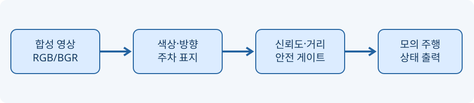

# 📘 11차시 — 신호등·방향 화살표·주차 객체 인식과 안전 판단

> 자율주행 자동차 로봇을 활용한 피지컬 AI · 필수 실습 60분 / 선택 심화 별도

> **검증 범위:** 합성 영상, OpenCV 결정적 규칙, 모의 상태 출력. 학습형 AI와 실제 알티노 AI 하드웨어는 미검증.

## 목차

- [01. 운영 계획과 산출물](#section-1)
- [02. 문제 정의와 입력·출력 계약](#section-2)
- [03. 인식과 판단을 분리하는 이유](#section-3)
- [04. 신호등 색상과 채널 순서](#section-4)
- [05. 방향 화살표의 형태 정보](#section-5)
- [06. 주차 표지와 주차 가능 판단의 차이](#section-6)
- [07. 실습 준비 및 실행 환경](#section-7)
- [08. 전체 Python 실습 코드](#section-8)
- [09. 자동 테스트 전체 코드](#section-9)
- [10. 예상 실행 결과와 판독](#section-10)
- [11. 검출 성능 평가 설계](#section-11)
- [12. 위험 사례와 안전 게이트](#section-12)
- [13. 오류 점검 절차](#section-13)
- [14. 선택 심화: 데이터 변화 실험](#section-14)
- [15. 학습형 AI로의 확장 경계](#section-15)
- [16. 차시 평가 체크리스트](#section-16)
- [17. 공식 문서와 참고 출처](#section-17)
- [18. 실험 A: 안전 판단 우선순위의 충돌](#section-18)
- [19. 실험 B: 고정 ROI와 좌표 변환](#section-19)
- [20. 실험 C: 데이터 품질과 오류 분석](#section-20)
- [21. 실험 D: 평가 데이터셋 구성과 누수 방지](#section-21)
- [22. 실험 E: 실제 장비 통합 전 승인 기준](#section-22)
- [23. 핵심 정리와 다음 차시 연결](#section-23)

<a id="section-1"></a>

## 01. 운영 계획과 산출물

| 시간 | 필수 활동 | 확인 항목 |
|---|---|---|
| 0~10분 | 신호등·화살표·주차 객체 구분 | 클래스 정의 |
| 10~20분 | 합성 장면 생성 및 저장 | PNG 4개 |
| 20~35분 | 고정 관심영역 색상·방향 분석 | Observation 출력 |
| 35~45분 | 안전 판단 규칙 구현 | 정지/계획 문자열 |
| 45~55분 | 자동 테스트와 실패 사례 | 테스트 7종 |
| 55~60분 | 결과·제약·오류 점검 | 실습 기록 |

**선택 심화(필수 60분 이후)**: 회전·노이즈·그림자·부분 가림 데이터를 생성하고 검출률 변화를 비교한다. 실차 모터에 연결하지 않는다.

<a id="section-2"></a>

## 02. 문제 정의와 입력·출력 계약

신호등의 색상, 방향 화살표의 지시 방향, 주차 표지의 존재 여부는 서로 다른 의미를 갖는다. 신호등은 정지·진행 가능성의 신호이며 화살표는 방향 정보를 제공한다. 주차 표지는 공간의 의미를 나타낼 뿐, 주차 가능 여부를 단독으로 보장하지 않는다.

입력은 BGR 360×640×3 `uint8` 영상 한 장과 모의 거리 측정값이다. 출력은 `Observation(signal, arrow, parking, confidence)`와 **모의 계획 문자열**이다. 모든 좌표는 합성 장면에 고정된다. 실제 도로에서 카메라 위치가 달라지면 같은 ROI를 사용할 수 없다.



<a id="section-3"></a>

## 03. 인식과 판단을 분리하는 이유

영상 인식은 **관측(Observation)** 을 생성한다. 판단 함수는 관측과 거리 정보를 함께 평가하여 모의 상태를 만든다. 두 단계를 분리하면 인식기가 바뀌어도 안전 규칙을 독립적으로 검증할 수 있다.

인식 결과가 불확실할 때 추정으로 진행시키지 않는다. 신호등이 빨간색이거나 노란색이면 교육용 정책에서는 정지한다. 실제 교통법규·도로 상황의 모든 예외를 구현한 정책은 아니다. 거리 값이 결측·음수·비정상이면 센서 오류로 처리한다.

<a id="section-4"></a>

## 04. 신호등 색상과 채널 순서

OpenCV는 기본적으로 BGR(파랑·초록·빨강 순서) 배열을 사용한다. `(0, 0, 255)`는 빨강이다. RGB로 잘못 해석하면 색상 판정이 뒤바뀐다. 빨강은 R이 크고 G보다 우세한지, 노랑은 R과 G가 동시에 큰지, 초록은 G가 우세한지 확인한다.

| 색상 | BGR 예시 | 중심 위치 | 의미 |
|---|---|---|---|
| 빨강 | (0,0,255) | (100,75) | 정지 후보 |
| 노랑 | (0,255,255) | (100,125) | 정지 후보 |
| 초록 | (0,255,0) | (100,175) | 다른 조건도 확인 |
| 꺼짐 | (75,75,75) | 나머지 램프 | 비활성 |

단일 픽셀 검사이므로 반사광, 압축, 노이즈, 위치 변화에 취약하다. 이는 고정 합성 장면에서만 통하는 기준선이다.

<a id="section-5"></a>

## 05. 방향 화살표의 형태 정보

왼쪽·오른쪽 화살표는 같은 흰색이다. 따라서 색상만으로 방향을 분류할 수 없다. 합성 장면에서는 화살촉이 있는 상단 좌측/우측 픽셀을 조사한다. 방향을 잘못 읽으면 경로 계획이 반대로 바뀌므로 불확실한 방향은 `unknown`으로 두고 정지한다.

| 관측 | 왼쪽 상단 화살촉 | 오른쪽 상단 화살촉 | 결과 |
|---|---|---|---|
| 좌회전 | 흰색 | 배경색 | `left` |
| 우회전 | 배경색 | 흰색 | `right` |
| 양쪽 흰색 | 흰색 | 흰색 | `unknown` |
| 양쪽 배경 | 배경색 | 배경색 | `unknown` |

실제 영상에서는 윤곽선·템플릿 매칭·학습형 분류기 등이 필요하다. 고정 좌표 분류는 일반적인 화살표 인식 모델이 아니다.

<a id="section-6"></a>

## 06. 주차 표지와 주차 가능 판단의 차이

파란 사각형과 흰색 P를 합성 영상에 그린다. 실습은 파란색 영역의 존재만 판정하므로 P 글자를 OCR로 읽지 않는다. 파란 사각형이 다른 곳에 있어도 오검출될 수 있다. `parking=True`는 **주차 표지 후보가 보임**을 의미하며, 빈 주차 공간·장애물·법적 주차 가능 여부를 뜻하지 않는다.

실제 주차 임무에는 빈 공간 탐색, 공간 크기 추정, 차량 위치 추정, 주행 경로 계획, 충돌 회피, 긴급 정지가 추가로 필요하다.

<a id="section-7"></a>

## 07. 실습 준비 및 실행 환경

Python 3, NumPy, OpenCV를 사용한다. 외부 카메라, 네트워크, 제조사 SDK가 필요하지 않다.

```bash
python -m venv .venv
source .venv/bin/activate
python -m pip install numpy opencv-python
python codes/ch11/traffic_scene_lab.py --out codes/ch11/outputs
python -m unittest discover -s codes/ch11 -p 'test_*.py' -v
```

명령은 프로젝트 최상위 폴더에서 실행한다. 첫 명령은 격리된 파이썬 환경을 만들고, 둘째 명령은 활성화하며, 셋째 명령은 필요한 패키지를 설치한다. 마지막 두 명령은 합성 영상 생성과 자동 테스트를 수행한다. 헤드리스 환경에서는 `opencv-python-headless`로 대체할 수 있다.

<a id="section-8"></a>

## 08. 전체 Python 실습 코드

아래 코드는 실습 파일의 **전체 내용**이다. `make_scene`은 합성 정답 장면을 만들고, `recognize`는 색·방향·주차 표지를 판정하며, `decide`는 위험 조건을 우선 처리한다. `main`은 결과 PNG를 저장한다.

```python
"""교육용 합성 교통 표지 인식: 실차 제어 API가 아닙니다."""
from dataclasses import dataclass
import cv2
import numpy as np

@dataclass(frozen=True)
class Observation:
    signal: str
    arrow: str
    parking: bool
    confidence: float

def make_scene(signal='red', arrow='left', parking=True):
    """재현 가능한 합성 장면과 정답을 생성합니다."""
    assert signal in ('red', 'yellow', 'green', 'off')
    assert arrow in ('left', 'right', 'none')
    img = np.full((360, 640, 3), (230, 230, 230), np.uint8)
    cv2.rectangle(img, (45, 30), (155, 225), (35, 35, 35), -1)
    positions = {'red': (100, 75), 'yellow': (100, 125), 'green': (100, 175)}
    colors = {'red': (0, 0, 255), 'yellow': (0, 255, 255), 'green': (0, 255, 0)}
    for key, pos in positions.items():
        cv2.circle(img, pos, 23, colors[key] if signal == key else (75, 75, 75), -1)
    cv2.rectangle(img, (240, 45), (400, 165), (40, 40, 40), -1)
    if arrow != 'none':
        if arrow == 'left':
            pts = np.array([[265, 105], [310, 65], [310, 90], [375, 90], [375, 120], [310, 120], [310, 145]])
        else:
            pts = np.array([[375, 105], [330, 65], [330, 90], [265, 90], [265, 120], [330, 120], [330, 145]])
        cv2.fillPoly(img, [pts], (255, 255, 255))
    if parking:
        cv2.rectangle(img, (460, 200), (600, 335), (255, 0, 0), -1)
        cv2.putText(img, 'P', (490, 305), cv2.FONT_HERSHEY_SIMPLEX, 2.8, (255, 255, 255), 7)
    return img

def recognize(img):
    """고정 ROI의 색상/형태 규칙. 학습형 객체 검출기가 아닙니다."""
    if img is None or img.shape != (360, 640, 3):
        return Observation('unknown', 'unknown', False, 0.0)
    hsv = cv2.cvtColor(img, cv2.COLOR_BGR2HSV)
    signal_scores = {}
    for name, (x, y) in {'red': (100, 75), 'yellow': (100, 125), 'green': (100, 175)}.items():
        b, g, r = [int(v) for v in img[y, x]]
        signal_scores[name] = (r > 180 and r > g * 1.5) if name == 'red' else ((r > 180 and g > 180 and b < 100) if name == 'yellow' else (g > 180 and g > r * 1.5))
    active = [name for name, yes in signal_scores.items() if yes]
    signal = active[0] if len(active) == 1 else 'unknown'
    # 화살표의 좌우 끝 영역 흰 픽셀 면적을 비교하여 방향 판정
    mask = cv2.inRange(img[60:155, 255:390], (220, 220, 220), (255, 255, 255))
    left = bool(mask[20, 45])  # 좌측 화살촉 위치 (원본 x=265, y=105)
    right = bool(mask[20, 90])  # 우측 화살촉 위치 (원본 x=375, y=105)
    arrow = 'left' if left and not right else 'right' if right and not left else 'unknown'
    blue = img[210:330, 470:590]
    parking = bool(np.count_nonzero((blue[:, :, 0] > 180) & (blue[:, :, 1] < 100)) > 500)
    return Observation(signal, arrow, parking, 1.0 if signal != 'unknown' and arrow != 'unknown' else 0.0)

def decide(obs, distance_m):
    """실차 명령이 아닌 모의 상태 출력. 불확실하면 정지."""
    if distance_m is None or not np.isfinite(distance_m) or distance_m < 0.0:
        return 'STOP_SENSOR_ERROR'
    if distance_m < 0.5:
        return 'STOP_OBSTACLE'
    if obs.signal in ('red', 'yellow', 'unknown') or obs.confidence < 0.8:
        return 'STOP_SIGNAL_UNCERTAIN'
    if obs.arrow == 'unknown':
        return 'STOP_ARROW_UNCERTAIN'
    return 'PLAN_' + obs.arrow.upper() + ('_PARKING_VISIBLE' if obs.parking else '')

def main():
    import argparse
    from pathlib import Path
    p = argparse.ArgumentParser()
    p.add_argument('--out', default='outputs')
    args = p.parse_args()
    out = Path(args.out); out.mkdir(parents=True, exist_ok=True)
    for s, a in [('red', 'left'), ('yellow', 'right'), ('green', 'left'), ('green', 'right')]:
        frame = make_scene(s, a)
        obs = recognize(frame)
        cv2.imwrite(str(out / f'{s}_{a}.png'), frame)
        print(s, a, obs, decide(obs, 1.2))
if __name__ == '__main__':
    main()
```

**코드 풀이:** `@dataclass(frozen=True)`는 관측값을 묶고 변경을 막는다. `cv2.circle`과 `cv2.fillPoly`는 신호등과 화살표를 만든다. `np.count_nonzero`는 파란색 조건을 만족하는 픽셀 수를 센다. `np.isfinite`는 NaN·무한대를 검사한다. `decide`는 거리 오류와 장애물을 먼저 검사하고 신호·방향의 불확실성을 확인한 다음에만 모의 계획을 반환한다.

<a id="section-9"></a>

## 09. 자동 테스트 전체 코드

다음은 재현 가능한 테스트 코드의 전체 내용이다. 각 테스트는 서로 다른 고장 유형을 확인한다.

```python
import unittest
import numpy as np
from traffic_scene_lab import make_scene, recognize, decide, Observation
class TestTraffic(unittest.TestCase):
    def test_signal(self):
        for signal in ('red','yellow','green'):
            self.assertEqual(recognize(make_scene(signal)).signal, signal)
    def test_arrow(self):
        for arrow in ('left','right'):
            self.assertEqual(recognize(make_scene('green',arrow)).arrow, arrow)
    def test_parking(self):
        self.assertTrue(recognize(make_scene(parking=True)).parking)
        self.assertFalse(recognize(make_scene(parking=False)).parking)
    def test_fail_safe(self):
        obs=recognize(make_scene('green','left'))
        for d in (None, float('nan'), -1):
            self.assertEqual(decide(obs,d),'STOP_SENSOR_ERROR')
        self.assertEqual(decide(obs,.3),'STOP_OBSTACLE')
    def test_red_yellow_stop(self):
        for s in ('red','yellow'):
            self.assertEqual(decide(recognize(make_scene(s)),2),'STOP_SIGNAL_UNCERTAIN')
    def test_green_plan(self):
        self.assertEqual(decide(recognize(make_scene('green','right')),2),'PLAN_RIGHT_PARKING_VISIBLE')
    def test_bad_image(self):
        self.assertEqual(recognize(np.zeros((10,10,3),dtype=np.uint8)).signal,'unknown')
if __name__=='__main__': unittest.main()
```

**코드 풀이:** `assertEqual`은 예상 상태와 실제 상태를 비교한다. `test_fail_safe`는 결측·NaN·음수 거리 및 근거리 장애물 정지를 확인한다. `test_bad_image`는 영상 크기가 다를 때 잘못된 성공 판정이 나오지 않는지 확인한다.

<a id="section-10"></a>

## 10. 예상 실행 결과와 판독

| 입력 | 관측 신호 | 관측 방향 | 거리 | 모의 결과 |
|---|---|---|---|---|
| 빨강/좌 | red | left | 1.2m | STOP_SIGNAL_UNCERTAIN |
| 노랑/우 | yellow | right | 1.2m | STOP_SIGNAL_UNCERTAIN |
| 초록/좌 | green | left | 1.2m | PLAN_LEFT_PARKING_VISIBLE |
| 초록/우 | green | right | 1.2m | PLAN_RIGHT_PARKING_VISIBLE |
| 초록/좌 | green | left | 0.3m | STOP_OBSTACLE |
| 초록/좌 | green | left | NaN | STOP_SENSOR_ERROR |

모의 결과 `PLAN_*`은 모터 명령이 아니다. 신호등의 초록색도 교차로 안전을 보장하지 않는다. 이 예제에는 다른 차량·보행자·교차로 우선순위가 없다.

<a id="section-11"></a>

## 11. 검출 성능 평가 설계

단일 합성 영상의 정답과 예측을 비교할 때는 클래스별 혼동행렬을 사용한다. 신호등 세 종류와 화살표 두 종류를 각각 독립적으로 평가해야 한다. 주차 표지 유무는 이진 분류로 평가한다.

정밀도는 `TP/(TP+FP)`, 재현율은 `TP/(TP+FN)`이다. 분모가 0이면 0으로 임의 대체하지 말고 평가 불능으로 기록한다. 이 실습의 고정 위치·고정 색상 영상에서 높은 정확도가 나와도 실도로 일반화 성능은 알 수 없다.

학습형 모델을 도입한다면 데이터 수집 → 라벨 검수 → 학습/검증/시험 분할 → 학습 → 시험 성능 → 실제 환경 안전 검증 순으로 진행한다. 같은 원본 영상에서 만든 변형 이미지를 학습과 시험에 동시에 넣으면 데이터 누수가 발생한다.

<a id="section-12"></a>

## 12. 위험 사례와 안전 게이트

| 실패 원인 | 잘못된 결과 | 안전 대응 |
|---|---|---|
| 신호등 가림 | 빨강을 초록으로 오인 | 미확실 상태 정지 |
| 화살표 회전 | 좌우 방향 오류 | 방향 미확실 정지 |
| 야간 조명 | 색 임계값 실패 | 영상 품질 검사 |
| 주차 표지 오검출 | 주차 공간 오판 | 공간·장애물 별도 검증 |
| 라이다 결측 | 장애물 누락 | 센서 오류 정지 |
| 영상 지연 | 오래된 신호 사용 | 타임스탬프 유효성 검사 |
| 프레임 누락 | 상태 갱신 실패 | 타임아웃 정지 |

본 실습은 물리 구동을 포함하지 않는다. 실제 로봇 연결 시에는 제조사 공식 SDK 확인, 긴급 정지 스위치, 바퀴 공중 테스트, 저속 제한, 전원·통신 오류 처리, 보호자/감독자 입회 등의 별도 검증이 필요하다.

<a id="section-13"></a>

## 13. 오류 점검 절차

**오류 1 — `ModuleNotFoundError: cv2`:** 가상환경이 활성화되었는지 확인하고 `python -m pip show opencv-python`으로 설치 상태를 조회한다.

**오류 2 — 이미지가 생성되지 않음:** 출력 디렉터리 쓰기 권한과 실행 위치를 확인한다. `--out`으로 상대 경로를 지정할 수 있다.

**오류 3 — 좌우 방향이 반대로 표시됨:** OpenCV 좌표 원점은 왼쪽 위이며 x는 오른쪽으로 증가한다. 화살촉 샘플 픽셀의 원본 좌표와 ROI 내부 좌표를 구분한다.

**오류 4 — 색상 검출 실패:** BGR과 RGB 순서를 확인한다. 카메라에서 읽은 실제 영상은 조명과 자동 노출에 따라 색이 달라진다.

**오류 5 — `unknown`이 반환됨:** 입력 영상의 크기와 형식, 신호등 중심 좌표, 화살표 위치가 합성 장면 규격과 일치하는지 확인한다.

**오류 6 — 테스트는 통과하지만 실제 카메라에서 실패:** 테스트는 합성 장면에 한정된다. 데이터 분포가 달라지는 실제 영상에 대해 성능을 주장할 수 없다.

<a id="section-14"></a>

## 14. 선택 심화: 데이터 변화 실험

필수 실습이 끝난 뒤, 아래 순서로 고정 좌표 기반 검출의 취약점을 분석한다.

1. 합성 이미지 전체를 10픽셀 이동시켜 신호등 인식률 변화를 기록한다.
2. 밝기를 0.5배로 낮추고 빨강·노랑·초록 오검출을 확인한다.
3. 화살표를 15도 회전시켜 방향 검출 실패를 관찰한다.
4. 파란색 차량을 주차 표지 ROI에 추가하여 주차 표지 오검출 여부를 확인한다.
5. `unknown` 반환 비율과 안전 정지 비율을 비교한다.

실험표에는 변경 전/후 조건, 정답, 예측, 실패 이유, 개선 아이디어를 기록한다. 개선 전후를 같은 시험 집합으로 비교하되, 그 시험 집합에 맞춰 임계값을 반복 조정하는 데이터 누수를 피한다.

<a id="section-15"></a>

## 15. 학습형 AI로의 확장 경계

09차시의 객체 검출은 박스를, 10차시의 인스턴스 분할은 픽셀 마스크를 반환한다. 11차시는 이 관측을 **의미 있는 교통 상황**으로 해석한다. 학습형 모델에서는 신호등·화살표·주차 표지 각각에 클래스와 위치를 부여하고, 필요한 경우 신호등의 램프 상태를 별도 분류한다.

분류 정확도뿐 아니라 작은 객체, 역광, 야간, 눈·비, 가림, 표지 훼손, 다른 나라 표지 모양에 대한 시험이 필요하다. 실차 적용에는 영상 시간 동기화, 경로 계획, 안전 제어, 책임 있는 운용 기준을 별도로 설계해야 한다.

<a id="section-16"></a>

## 16. 차시 평가 체크리스트

| 확인 항목 | 통과 기준 | 결과 기록 |
|---|---|---|
| 환경 구성 | NumPy/OpenCV import 성공 | □ |
| 장면 생성 | 4개 PNG 저장 | □ |
| 신호등 | 빨강·노랑·초록 구분 | □ |
| 화살표 | 좌·우 구분 | □ |
| 주차 표지 | 존재/부재 구분 | □ |
| 안전 정지 | 장애물·결측·빨강·노랑 정지 | □ |
| 자동 테스트 | 7개 테스트 통과 | □ |
| 제한 사항 | 실차·학습형 모델 미검증 명시 | □ |

오류가 발생하면 해당 조건의 입력 영상, 기대 결과, 실제 결과, 수정 전후 차이를 기록한다. 원인을 확인하기 전에는 임계값만 임의로 변경하지 않는다.

<a id="section-17"></a>

## 17. 공식 문서와 참고 출처

- [Python 공식 문서 — dataclasses](https://docs.python.org/3/library/dataclasses.html): 관측 자료형.
- [Python 공식 문서 — unittest](https://docs.python.org/3/library/unittest.html): 단위 테스트.
- [NumPy 공식 문서](https://numpy.org/doc/stable/): 배열과 유한값 판정.
- [OpenCV 공식 문서](https://docs.opencv.org/4.x/): 색상 공간, 그리기 함수, 배열 처리.
- [PyTorch 공식 튜토리얼](https://pytorch.org/tutorials/): 향후 학습형 모델 확장.

제조사 알티노 AI 전용 SDK는 이번 실행에서 실제 API와 하드웨어 연동을 검증하지 않았다. 따라서 본 코드에는 제조사 API 호출이 없다. 외부 자료의 버전·라이선스·하드웨어 적합성은 실물 적용 전에 별도 확인해야 한다.

<a id="section-18"></a>

## 18. 실험 A: 안전 판단 우선순위의 충돌

여러 조건이 동시에 발생할 때 어떤 조건을 먼저 검사하는지가 중요하다. 예를 들어 신호등은 초록색이지만 거리가 0.3m라면 `STOP_OBSTACLE`이 우선한다. 반대로 거리는 충분해도 신호등이 빨강이면 `STOP_SIGNAL_UNCERTAIN`을 반환한다. 이 정책은 위험 조건을 먼저 확인하고 모의 계획은 마지막에 생성하는 **우선순위 안전 게이트**이다.

| 신호 | 거리 | 화살표 | 우선 판단 | 이유 |
|---|---:|---|---|---|
| green | 0.3m | left | STOP_OBSTACLE | 충돌 가능성 |
| red | 1.2m | left | STOP_SIGNAL_UNCERTAIN | 정지 신호 |
| green | NaN | right | STOP_SENSOR_ERROR | 거리 정보 무효 |
| green | 1.2m | unknown | STOP_SIGNAL_UNCERTAIN | 신뢰도 부족 |
| green | 1.2m | right | PLAN_RIGHT_PARKING_VISIBLE | 모의 계획만 허용 |

실제 로봇에서는 긴급 정지 회로, 하드웨어 워치독, 구동 전원 차단, 통신 타임아웃 등 소프트웨어 판단보다 강한 보호 계층이 필요하다. 특히 Python 프로세스가 멈춘 경우 `decide`가 호출되지 않을 수 있으므로, 함수 안의 정지 조건만으로 안전을 보장할 수 없다.

<a id="section-19"></a>

## 19. 실험 B: 고정 ROI와 좌표 변환

영상 좌표계의 원점은 왼쪽 위이며 x축은 오른쪽, y축은 아래쪽으로 증가한다. 합성 영상에서 신호등의 중심은 (100,75), (100,125), (100,175)이다. 화살표의 ROI는 원본 x=255~389, y=60~154이며, ROI 안에서 x=45는 원본 x=300을 가리킨다.

| 항목 | 원본 좌표 | ROI 내부 좌표 | 주의 |
|---|---|---|---|
| 좌측 화살촉 샘플 | (300,80) | (45,20) | 잘못된 ROI는 오검출 |
| 우측 화살촉 샘플 | (345,80) | (90,20) | 좌우 뒤집기 주의 |
| 빨강 중심 | (100,75) | 해당 없음 | 고정 카메라 가정 |
| 주차 표지 | x=460~600 | 해당 없음 | 파란색 물체 혼동 |

실제 영상에선 카메라 이동, 기울기, 렌즈 왜곡으로 위치가 변한다. 정적 좌표만 사용하는 본 실습은 영상 처리의 첫 번째 기준선이며, 실제 객체 위치 추정에는 검출 박스나 세그먼테이션 마스크가 필요하다.

<a id="section-20"></a>

## 20. 실험 C: 데이터 품질과 오류 분석

동일한 장면이라도 노출, 화이트밸런스, 압축, 흔들림, 초점, 그림자에 따라 픽셀 값이 변한다. 단일 픽셀 판정은 잡음에 특히 취약하다. 색 영역 평균, 히스토그램, 형태학적 후처리, 시간적 누적 판단 등을 도입하면 안정성을 높일 수 있으나, 실제 시험 영상에서 검증해야 한다.

| 변화 조건 | 예상 실패 | 관찰할 지표 | 개선 후보 |
|---|---|---|---|
| 밝기 50% | 활성 램프 미검출 | FN 증가 | 적응형 색 기준 |
| 수평 이동 10px | 화살표 unknown | unknown 비율 | 객체 검출 ROI |
| 가우시안 잡음 | 단일 픽셀 오판 | 오류 빈도 | 패치 평균 |
| 일부 가림 | 방향 판정 불능 | 재현율 | 다중 특징 |
| 파란색 차량 | 주차 표지 오검출 | FP 증가 | 글자/형태 검증 |
| 영상 지연 | 과거 상태 사용 | 지연 시간 | 타임스탬프 |

오류 분석에서는 정답이 없는 데이터와 정답이 있는 데이터를 구분해야 한다. 정답이 없는 실제 영상에서 모델의 출력만 보고 정확하다고 주장하지 않는다.

<a id="section-21"></a>

## 21. 실험 D: 평가 데이터셋 구성과 누수 방지

학습형 객체 인식으로 확장하려면 실제 데이터 수집 계획이 필요하다. 주간/야간, 비/맑음, 카메라 높이, 조도, 신호등 크기, 가림, 교차로 형태를 균형 있게 포함한다. 같은 주행 동영상에서 연속 추출한 프레임은 매우 유사하므로, 프레임 단위 무작위 분할만 하면 시험 성능이 과대평가될 수 있다.

| 분할 | 목적 | 주의 |
|---|---|---|
| 학습 | 모델 파라미터 조정 | 라벨 품질 관리 |
| 검증 | 하이퍼파라미터 선택 | 시험 데이터 재사용 금지 |
| 시험 | 최종 일반화 평가 | 별도 장소/주행 세션 권장 |

신호등 색상 분류와 화살표 방향 분류를 분리하여 혼동행렬을 만든다. 클래스별 표본 수를 함께 보고하고, 안전에 중요한 빨강 신호의 미검출을 별도 지표로 관리한다. 시험 결과는 영상의 조건과 모델 버전을 함께 보관해야 재현할 수 있다.

<a id="section-22"></a>

## 22. 실험 E: 실제 장비 통합 전 승인 기준

합성 장면 테스트 통과는 실제 알티노 AI 제어 승인과 다르다. 제조사 SDK 버전, 통신 포트, 모터 제어 단위, 조향 중립값, 비상 정지 방법, 센서 주기, 영상 포맷을 공식 자료와 실물에서 확인해야 한다. 해당 항목이 미확인인 상태에서는 모터 명령 함수를 만들거나 실행하지 않는다.

| 승인 게이트 | 요구 증거 | 이번 상태 |
|---|---|---|
| SDK 적합성 | 공식 API 문서와 설치 확인 | 미검증 |
| 센서 인터페이스 | 실제 프레임·거리 로그 | 미검증 |
| 모터 제어 | 바퀴 공중 저속 시험 | 미검증 |
| 긴급 정지 | 독립 정지 기능 시험 | 미검증 |
| 주행 안전 | 폐쇄 시험장 위험 평가 | 미검증 |
| 합성 영상 규칙 | 단위 테스트 통과 | 검증 |

승인되지 않은 항목은 체크리스트에 남겨 두며, 교육용 `PLAN_*` 문자열을 실제 PWM·속도 명령으로 변환하지 않는다.

<a id="section-23"></a>

## 23. 핵심 정리와 다음 차시 연결

신호등·방향 화살표·주차 표지는 동일한 이미지 안에 존재해도 서로 다른 역할을 갖는다. 인식 결과와 행동 판단을 분리해야 잘못된 인식이 곧바로 모터 동작으로 이어지는 위험을 줄일 수 있다. 모의 프로그램에서 `PLAN_*`이 반환되어도 실제 주행 허가는 아니다.

12차시에서는 차선 인식과 주행 미션을 다루되, 실제 장비가 검증되기 전에는 영상·모의 판단 범위로 제한한다. 앞 차시의 박스·마스크·클래스 판정은 주행 계획의 입력 중 일부일 뿐이다.

---

## 적대적 검증 반영 — 신호·방향 상태 허용 목록

미등록 신호 문자열이 수신되어도 실제 녹색 신호인 것처럼 해석하면 안 된다. 이 시뮬레이터는 `obs.signal == 'green'`일 때만 다음 단계로 진행하고, 신뢰도 값이 `NaN`이면 정지한다. 화살표는 `left` 또는 `right`만 허용하며, `spin` 같은 미등록 값은 `STOP_ARROW_UNCERTAIN`으로 처리한다.

```python
if obs.signal != 'green' or not np.isfinite(obs.confidence) or obs.confidence < 0.8:
    return 'STOP_SIGNAL_UNCERTAIN'
if obs.arrow not in ('left', 'right'):
    return 'STOP_ARROW_UNCERTAIN'
```

`Observation('blue','left',False,1.0)`은 이제 `STOP_SIGNAL_UNCERTAIN`을 반환한다. 이 예제에서 신뢰도는 보정된 학습형 AI 확률이 아닌 **정해진 규칙의 내부 상태값**이다. 실제 도로에서는 단순 색 인식 결과만으로 교차로 진입을 허용할 수 없다.
