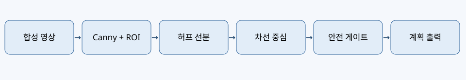
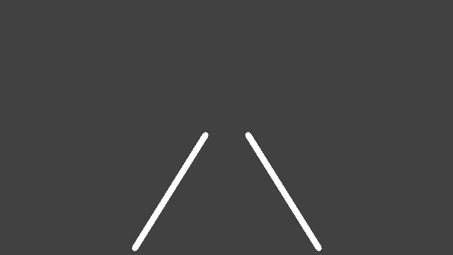
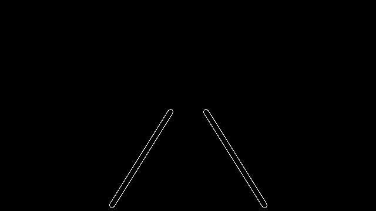

# 12차시 — 차선 인식과 자율주행 미션

> **교육용 모의 실습 / 실차 연동 미검증.** 60분 필수 실습 + 선택 심화.



## 목차

- [1. 교육 개요와 시스템 경계](#section-1)
- [2. 전체 데이터 흐름](#section-2)
- [3. 영상 좌표계](#section-3)
- [4. 합성 도로 영상 만들기](#section-4)
- [5. 회색조와 에지 검출](#section-5)
- [6. 관심 영역 ROI](#section-6)
- [7. 허프 선분 검출](#section-7)
- [8. 기울기와 좌우 차선 분리](#section-8)
- [9. 동일 높이에서 위치 비교](#section-9)
- [10. 차선 중심 오차](#section-10)
- [11. 안전 우선순위](#section-11)
- [12. 임계값의 의미](#section-12)
- [13. 필수 실습 60분: 준비와 생성](#section-13)
- [14. 필수 실습 60분: 영상 처리](#section-14)
- [15. 필수 실습 60분: 판단과 검증](#section-15)
- [16. 전체 코드 읽기: scene와 detect](#section-16)
- [17. 전체 코드 읽기: decide와 main](#section-17)
- [18. 실행 결과 해석](#section-18)
- [19. 선택 심화 A: 곡선 도로](#section-19)
- [20. 선택 심화 B: 강건성 시험](#section-20)
- [21. 선택 심화 C: 센서 융합](#section-21)
- [22. 오류 점검과 복구](#section-22)
- [23. 실차 적용 금지 조건과 검증 게이트](#section-23)
- [24. 평가 루브릭과 제출물](#section-24)
- [25. 공식 문서와 검증 범위](#section-25)

<a id="section-1"></a>

## 1. 교육 개요와 시스템 경계

차선 인식은 카메라 프레임에서 도로 경계의 후보를 찾아 중심 위치를 추정하는 지각 기능이다. 주행 미션은 이 추정값을 안전 조건과 결합해 다음 행동을 계획한다. 이번 예제는 실제 차량을 움직이지 않으며 계획 상태만 출력한다. 실제 제어기와의 연결은 제조사 인터페이스 확인·정지 장치·현장 안전 시험 이후에만 허용한다.


**확인 질문** — 이 단계의 입력·출력 데이터와 실패 시 처리 방법은 무엇인가?


<a id="section-2"></a>

## 2. 전체 데이터 흐름

영상 생성 → 회색조 변환 → Canny(캐니, 에지 검출) → ROI(알오아이, 관심 영역) → HoughLinesP(허프 라인즈 피, 선분 검출) → 좌우 차선 후보 분류 → 중심 추정 → 장애물·신호 안전 게이트 → 모의 주행 계획의 순서로 진행한다. 검출 실패 시 이전 프레임의 판단을 무조건 재사용하지 않고 정지 상태를 선택한다.


**확인 질문** — 합성 데이터에서 성공한 결과가 실차 검증을 대신할 수 있는가?


<a id="section-3"></a>

## 3. 영상 좌표계

이미지 좌상단을 원점으로 두고 x는 오른쪽, y는 아래로 증가한다. 640×360 프레임에서 영상 중심 x는 320이다. 영상의 중심과 실제 차량의 기하학적 중심은 카메라 장착 오프셋이 있을 수 있으므로 실차에서는 보정해야 한다. 합성 영상에서는 카메라가 정중앙에 있다고 가정한다.


**확인 질문** — 어떤 조건에서 안전 정지해야 하는가?


<a id="section-4"></a>

## 4. 합성 도로 영상 만들기

회색 도로 배경에 흰 차선 두 개를 그린다. 카메라 접근 권한이나 실차 장치 없이 항상 같은 입력을 재현할 수 있다. 이동된 차선과 누락된 차선을 별도 생성하여 정상 및 실패 사례를 검증한다. 합성 영상은 실제 노면의 그림자·차선 마모·빛 반사·곡률을 대표하지 않는다.


**확인 질문** — 이 단계의 입력·출력 데이터와 실패 시 처리 방법은 무엇인가?


**실습 기록** — 입력 조건, 관찰 결과, 실패 원인, 안전 판단을 아래 표에 직접 기입한다.

| 입력 조건 | 예상 출력 | 관찰 결과 | 점검 사항 |

|---|---|---|---|

| 정상 | 차선 중심 계산 | 기록 | ROI 확인 |

| 오류/결측 | 정지 | 기록 | 오류 코드 확인 |


<a id="section-5"></a>

## 5. 회색조와 에지 검출

BGR(비지알, 파랑·초록·빨강 채널) 영상을 회색조로 변환하면 색상보다 밝기 경계를 강조할 수 있다. Canny는 강한 경계 후보를 이진 영상으로 반환한다. 낮은 임계값은 잡음을 늘리고 높은 임계값은 약한 차선을 놓칠 수 있다. 임계값 70과 150은 합성 영상에 맞춘 교육용 값이다.


**확인 질문** — 합성 데이터에서 성공한 결과가 실차 검증을 대신할 수 있는가?


<a id="section-6"></a>

## 6. 관심 영역 ROI

하늘과 먼 배경까지 분석하면 불필요한 선분이 늘어난다. 차량 앞쪽 도로에 해당하는 사다리꼴 마스크만 남겨 탐색 영역을 줄인다. ROI는 카메라 높이·시야각·도로 경사에 따라 달라진다. 실차에서는 ROI를 고정하기보다 캘리브레이션과 다양한 환경 데이터를 바탕으로 검증한다.


**확인 질문** — 어떤 조건에서 안전 정지해야 하는가?


**실습 기록** — 입력 조건, 관찰 결과, 실패 원인, 안전 판단을 아래 표에 직접 기입한다.

| 입력 조건 | 예상 출력 | 관찰 결과 | 점검 사항 |

|---|---|---|---|

| 정상 | 차선 중심 계산 | 기록 | ROI 확인 |

| 오류/결측 | 정지 | 기록 | 오류 코드 확인 |


<a id="section-7"></a>

## 7. 허프 선분 검출

확률적 허프 변환은 에지 픽셀에서 선분의 두 끝점 (x1,y1,x2,y2)을 추정한다. rho는 거리 분해능, theta는 각도 분해능, threshold는 누적 임계값이다. minLineLength와 maxLineGap은 짧은 잡음 선분과 끊어진 선분을 처리하는 기준이다. 반환값이 None일 수 있으므로 반드시 분기한다.


**확인 질문** — 이 단계의 입력·출력 데이터와 실패 시 처리 방법은 무엇인가?


<a id="section-8"></a>

## 8. 기울기와 좌우 차선 분리

선분 기울기는 (y2-y1)/(x2-x1)로 계산한다. 수직에 가까운 선분의 0 나눗셈을 막기 위해 x 차이가 작으면 건너뛴다. 합성 원근 영상에서 왼쪽 차선은 음의 기울기, 오른쪽 차선은 양의 기울기를 갖는다. 이 가정은 모든 카메라 자세나 곡선 도로에 적용되지 않는다.


**확인 질문** — 합성 데이터에서 성공한 결과가 실차 검증을 대신할 수 있는가?


<a id="section-9"></a>

## 9. 동일 높이에서 위치 비교

검출된 선분마다 y=320인 위치로 연장한 x값을 계산한다. 동일한 높이에서 비교해야 길이가 다른 선분들의 중심을 합리적으로 합칠 수 있다. 좌우 후보의 중앙값을 사용하여 일부 튀는 선분의 영향을 줄인다. 차선 폭 자체가 비정상적인 경우를 검사하는 추가 검증이 실차에 필요하다.


**확인 질문** — 어떤 조건에서 안전 정지해야 하는가?


**실습 기록** — 입력 조건, 관찰 결과, 실패 원인, 안전 판단을 아래 표에 직접 기입한다.

| 입력 조건 | 예상 출력 | 관찰 결과 | 점검 사항 |

|---|---|---|---|

| 정상 | 차선 중심 계산 | 기록 | ROI 확인 |

| 오류/결측 | 정지 | 기록 | 오류 코드 확인 |


<a id="section-10"></a>

## 10. 차선 중심 오차

좌우 차선 x좌표 평균을 차선 중심으로 사용한다. 중심 오차는 차선 중심에서 영상 중심 320을 뺀 값이다. 오차가 양수면 목표 중심이 오른쪽, 음수면 왼쪽이다. 이 부호는 조향 모터의 실제 회전 부호와 독립적이며, 이번 실습에서는 PLAN_RIGHT·PLAN_LEFT라는 문자열만 출력한다.


**확인 질문** — 이 단계의 입력·출력 데이터와 실패 시 처리 방법은 무엇인가?


<a id="section-11"></a>

## 11. 안전 우선순위

영상이 유효하지 않거나 좌우 차선이 충분하지 않으면 STOP_VISION을 반환한다. 거리 센서가 누락되거나 비정상 값이면 STOP_SENSOR를 반환한다. 전방 거리가 0.7m 미만이면 STOP_OBSTACLE, 진행 신호가 아니면 STOP_SIGNAL을 반환한다. 안전 조건을 모두 통과했을 때만 주행 계획을 출력한다.


**확인 질문** — 합성 데이터에서 성공한 결과가 실차 검증을 대신할 수 있는가?


**실습 기록** — 입력 조건, 관찰 결과, 실패 원인, 안전 판단을 아래 표에 직접 기입한다.

| 입력 조건 | 예상 출력 | 관찰 결과 | 점검 사항 |

|---|---|---|---|

| 정상 | 차선 중심 계산 | 기록 | ROI 확인 |

| 오류/결측 | 정지 | 기록 | 오류 코드 확인 |


<a id="section-12"></a>

## 12. 임계값의 의미

0.7m는 교육용 시뮬레이션 임계값이다. 실제 안전 정지거리는 속도·지연시간·제동 성능·노면 마찰·센서 오차를 고려해 결정해야 한다. 정지거리의 단순 예시는 반응거리 v×t와 제동거리 v²/(2a)의 합이다. 이 수식만으로 실차 안전성을 인증할 수 없다.


**확인 질문** — 어떤 조건에서 안전 정지해야 하는가?


<a id="section-13"></a>

## 13. 필수 실습 60분: 준비와 생성

0~10분: Python, NumPy, OpenCV 환경 확인과 프로젝트 파일 배치. 10~20분: scene()으로 정상·이동·차선 누락 프레임 생성. 출력 PNG를 열어 좌우 차선 위치와 영상 좌표를 확인한다. 그래픽 창 없이 cv2.imwrite()를 사용하므로 원격·헤드리스 환경에서도 실행할 수 있다.


**확인 질문** — 이 단계의 입력·출력 데이터와 실패 시 처리 방법은 무엇인가?


<a id="section-14"></a>

## 14. 필수 실습 60분: 영상 처리

20~35분: detect()의 회색조 변환·Canny·ROI·HoughLinesP 결과를 순서대로 관찰한다. 생성된 *_edges.png에서 관심 영역 밖 픽셀이 제거되었는지 확인한다. 차선이 사라진 프레임에서는 검출 실패가 예외가 아닌 정상적인 상태 반환으로 처리되는지 확인한다.


**확인 질문** — 합성 데이터에서 성공한 결과가 실차 검증을 대신할 수 있는가?


**실습 기록** — 입력 조건, 관찰 결과, 실패 원인, 안전 판단을 아래 표에 직접 기입한다.

| 입력 조건 | 예상 출력 | 관찰 결과 | 점검 사항 |

|---|---|---|---|

| 정상 | 차선 중심 계산 | 기록 | ROI 확인 |

| 오류/결측 | 정지 | 기록 | 오류 코드 확인 |


<a id="section-15"></a>

## 15. 필수 실습 60분: 판단과 검증

35~50분: 차선 중심 320, 355, 미검출 입력의 계획 상태를 비교한다. 장애물 거리 0.3m와 빨간 신호를 넣어 정지 우선순위를 검증한다. 50~60분: unittest를 실행해 13개 검증 항목을 확인하고 결과 PNG·콘솔 로그를 과제 결과물로 정리한다.


**확인 질문** — 어떤 조건에서 안전 정지해야 하는가?


<a id="section-16"></a>

## 16. 전체 코드 읽기: scene와 detect

scene()은 동일한 크기의 영상 배열을 반환한다. detect()는 입력 크기를 먼저 검사하고 회색조·에지·ROI를 적용한다. 반환형은 (중심값 또는 None, 상태 문자열, 에지 영상 또는 None)이다. 실패 상태를 별도 문자열로 반환하면 사용자 인터페이스나 로그가 원인을 구분하기 쉽다.


**확인 질문** — 이 단계의 입력·출력 데이터와 실패 시 처리 방법은 무엇인가?


<a id="section-17"></a>

## 17. 전체 코드 읽기: decide와 main

decide()는 검출 결과를 받아 정지 상태 또는 계획 상태를 결정한다. 출력은 하드웨어 명령이 아닌 문자열이다. main()은 다섯 가지 장면을 반복하여 PNG를 저장하고 판단 로그를 출력한다. 코드에서 제조사 SDK 호출이나 직렬 포트 연결을 수행하지 않는다.


**확인 질문** — 합성 데이터에서 성공한 결과가 실차 검증을 대신할 수 있는가?


<a id="section-18"></a>

## 18. 실행 결과 해석

straight의 중심은 약 320이고 PLAN_STRAIGHT를 출력한다. offset의 중심은 약 355이고 PLAN_RIGHT를 출력한다. missing은 NO_LANES와 STOP_VISION, obstacle은 STOP_OBSTACLE, red는 STOP_SIGNAL을 출력한다. 이 결과는 정해진 합성 입력에서 재현 가능한지 검사하는 것이 목적이다.


**확인 질문** — 어떤 조건에서 안전 정지해야 하는가?


**실습 기록** — 입력 조건, 관찰 결과, 실패 원인, 안전 판단을 아래 표에 직접 기입한다.

| 입력 조건 | 예상 출력 | 관찰 결과 | 점검 사항 |

|---|---|---|---|

| 정상 | 차선 중심 계산 | 기록 | ROI 확인 |

| 오류/결측 | 정지 | 기록 | 오류 코드 확인 |


<a id="section-19"></a>

## 19. 선택 심화 A: 곡선 도로

곡선 차선은 단일 직선으로 근사하기 어렵다. 여러 높이의 차선 중심을 추출하고 2차 다항식으로 근사하는 방법을 조사한다. 다항식은 영상 좌표계에서 계산하며 실제 곡률 반경을 구하려면 카메라 보정·투영 변환과 실제 길이 척도가 필요하다. 성공 기준은 곡선 장면에서도 미검출을 안전하게 처리하는 것이다.


**확인 질문** — 이 단계의 입력·출력 데이터와 실패 시 처리 방법은 무엇인가?


<a id="section-20"></a>

## 20. 선택 심화 B: 강건성 시험

합성 프레임에 가우시안 잡음·그림자·부분 가림을 추가한다. 잡음 수준별 검출 성공률과 중심 오차를 기록한다. 입력이 모호할 때 억지로 방향을 정하지 않고 STOP_VISION으로 돌아오는지 확인한다. 정확도 수치는 시험 데이터 구성과 함께 제시한다.


**확인 질문** — 합성 데이터에서 성공한 결과가 실차 검증을 대신할 수 있는가?


**실습 기록** — 입력 조건, 관찰 결과, 실패 원인, 안전 판단을 아래 표에 직접 기입한다.

| 입력 조건 | 예상 출력 | 관찰 결과 | 점검 사항 |

|---|---|---|---|

| 정상 | 차선 중심 계산 | 기록 | ROI 확인 |

| 오류/결측 | 정지 | 기록 | 오류 코드 확인 |


<a id="section-21"></a>

## 21. 선택 심화 C: 센서 융합

라이다 전방 거리와 카메라 차선 중심을 결합한다. 두 센서의 타임스탬프 차이가 크거나 측정값이 오래되면 STOP_SENSOR를 반환하도록 확장한다. 비동기 데이터는 최신값이라는 이유만으로 동일 시점의 장면을 나타내지 않는다. 실제 센서 드라이버와 시간 동기화는 별도 검증 대상이다.


**확인 질문** — 어떤 조건에서 안전 정지해야 하는가?


<a id="section-22"></a>

## 22. 오류 점검과 복구

ModuleNotFoundError는 가상환경과 설치 패키지를 확인한다. imwrite 실패 시 출력 폴더 권한과 경로를 확인한다. HoughLinesP가 None이면 차선 대비·ROI·임계값을 순서대로 점검한다. 좌우 선분이 뒤바뀌면 카메라 방향과 기울기 가정을 확인한다. 프레임 크기가 다르면 현재 예제는 INVALID_FRAME으로 중단한다.


**확인 질문** — 이 단계의 입력·출력 데이터와 실패 시 처리 방법은 무엇인가?


<a id="section-23"></a>

## 23. 실차 적용 금지 조건과 검증 게이트

이번 실습 코드를 실제 주행 액추에이터에 직접 연결하지 않는다. 제조사 SDK 문서·장치 식별·명령 범위·긴급 정지·통신 단절·센서 실패 시 동작을 확인해야 한다. 바퀴 공중 부양 상태의 제한된 테스트, 저속 폐쇄 공간 테스트, 안전 담당자의 승인 순서로 검증한다. 모든 실제 하드웨어 항목은 현재 미검증이다.


**확인 질문** — 합성 데이터에서 성공한 결과가 실차 검증을 대신할 수 있는가?


**실습 기록** — 입력 조건, 관찰 결과, 실패 원인, 안전 판단을 아래 표에 직접 기입한다.

| 입력 조건 | 예상 출력 | 관찰 결과 | 점검 사항 |

|---|---|---|---|

| 정상 | 차선 중심 계산 | 기록 | ROI 확인 |

| 오류/결측 | 정지 | 기록 | 오류 코드 확인 |


<a id="section-24"></a>

## 24. 평가 루브릭과 제출물

필수 제출물은 실행 코드, 테스트 로그, 정상/이동/누락/장애물/적색 신호 이미지, 중심 오차 해석 표, 안전 실패 시나리오 1건이다. 평가 기준은 실행 재현성 30%, 차선 중심 이해 25%, 안전 게이트 25%, 오류 분석 20%이다. 심화 실습은 필수 실습 점수와 분리한다.


**확인 질문** — 어떤 조건에서 안전 정지해야 하는가?


<a id="section-25"></a>

## 25. 공식 문서와 검증 범위

OpenCV 공식 Hough Line Transform 튜토리얼: https://docs.opencv.org/4.x/d9/db0/tutorial_hough_lines.html . OpenCV 공식 Canny 튜토리얼: https://docs.opencv.org/4.x/da/d22/tutorial_py_canny.html . Python unittest 공식 문서: https://docs.python.org/3/library/unittest.html . NumPy 공식 문서: https://numpy.org/doc/stable/ . 알티노 AI 전용 SDK의 정확한 API·호환 버전은 확인되지 않아 교재에 사용하지 않는다.


**확인 질문** — 이 단계의 입력·출력 데이터와 실패 시 처리 방법은 무엇인가?


## 전체 Python 코드 — lane_mission.py

```python

"""Synthetic lane mission: no hardware output, no robot SDK."""
from pathlib import Path
import cv2
import numpy as np

W, H = 640, 360

def scene(shift=0, missing=False):
    """Generate reproducible road with two white lane markings."""
    frame = np.full((H, W, 3), (65, 65, 65), dtype=np.uint8)
    if not missing:
        cv2.line(frame, (190 + shift, 350), (290 + shift, 190), (255,255,255), 8)
        cv2.line(frame, (450 + shift, 350), (350 + shift, 190), (255,255,255), 8)
    return frame

def detect(frame):
    """Detect two lanes in a lower trapezoid; reject ambiguous geometry."""
    if frame is None or frame.shape != (H,W,3):
        return None, 'INVALID_FRAME', None
    gray = cv2.cvtColor(frame, cv2.COLOR_BGR2GRAY)
    edges = cv2.Canny(gray, 70, 150)
    roi = np.zeros_like(edges)
    poly = np.array([[(90,359),(550,359),(400,170),(240,170)]], np.int32)
    cv2.fillPoly(roi, poly, 255)
    edges = cv2.bitwise_and(edges, roi)
    lines = cv2.HoughLinesP(edges, 1, np.pi/180, 30, minLineLength=55, maxLineGap=30)
    if lines is None:
        return None, 'NO_LANES', edges
    left, right = [], []
    for x1,y1,x2,y2 in lines[:,0]:
        if abs(x2-x1) < 5: continue
        slope = (y2-y1)/(x2-x1)
        if not 0.5 < abs(slope) < 5: continue
        # Extrapolate to a common y=320, robustly separated by slope.
        x_at = x1 + (320-y1)/slope
        if slope < 0 and x_at < 320: left.append(x_at)
        elif slope > 0 and x_at > 320: right.append(x_at)
    if not left or not right:
        return None, 'ONE_SIDE_OR_AMBIGUOUS', edges
    center = (float(np.median(left)) + float(np.median(right))) / 2
    if not 220 < center < 420:
        return None, 'GEOMETRY_OUT_OF_RANGE', edges
    return center, 'OK', edges

def decide(center, status, distance_m, green=True):
    """Safety gate; produces a simulation label, NEVER motor commands."""
    if status != 'OK' or center is None: return 'STOP_VISION'
    if distance_m is None or not np.isfinite(distance_m): return 'STOP_SENSOR'
    if distance_m < 0.7: return 'STOP_OBSTACLE'
    if not green: return 'STOP_SIGNAL'
    error = center - W/2
    if abs(error) <= 12: return 'PLAN_STRAIGHT'
    return 'PLAN_RIGHT' if error > 0 else 'PLAN_LEFT'

def main(output=None):
    out = Path(output or 'outputs')
    out.mkdir(parents=True, exist_ok=True)
    for name, shift, missing, dist, green in [
        ('straight',0,False,1.5,True), ('offset',35,False,1.5,True),
        ('missing',0,True,1.5,True), ('obstacle',0,False,0.3,True),
        ('red',0,False,1.5,False)]:
        frame = scene(shift, missing)
        center, status, edges = detect(frame)
        action = decide(center,status,dist,green)
        cv2.imwrite(str(out / f'{name}.png'), frame)
        if edges is not None: cv2.imwrite(str(out / f'{name}_edges.png'), edges)
        print(f'{name}: {status}, center={center}, decision={action}')

if __name__ == '__main__': main()


```

## 전체 자동 테스트 코드 — test_lane_mission.py

```python

import unittest
import numpy as np
from lane_mission import scene,detect,decide,W,H
class TestLane(unittest.TestCase):
    def test_dimensions(self): self.assertEqual(scene().shape,(H,W,3))
    def test_nominal(self):
        c,s,_=detect(scene());self.assertEqual(s,'OK');self.assertAlmostEqual(c,320,delta=15)
    def test_offset(self):
        c,s,_=detect(scene(35));self.assertEqual(s,'OK');self.assertGreater(c,330)
    def test_missing(self):self.assertEqual(detect(scene(missing=True))[1],'NO_LANES')
    def test_invalid(self):self.assertEqual(detect(np.zeros((10,10,3),np.uint8))[1],'INVALID_FRAME')
    def test_straight(self):self.assertEqual(decide(320,'OK',1.5),'PLAN_STRAIGHT')
    def test_left(self):self.assertEqual(decide(280,'OK',1.5),'PLAN_LEFT')
    def test_right(self):self.assertEqual(decide(350,'OK',1.5),'PLAN_RIGHT')
    def test_obstacle(self):self.assertEqual(decide(320,'OK',0.3),'STOP_OBSTACLE')
    def test_missing_sensor(self):self.assertEqual(decide(320,'OK',None),'STOP_SENSOR')
    def test_red(self):self.assertEqual(decide(320,'OK',1.5,False),'STOP_SIGNAL')
    def test_vision(self):self.assertEqual(decide(None,'NO_LANES',1.5),'STOP_VISION')
    def test_nan(self):self.assertEqual(decide(320,'OK',float('nan')),'STOP_SENSOR')
if __name__=='__main__':unittest.main()


```

## 예상 콘솔 출력

```text

straight: OK, center=320.0, decision=PLAN_STRAIGHT

offset: OK, center=355.19727691826847, decision=PLAN_RIGHT

missing: NO_LANES, center=None, decision=STOP_VISION

obstacle: OK, center=320.0, decision=STOP_OBSTACLE

red: OK, center=320.0, decision=STOP_SIGNAL

```

## 실행 명령

```bash

python -m pip install numpy opencv-python

python lane_mission.py outputs

python -m unittest -v test_lane_mission.py

```

## 실습 결과 이미지






## 전후 차시

[11차시](ch11.html) · [전체 목차](../index.html)

---

## 적대적 검증 반영 — 거리 오류와 신호 불확실성

차선이 정상 검출되었더라도 음수 거리, 측정 실패, 비정상 신호 상태라면 주행 계획을 만들지 않는다. `distance_m < 0`은 장애물 거리로 해석하지 않고 `STOP_SENSOR`로 판정한다. `green`은 명확히 `True`인 경우에만 주행 계획을 허용한다.

| 상태 | 모의 결과 | 이유 |
|---|---|---|
| 차선 정상, 거리 `-1` | `STOP_SENSOR` | 센서 오류 |
| 차선 정상, 거리 `NaN` | `STOP_SENSOR` | 유효하지 않은 측정 |
| 차선 정상, `green=None` | `STOP_SIGNAL` | 신호 불확실 |
| 차선 없음, 전방 안전 | `STOP_VISION` | 시각 인식 미확정 |

이 상태 문자열은 판단 결과이며 실제 주행·제동 회로로 연결되지 않는다. 실제 로봇의 비상정지 하드웨어, 통신 단절, 동작 시험은 별도의 필수 통합 검증으로 남아 있다.
