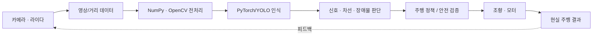
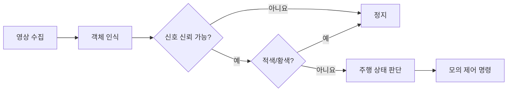

# 📘 자율주행 자동차 로봇을 활용한 피지컬 AI

> 교육자료 초안 v0.1 · 훈련 교·강사 보수교육(기본-전공) · 총 12시간 · 2일
>
> 기준: 사용자가 제공한 「과정 안내서」 2쪽. **원본 교육시간과 차시 순서를 변경하지 않음.**

## 0. 과정 개요

- **대상:** 민간직업훈련기관 교·강사 및 행정직원
- **선수지식:** Python(파이썬, 범용 프로그래밍 언어) 기초
- **주요 장비:** 알티노 AI, 실습용 PC (원본 안내서상 준비 완료)
- **전체 흐름:** 로봇 이해 → 모터 제어 → 카메라·라이다 → Python → NumPy → OpenCV → PyTorch → 이미지 분류 → 객체 인식 → 인스턴스 분할 → 주행 미션
- **교육방법:** 이론 1시간, 실습 9시간, 평가 2시간
- **최종 결과:** 영상에서 의미 있는 정보를 추출하고, 안전한 주행 판단 로직에 연결하는 자율주행 미션 시연

### 원본 교육계획과 제작 보완의 구분

- **원본 확정 내용:** 12차시 일정, 주제, 주요 내용, 이론/실습/평가 구분.
- **본 자료에서 보완한 내용:** 구체적인 실습 절차, 예제 코드, 실습 파일명, 안전 절차, 평가 루브릭.
- **미확인 항목:** 납품된 알티노 AI의 소프트웨어 버전, 카메라/라이다 접근 방식, 제조사 Python SDK 함수명, AI 모델 형식, 모델 가중치 파일, 실제 모터/조향 명령의 단위. 해당 정보는 임의로 단정하지 않음.

### 핵심 개념

- **Physical AI(피지컬 에이아이, 현실 환경을 인식하고 행동하는 인공지능):** 센서로 물리 환경을 보고, 인식·판단한 결과를 실제 동작으로 연결한다.
- **NumPy(넘파이, 다차원 배열 연산 라이브러리):** 이미지와 라이다 데이터를 수치 배열로 처리한다.
- **OpenCV(오픈씨브이, 컴퓨터 영상처리 라이브러리):** 영상 읽기, 관심영역, 에지, 윤곽선 등을 다룬다.
- **PyTorch(파이토치, 딥러닝 프레임워크):** 학습 데이터로 신경망 모델을 훈련·추론한다.
- **YOLO(욜로, 한 번의 처리로 객체를 탐지하는 모델 계열):** 영상 속 객체를 인식하는 한 구현 방식이다.
- **LiDAR(라이다, 빛을 이용한 거리 측정 기술):** 주변 장애물까지의 거리를 측정한다.

### 피지컬 AI 시스템 구조



### 안전 및 실습환경 원칙

1. 모터와 조향을 제어하기 전 **비상정지 수단, 조작 권한, 저속 설정**을 확인한다.
2. 최초 실행은 **차량 구동 없는 모의 실행(MOCK)** 모드에서 진행한다.
3. 실제 이동은 차단된 실습 트랙에서 실시한다. 차체를 들어 바퀴를 공회전시키는 테스트는 안전 확보된 지그에서만 수행한다.
4. 카메라 영상 처리 실패·통신 단절·차선 소실·신호 불확실 시 기본 동작은 **정지**로 설정한다.
5. 제조사 소프트웨어/기존 Jetson 환경에 Python 패키지를 무작정 설치하거나 업그레이드하지 않는다.

### 공통 실행환경 확인

```bash
# 설치되어 있는 Python 버전 확인
python3 --version

# 코드가 위치한 폴더로 이동
cd labs

# 필요한 모듈 설치 여부·CUDA 사용 가능 여부 확인
python3 ch01_environment_check.py
```

> `numpy`, `cv2`, `torch`, `ultralytics` 설치 여부를 출력한다. **패키지 설치는 필요한 경우에만** 제조사 환경의 호환성을 확인한 다음 수행한다. 카메라 입력과 GPU 관련 실행은 장비 또는 PC 환경에 따라 다르다.

---

## 1일차 · 10:00~17:00

### 01차시 · 10:00~11:00 | 자율주행 자동차 로봇 이해하기 (이론)

**개요:** 알티노 AI의 센서, 연산 장치, 구동 장치가 서로 어떤 역할을 하는지 이해하고 실습환경을 확인한다.

**핵심 개념**

- 센서: 카메라는 영상, 라이다는 거리 정보를 생산한다.
- 연산장치: 센서 데이터를 입력받아 Python/AI 모델로 인식과 판단을 실행한다.
- 액추에이터: 조향 모터와 구동 모터가 판단 결과를 물리적인 움직임으로 바꾼다.
- 폐루프: 인식 → 판단 → 동작 → 다시 인식을 반복한다.

**따라 하기**

1. 알티노 AI 본체, 카메라·라이다, 조향부, 구동부, 통신 연결부를 구분한다.
2. PC와 로봇의 전원 및 네트워크 연결 상태를 확인한다.
3. 제조사에서 제공한 개발환경 실행 프로그램과 예제 목록을 확인한다.
4. `ch01_environment_check.py`를 실행하여 Python·NumPy·OpenCV·PyTorch 환경을 확인한다.
5. 모터 제어 없이 카메라/라이다 데이터 표시가 가능한지 확인한다.

**확인 사항:** 데이터 흐름을 말로 설명하고, 소프트웨어 환경 점검 결과를 보존한다.

**교육용 작업 결과:** 환경 확인 기록(사용 장비, 소프트웨어 버전, 연결 결과).

### 02차시 · 11:00~12:00 | 조향 및 후륜 모터 제어 (실습)

**개요:** 전진·정지·좌우 회전 명령을 만들고 모터 제어와 주행 판단을 분리한다.

**핵심 개념**

- **속도 제어:** 전진/후진 방향과 이동 속도를 결정한다.
- **조향 제어:** 차량이 진행하는 방향을 바꾼다.
- **명령 범위:** 실제 속도와 조향 각도의 범위는 반드시 제조사 명세에 따른다.
- **정지 우선:** 정상주행보다 안전정지 확인이 선행되어야 한다.

**따라 하기**

```bash
python3 ch02_mock_drive.py
```

**기대 실행 결과(모의 주행):**

```text
[MOCK] speed=+0.25, steering=+0.00
[MOCK] speed=+0.20, steering=-0.30
[MOCK] speed=+0.20, steering=+0.30
[MOCK] speed=+0.00, steering=+0.00
```

**실제 장비 연결 절차**

1. 제조사 설명서에서 전·후륜 제어 함수와 단위, 최대/최소값, 정지 함수를 확인한다.
2. 모의 `MockRobot.send()` 출력을 제조사 전용 함수로 대체한다(교육 현장에서 SDK 확인 후 적용).
3. 바퀴가 바닥에 닿지 않은 안전한 상태에서 저속 명령만 시험한다.
4. 정지 명령, 통신 중단 시 동작, 제어권 충돌 여부를 확인한다.
5. 실습 트랙에서 최소 속도로 전진·정지·좌우 조향을 수행한다.

**확인 사항:** 모의 동작과 실제 동작의 차이 기록, 정지 동작 검증.

### 03차시 · 13:00~14:00 | 카메라·라이다 데이터 확인 (실습)

**개요:** 영상은 픽셀 배열, 라이다는 각도와 거리 배열로 다룬다.

**핵심 개념**

- 카메라: 영상 프레임의 가로·세로 해상도와 프레임 속도 확인.
- 라이다: 측정 각도·거리·좌표 기준 확인.
- 데이터가 비어 있거나 값이 튀는 경우는 그대로 주행 판단에 사용하지 않는다.

**따라 하기**

```bash
python3 ch03_lidar_numpy.py
```

**기대 실행 결과**

```text
전방 최소거리: 0.45 m
가상 장애물 경고: True
```

**실제 장비 연결 절차**

1. 제조사 도구에서 카메라 원본 영상을 출력한다.
2. 라이다의 각도별 거리 데이터를 확인한다.
3. 장애물 위치를 바꾸며 값이 달라지는지 확인한다.
4. 데이터 표본 1개 이상을 저장하고 입력값 범위와 결측값을 점검한다.

**확인 사항:** 카메라 영상 1장과 라이다 관측값 1세트.

### 04차시 · 14:00~15:00 | Python 기초 (실습)

**개요:** 변수, 조건문, 반복문, 함수 개념을 센서 값에 따른 주행 명령으로 연결한다.

**핵심 개념**

- 변수: 거리, 속도, 조향 등 현재 상태값 보관.
- 조건문: 위험거리 미만인지 판단하여 서로 다른 동작 선택.
- 반복문: 여러 센서 값을 시간 순서로 검사.
- 함수: 같은 판단을 반복 사용할 수 있도록 독립시킴.

**따라 하기**

```bash
python3 ch04_python_basics.py
```

**기대 실행 결과**

```text
distance=1.20m, action=GO
distance=0.82m, action=SLOW
distance=0.47m, action=STOP
distance=0.65m, action=SLOW
```

**추가 실습:** 정지거리 기준을 변경하고 출력이 어떻게 바뀌는지 확인한다.

**확인 사항:** `distance → decision()` 판단 흐름 설명.

### 05차시 · 15:00~16:00 | NumPy 주요 함수 (실습)

**개요:** 영상 데이터의 픽셀은 배열 요소이며, 부분 영역과 조건 선택은 배열 연산으로 표현할 수 있다.

**핵심 개념**

- `shape`: 배열의 행·열·채널 차원 확인.
- `dtype`: 데이터 형식 확인.
- 슬라이싱: 배열의 원하는 구간 추출.
- `mean()`: 평균 계산. `sum()`: 합계 및 조건에 맞는 픽셀 개수 계산.

**따라 하기**

```bash
python3 ch05_numpy_image.py
```

**확인 사항:** 전체 이미지, 하단 관심영역, 임계값 마스크의 크기와 의미를 설명한다.

**추가 실습:** `roi = image[3:, :]`에서 시작 행을 바꾸어 관심 영역의 평균 밝기가 어떻게 변하는지 관찰한다.

### 06차시 · 16:00~17:00 | OpenCV 영상처리 (실습)

**개요:** 관심 영역(ROI), 에지, 시각화를 구현하고 이를 차선 인식의 입력 과정으로 연결한다.

**핵심 개념**

- **ROI(알오아이, 관심영역):** 전체 이미지 중 필요한 영역만 처리한다.
- **Canny(캐니, 에지 검출 알고리즘):** 밝기 변화가 큰 경계를 검출한다.
- **Contour(컨투어, 윤곽선):** 외곽선이나 대상 영역의 형태를 추적한다.
- 원본 안내서의 사각형·텍스트 그리기 실습은 `cv2.rectangle`, `cv2.putText`로 확장 가능하다.

**따라 하기**

```bash
# 로컬 카메라 0번 장치를 사용하는 경우
python3 ch06_opencv_view.py --source 0

# 카메라 대신 영상 파일을 사용하는 경우
python3 ch06_opencv_view.py --source lane.mp4
```

**실습 절차**

1. 영상 열기 → 그레이스케일 변환 → 에지 검출.
2. 화면 하반부를 ROI로 설정한다.
3. 에지를 녹색으로 겹쳐 원본과 비교한다.
4. `q` 키를 눌러 안전하게 종료한다.
5. `cv2.rectangle`, `cv2.putText`를 추가하여 검출 영역과 상태 문자열을 화면에 표시해 본다.

**확인 사항:** 원본 영상과 ROI 적용 영상을 비교한다. **에지가 검출되었다는 사실만으로 차선의 위치가 정확히 계산된 것은 아니다.**

---

## 2일차 · 09:00~16:00

### 07차시 · 09:00~10:00 | 딥러닝의 기본 원리 (실습)

**개요:** 선형회귀의 예측과 오차 감소를 관찰하고 신경망으로 확장되는 구조를 이해한다.

**핵심 개념**

- 선형회귀: 입력과 출력의 관계를 가중치·편향으로 근사한다.
- 손실함수: 예측값과 정답의 차이를 숫자로 표현한다.
- 경사하강법: 손실이 작아지는 방향으로 매개변수를 갱신한다.
- 심층 신경망: 중간층의 비선형 변환을 통해 복잡한 특징을 학습한다.

**따라 하기**

```bash
python3 ch07_torch_regression.py
```

**코드 풀이**

- `nn.Linear(1, 1)`은 입력 1개에서 출력 1개를 만드는 학습 가능한 선형층이다.
- `MSELoss()`는 평균제곱오차를 계산한다.
- `zero_grad → backward → step`은 이전 기울기 초기화 → 기울기 계산 → 매개변수 갱신의 과정이다.
- 학습 데이터가 `y = 2x + 1`이므로 충분히 학습하면 가중치는 2, 편향은 1에 가까워진다.

**확인 사항:** 학습 전·후 손실, 가중치, 편향 수치 기록.

### 08차시 · 10:00~11:00 | 이미지 분류 (실습)

**개요:** 한 이미지에 가장 적합한 클래스(분류 대상)를 부여한다.

**핵심 개념**

- 입력: 이미지 1장.
- 출력: `신호등`, `화살표`, `주차 표지` 등 이미지 수준의 클래스 확률(훈련 클래스에 따라 달라짐).
- 분류 모델은 기본적으로 위치를 표시하는 사각형이 아니라 이미지 전체에 대한 클래스를 예측한다.

**따라 하기**

1. 제공 데이터의 클래스 목록과 이미지 수를 확인한다.
2. 학습용/검증용 이미지가 섞이지 않도록 구분한다.
3. **사전에 준비된 분류 가중치**로 이미지 1장의 클래스를 추론한다.
4. 잘못 분류한 이미지를 모아 조명·각도·거리 차이를 분석한다.

```bash
# 실제 가중치 파일명과 입력 이미지명을 지정해야 실행됩니다.
python3 ch08_10_model_inference.py \
  --task classify --weights models/classify.pt --input samples/sign.jpg
```

**모델 생성/학습 보완:** 원본에 있는 '클래스 생성·인공지능 학습·모델 만들기'는 사전 준비한 소규모 데이터와 전이학습 환경을 사용하여 단계적으로 실습한다. 1시간 안에 대규모 모델을 처음부터 학습시키는 것으로 가정하지 않는다.

**확인 사항:** 분류 결과, 확률, 오분류 사례 1개.

### 09차시 · 11:00~12:00 | 객체 인식 (실습)

**개요:** 이미지 안에서 어떤 객체가 **어디에** 있는지 검출한다.

**핵심 개념**

- 이미지 분류와 달리 객체 인식은 대상을 감싸는 **바운딩 박스(Bounding Box, 바운딩 박스, 위치를 나타내는 사각형)** 및 분류 결과를 출력한다.
- 탐지 대상: 신호등, 화살표, 주차 표지 등. 학습되어 있지 않은 클래스는 탐지할 수 없다.
- 정확도만 아니라 **탐지 누락, 중복 탐지, 잘못된 탐지**를 확인한다.

**따라 하기**

```bash
python3 ch08_10_model_inference.py \
  --task detect --weights models/detect.pt --input samples/road.jpg
```

**실습 절차:** 검출 박스 확인 → 클래스·신뢰도 확인 → 조명·각도 변경 → 오류 기록.

**확인 사항:** 박스 좌표/검출 수, 정상·오류 사례 각 1개.

### 10차시 · 13:00~14:00 | 인스턴스 분할 (실습)

**개요:** 객체별로 픽셀 단위의 영역을 구분한다.

**핵심 개념**

- 이미지 분류: 무엇인가?
- 객체 인식: 무엇이 어디에 있는가?
- 인스턴스 분할: 각 개체의 실제 영상 영역은 어디까지인가?
- 인스턴스 분할과 차선 인식은 관련 기술이지만 반드시 동일한 과제·출력 형식은 아니다.

**따라 하기**

```bash
python3 ch08_10_model_inference.py \
  --task segment --weights models/segment.pt --input samples/road.jpg
```

**실습 절차:** 객체 탐지 박스와 마스크(영역) 비교 → 객체 중첩 사례 확인 → 배경과 대상 분리 정확도 평가.

**확인 사항:** 검출한 인스턴스 개수, 마스크 표시 결과, 실패 사례.

### 11차시 · 14:00~15:00 | 피지컬 AI 미션: 신호등·방향·주차 표지 (평가)

**개요:** 탐지 결과를 주행 정책에 연결한다. 원본 안내서의 신호등·화살표·파킹 객체 인식을 평가한다.

**미션 입력**

- 신호등 상태: 적색/황색/녹색/불명확.
- 방향 화살표: 직진/좌회전/우회전/불명확.
- 주차 표지: 존재/미검출.
- 장애물과 차선 상태.

**필수 처리 흐름**



**따라 하기**

```bash
python3 ch11_12_mission_logic.py
```

**평가 절차**

1. 제공된 테스트 이미지에서 신호등·화살표·주차 객체를 검출한다.
2. 조건과 신뢰도를 읽어 결과 로그로 기록한다.
3. 탐지 실패 상황에서 안전정지가 수행되는지 확인한다.
4. 사전에 검증된 제조사 제어 인터페이스만 사용하여 실제 트랙 미션에 연결한다.

**확인 사항:** 미션 화면, 객체 검출 로그, 정상·안전정지 사례.

> 본 예제의 속도/조향은 교육용 정규화 값이며, 제조사 SDK의 실제 값이나 조향 부호와는 다를 수 있다. 방향 화살표의 제어 적용에는 별도의 경로·교차로 진입 판단이 필요하며, 단순히 탐지되었다는 이유로 즉시 회전시키지 않는다.

### 12차시 · 15:00~16:00 | 피지컬 AI 미션: 차선 인식 (평가)

**개요:** 영상의 차선 후보를 검출하고 실제 주행 경로가 유지되는지 확인한다.

**핵심 개념**

- 영상 하단 ROI 설정 → 밝기/색상 기반 후보 추출 → 에지/선분 또는 AI 기반 차선 추정.
- 좌우 차선 인식 결과로 중심 위치와 편차를 추정.
- 차선이 끊어지거나 보이지 않으면 제어 명령을 유효하지 않음으로 처리한다.

**평가 절차**

1. 차선이 있는 영상으로 `ch06_opencv_view.py`의 ROI와 에지 출력을 확인한다.
2. 별도 제공/구현된 차선 중심 추정 결과로 `lane_offset` 값을 만든다.
3. 결과 유효성을 표시하는 `lane_valid`가 False이면 정지하는지 확인한다.
4. 신호와 장애물 값도 함께 입력해 안전 정책을 통합 검증한다.
5. 실차 시연은 저속·안전관리자 확인·전용 트랙 조건을 충족했을 때만 실행한다.

**자가 검증**

```bash
# 5개 안전/정상 주행 판단 단위 테스트
python3 -m unittest -v test_mission_logic.py
```

**확인 사항:** 차선 인식 화면과 로그, 정상 주행, 차선 소실 시 정지 기록.

---

## 최종 미션 평가표(교육자료 제작 제안)

> 아래 점수 배점은 원본 안내서에 없는 **제안 기준**이며, 기관 운영 기준 확정 전에 검토해야 한다.

| 평가 항목 | 세부 기준 | 제안 배점 |
|---|---|---:|
| 신호등·화살표·주차 표지 | 대상 식별·신뢰도·오검출 분석 | 35점 |
| 차선 인식 | ROI·차선 후보·중심 편차 표시 | 30점 |
| 주행 안전 | 위험거리·인식 불확실·차선 소실 정지 | 25점 |
| 결과 정리 | 실행 로그·오류원인·개선 방향 | 10점 |
| **합계** | | **100점** |

**실습 결과 제출물:** 실행 코드, 인식 결과 이미지 3장 이상, 안전정지 결과, 평가 기록 1장.

## 프로젝트 파일 구성

```text
physical_ai_12h/
├── 자율주행_자동차_로봇을_활용한_피지컬_AI_12시간_교재.md
├── 자율주행_자동차_로봇을_활용한_피지컬_AI_12시간_교재.html
└── labs/
    ├── ch01_environment_check.py
    ├── ch02_mock_drive.py
    ├── ch03_lidar_numpy.py
    ├── ch04_python_basics.py
    ├── ch05_numpy_image.py
    ├── ch06_opencv_view.py
    ├── ch07_torch_regression.py
    ├── ch08_10_model_inference.py
    ├── ch11_12_mission_logic.py
    └── test_mission_logic.py
```

## 현장 적용 전에 확보할 자료

- 알티노 AI 정확한 장비 모델과 펌웨어·운용 소프트웨어 버전.
- 제조사 카메라/라이다 접근 코드 및 API 사용 설명서.
- 제조사 조향·후륜 모터 제어 코드와 정지/비상정지 절차.
- 교육용 이미지 및 영상 데이터셋(신호등·화살표·주차·차선).
- 학습 완료된 이미지 분류·객체 인식·인스턴스 분할 가중치 파일.
- PyTorch/YOLO 실행환경의 OS/Python/CUDA 호환 버전.

## 참고 및 근거

1. 기준 문서: 「과정 안내서」, 1쪽 교육개요·교육내용, 2쪽 세부시간표(사용자 제공).
2. 새온 알티노 AI 2025-12-12 공개/시연 기사: https://www.donga.com/news/It/article/all/20251212/132955764/1
3. 알티노 AI 공급 제품 구성(기종 구분 참고): https://www.eduino.kr/product/ai/robot.html
4. 제조사 교재 카탈로그(참고용·저작권 자료는 원문 재현하지 않음): https://shop.saeon.co.kr/category/%EC%95%8C%ED%8B%B0%EB%85%B8/67/

**상태 구분:** 본 문서의 로봇 연결 부분은 실제 제조사 SDK가 확인되기 전의 교육용 인터페이스 설계이다. 예제 Python 코드는 문법 검증 및 모의 판단 테스트를 거쳤으나, 카메라/모델/로봇 실장비 통합은 별도 검증이 필요하다.
